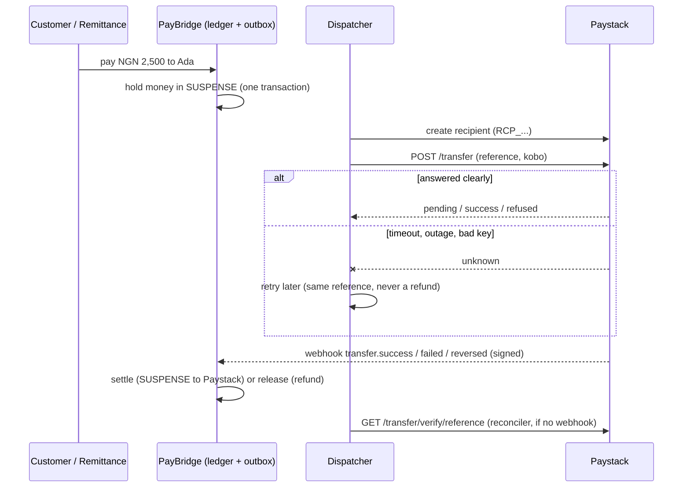

# The Paystack Gateway Guide (Step 11): explained for a 5-year-old

Same rules as the other guides. Every piece of code gets: **the picture** (everyday words), **why we need it**, **the code**, then **line by line**. Technical words are in `code font` with their plain meaning beside them.

> **Honest status.** The Paystack client is built and tested against a *pretend* Paystack. I then **read Paystack's own documentation** (paystack.com/docs: Single Transfers, How Transfers Work, the Transfer, Transfer Recipient and Verification APIs, and Webhooks) and checked the code against it; Part 8.4 lists what was confirmed and the few things the docs do not say. **It has not yet talked to the real Paystack**, because I can't see your key and never should. Section 8 shows how *you* run one safe, no-money check with your test key. The fake bank is untouched and is still the default.

---

# Part 1: The big picture

## 1.1 What is a gateway?

**The picture.** PayBridge needs to send money to other banks, but it isn't a bank that can do that itself. So it hires a **delivery company** (Paystack). PayBridge writes the parcel details; the delivery company drives it to the other bank.

In our code the delivery company is hidden behind a plug socket called `TransferGateway`. Anything with the right plug shape works:

```java
public interface TransferGateway {
    ResolvedAccount resolveAccount(String bankCode, String accountNumber);   // "whose account is this?"
    String createRecipient(String bankCode, String accountNumber, String accountName); // "register this payee"
    GatewayTransferResult initiateTransfer(TransferInstruction instruction); // "send the money"
    GatewayTransferResult fetchTransferStatus(String reference);             // "what happened to it?"
}
```

We already had a **fake** delivery company (`FakeTransferGateway`) for learning and tests. Step 11 adds a **real** one (`PaystackTransferGateway`). The rest of PayBridge never knows which one it's talking to. *Like swapping a toy phone for a real phone: the same buttons, but now it actually calls someone.*

## 1.2 Which one is used?

One setting decides: `paybridge.gateway`.

* `fake` (the default): the pretend bank. All 840+ tests use this. Nothing changes for anyone who leaves it alone.
* `paystack`: the real client. You turn this on deliberately.

## 1.3 The key you were given

| Key | What it's for | Do we use it? |
|---|---|---|
| **Secret** `sk_test_...` | Server-to-server calls (send money, look up accounts) and checking webhook seals | **Yes**, read from the environment variable `PAYSTACK_SECRET_KEY` |
| **Public** `pk_test_...` | Card forms in a browser/phone app | **No**, PayBridge has no card forms |

*The secret key is the front-door key to the delivery company's account. Never paste it in chat, in a file, or in git.* `test` means play money; a `live` key moves real money. Use `sk_test_` until you have decided otherwise.

---

# Part 2: The four golden rules (why the code looks the way it does)

These come from the contract written on `TransferGateway` and from the lessons of earlier steps.

1. **"I don't know" is not "it failed".** If the phone line dies after we say "send it", the parcel may or may not be on its way. Treating that as a failure would refund the customer while the money also arrives: money created from nothing. So unclear answers are thrown as `GatewayUnavailableException` ("unknown, ask again later"). Only a **clear "no"** becomes `FAILED`.
2. **Asking twice sends once (idempotent).** Every transfer has a unique `reference`. Paystack refuses a reference it has seen; we then *ask what happened to it* instead of sending again.
3. **Nothing secret in logs or errors.** Never the key; never full account numbers.
4. **Money is whole kobo.** Paystack's `amount` is already in kobo, so we pass our `long` straight through. No decimals, ever.

---

# Part 3: The settings

## 3.1 PaystackProperties

**The picture.** A settings card: where is the delivery company's office, what's the key, and how long do we wait on the phone before giving up?

**Why.** Addresses and timeouts shouldn't be hard-coded; and the key must come from outside the code.

**The code** (`PaystackProperties.java`):

```java
@ConfigurationProperties(prefix = "paybridge.paystack")
public record PaystackProperties(
        @DefaultValue("") String secretKey,
        @DefaultValue("https://api.paystack.co") String baseUrl,
        @DefaultValue("3s") Duration connectTimeout,
        @DefaultValue("10s") Duration readTimeout) {
}
```

**Line by line.**
* `@ConfigurationProperties(prefix = "paybridge.paystack")`: "fill this card from the `paybridge.paystack...` lines in `application.yml`."
* `record`: a small immutable bag of values.
* `secretKey` default `""`: empty unless the environment supplies one.
* `baseUrl`: Paystack's address. The same address serves test *and* live; **the key decides which**.
* `connectTimeout` (3s): how long to wait for the phone to ring. `readTimeout` (10s): how long to wait for an answer once connected. After that we give up and say "unknown".

**And in `application.yml`:**

```yaml
paystack:
  secret-key: ${PAYSTACK_SECRET_KEY:}
  base-url: https://api.paystack.co
  connect-timeout: 3s
  read-timeout: 10s
```

* `${PAYSTACK_SECRET_KEY:}` means "read the environment variable `PAYSTACK_SECRET_KEY`; if it isn't set, use empty." The real key never appears in any file.

`TransferConfig` got `PaystackProperties.class` added to its `@EnableConfigurationProperties` list, which is what makes Spring actually fill the card.

---

# Part 4: The client, block by block

## 4.1 Turning the client on only when asked

**The code:**

```java
@Component
@ConditionalOnProperty(name = "paybridge.gateway", havingValue = "paystack")
public class PaystackTransferGateway implements TransferGateway {
```

**Line by line.**
* `@Component`: "Spring, please create one of these."
* `@ConditionalOnProperty(... havingValue = "paystack")`: **only** if `paybridge.gateway` is exactly `paystack`. Otherwise this class doesn't exist at all, so the fake (which has the mirror-image condition) is the only gateway. Exactly one gateway is ever active. `PaystackWiringTest` proves that with the setting on, the Paystack client is the only gateway and the fake is gone.

## 4.2 Refusing to start without a key

**Why.** Starting "real mode" with no key would fail strangely later, in the middle of a payment. Better to fail loudly on day one.

**The code:**

```java
private static PaystackProperties requireKey(PaystackProperties properties) {
    if (properties.secretKey() == null || properties.secretKey().isBlank()) {
        throw new IllegalStateException("paybridge.gateway=paystack but PAYSTACK_SECRET_KEY is not set");
    }
    return properties;
}
```

**Line by line.** If the key is missing or just spaces, throw a clear error naming the exact variable to set. The app won't boot. (Tested: `itRefusesToStartWithoutAKey`.)

## 4.3 Building the phone line

**The code:**

```java
private static RestClient buildClient(PaystackProperties properties) {
    HttpClient client = HttpClient.newBuilder().connectTimeout(properties.connectTimeout()).build();
    JdkClientHttpRequestFactory factory = new JdkClientHttpRequestFactory(client);
    factory.setReadTimeout(properties.readTimeout());
    return RestClient.builder()
            .baseUrl(properties.baseUrl())
            .requestFactory(factory)
            .defaultHeader("Authorization", "Bearer " + properties.secretKey())
            .defaultHeader("Accept", "application/json")
            .build();
}
```

**Line by line.**
* `HttpClient ... connectTimeout`: a web browser with a stopwatch for connecting.
* `factory.setReadTimeout`: a stopwatch for waiting for the answer.
* `RestClient.builder().baseUrl(...)`: Spring's tidy way to make web calls to one address.
* `defaultHeader("Authorization", "Bearer " + key)`: stamp **every** call with the key, like writing your name on every envelope. This is how Paystack knows it's us.
* `Accept: application/json`: "please reply in JSON".

A second constructor accepts an already-built `RestClient`; tests use it to point the client at a pretend Paystack.

## 4.4 One function for every call: `call(...)`

**The picture.** A single "make the phone call and write down what they said" routine. Every request goes through it so the rules for timeouts and bad answers live in one place.

**The code:**

```java
private Reply call(HttpMethod method, String path, Object requestBody) {
    try {
        RestClient.RequestBodySpec spec = http.method(method).uri(path);
        if (requestBody != null) {
            spec.contentType(MediaType.APPLICATION_JSON).body(requestBody);
        }
        return spec.exchange((request, response) -> {
            byte[] bytes = response.getBody().readAllBytes();
            JsonNode json;
            try {
                json = bytes.length == 0 ? emptyJson : WebhookJson.parseObject(bytes);
            } catch (MalformedWebhookException e) {
                json = emptyJson;
            }
            return new Reply(response.getStatusCode().value(), json);
        });
    } catch (RestClientException e) {
        throw new GatewayUnavailableException("Could not reach Paystack: " + e.getClass().getSimpleName(), e);
    }
}
```

**Line by line.**
* `http.method(method).uri(path)`: prepare "GET/POST this path".
* If there's a body, attach it as JSON.
* `exchange(...)`: send it, and let us look at the answer **whatever its status**. (The simpler `retrieve()` would throw on any 4xx/5xx and hide the details we need.)
* `readAllBytes()`: read the whole reply.
* Parse JSON; if the reply is empty or **not JSON** (an HTML error page from a broken proxy, say), use an empty JSON object instead of crashing. The status code still tells the story.
* `new Reply(status, json)`: a tiny pair: the number and the content.
* `catch (RestClientException e)`: the phone line failed (timeout, DNS, connection refused). We throw **`GatewayUnavailableException`**: golden rule 1, "unknown, not failed". The exception message contains only the *class name* of the problem, never the URL or the key.

And the small `Reply` helper:

```java
private record Reply(int status, JsonNode body) {
    boolean ok()            { return status >= 200 && status < 300; }
    boolean isClientError() { return status >= 400 && status < 500; }
    String message()        { ...Paystack's "message" field, cleaned and shortened... }
}
```

* `ok()`: 2xx = success. `isClientError()`: 4xx = "you asked wrong" (a clear no, usually). `message()`: the sentence Paystack gave us, with control characters removed and length capped (it's outside text; never trust it raw).

## 4.5 Whose account is this? `resolveAccount`

**The picture.** Ring the delivery company: "Who owns account 0123456789 at bank 058?" They say "ADA OBI".

**The code:**

```java
Reply reply = call(HttpMethod.GET, "/bank/resolve?account_number=" + enc(accountNumber) + "&bank_code=" + enc(bankCode), null);
if (reply.ok() && reply.body().path("status").asBoolean(false)) {
    String name = WebhookJson.text(reply.body().path("data"), "account_name");
    if (name != null) {
        return new ResolvedAccount(bankCode, accountNumber, name);
    }
}
if (reply.isClientError() && reply.status() != 401 && reply.status() != 403 && reply.status() != 429) {
    throw new PayBridgeException(ErrorCode.RESOURCE_NOT_FOUND, "Could not resolve account " + mask(accountNumber) + " at bank " + bankCode);
}
throw unavailable("name enquiry", reply);
```

**Line by line.**
* `enc(...)`: URL-encode the values so odd characters can't break the address (or sneak extra parameters in).
* Success: Paystack says `status: true` and gives `data.account_name` → return it.
* A 4xx other than 401/403/429 (typically "Could not resolve account name") → this account really can't be found → `RESOURCE_NOT_FOUND` (an HTTP 404 to our caller). The message uses `mask(...)` so only the last four digits are shown.
* Anything else (401/403 = our key is wrong; 429 = slow down; 5xx = their outage) → **unavailable**: "we couldn't find out", *not* "no such account". We never tell a customer their real account doesn't exist because of a Paystack outage.

## 4.6 Registering the payee: `createRecipient`

**The picture.** Before sending to someone, Paystack wants them added to an address book and gives back a **code** (`RCP_...`). We use that code on every transfer.

**The code:**

```java
Map<String, Object> body = new LinkedHashMap<>();
body.put("type", "nuban");
body.put("name", accountName);
body.put("account_number", accountNumber);
body.put("bank_code", bankCode);
body.put("currency", "NGN");
Reply reply = call(HttpMethod.POST, "/transferrecipient", body);
if (reply.ok() && reply.body().path("status").asBoolean(false)) {
    String code = WebhookJson.text(reply.body().path("data"), "recipient_code");
    if (code != null) return code;
}
throw unavailable("creating a recipient", reply);
```

**Line by line.**
* `type: "nuban"`: Nigerian bank account numbers are called NUBAN; this tells Paystack which kind of payee it is.
* The rest: name, number, bank, currency.
* Success returns the `recipient_code`.
* Any failure → **unavailable** (even a 4xx). Why? Making an address-book entry isn't "a payment that may have happened". The caller (the dispatcher) retries with backoff and eventually gives up safely. Throwing a different exception here would leave a payout stuck in a loop.

## 4.7 Sending the money: `initiateTransfer` (the careful one)

**The picture.** "Please send NGN 2,500 to the payee with this code. Our parcel number is `pb-...`."

**The code:**

```java
if (!"NGN".equalsIgnoreCase(instruction.currency())) {
    throw new PayBridgeException(ErrorCode.VALIDATION_FAILED, "Paystack transfers here are in NGN only");
}
String reference = paystackReference(instruction.reference());
Map<String, Object> body = new LinkedHashMap<>();
body.put("source", "balance");
body.put("amount", instruction.amountMinor());
body.put("recipient", instruction.recipientCode());
body.put("reference", reference);
body.put("reason", instruction.narration() == null ? "PayBridge transfer" : instruction.narration());

Reply reply = call(HttpMethod.POST, "/transfer", body);
if (reply.ok()) {
    return fromTransferData(reply.body());
}
if (isDuplicateReference(reply)) {
    return fetchTransferStatus(instruction.reference());
}
if (reply.isClientError() && reply.status() != 401 && reply.status() != 403 && reply.status() != 429) {
    return GatewayTransferResult.of(GatewayOutcome.FAILED, null, reply.message());
}
throw unavailable("sending a transfer", reply);
```

**Line by line.**
1. **Currency guard.** Only naira. A dollar request here is a bug elsewhere, so refuse.
2. **`paystackReference`** lowercases our reference. Paystack's rule: lowercase letters, digits, `-` and `_` only, 16–50 characters. Our references (`pb-<uuid>` or `PO-RM-...`) are close, and lowercasing makes them exact.
3. **The body.** `source: "balance"` = pay out of our Paystack balance. `amount` = kobo (our `long`, untouched). `recipient` = the code from 4.6. `reference` = our parcel number. `reason` = the narration the recipient sees.
4. **Success (2xx)** → read the status Paystack gives (4.8).
5. **Any ordinary refusal (4xx), then a safety look-up.** Paystack's documentation says to retry with the **same reference** after an error, but it does not spell out how a *repeated* reference is refused. So we don't depend on the wording. Whenever Paystack says no, we first **ask Paystack whether that reference exists** (`fetchTransferStatus`):
   * It exists → an earlier attempt of ours got through (a retry after a lost answer). Return **its real status** and never send again. This is what makes retries safe (golden rule 2).
   * It doesn't exist (404) → the refusal is genuine and nothing was sent.
   * The look-up itself can't be answered (outage) → **unknown**: throw, don't guess.
6. **A genuine refusal** (e.g. "Your balance is not enough", "Sorry, we can't make the transfer to this recipient", "Bank code is invalid": all error messages from Paystack's own list) → the money was **not** sent → `FAILED` with Paystack's message. The ledger then refunds the customer. Safe, because we checked nothing exists.
7. **Anything else** (401/403 wrong key, 429, 5xx, timeout) → **unavailable**: unknown. *Note 401/403 are deliberately NOT treated as failures: a wrong key is our mistake, not a reason to refund and forget; the dispatcher retries, and the reconciler later asks Paystack what really happened.*

## 4.8 Reading Paystack's status word

**The picture.** Paystack describes a transfer's progress in its own words. We translate into ours.

**The code:**

```java
return switch (status.toLowerCase(Locale.ROOT)) {
    case "success"  -> GatewayTransferResult.of(GatewayOutcome.SUCCESS, providerReference, "Transferred");
    case "failed"   -> GatewayTransferResult.of(GatewayOutcome.FAILED, providerReference, reason-or-default);
    case "reversed" -> GatewayTransferResult.of(GatewayOutcome.REVERSED, providerReference, "Reversed by Paystack");
    case "otp"      -> { log.warn("...switch OTP off..."); yield GatewayTransferResult.of(GatewayOutcome.PENDING, providerReference, "Waiting for an OTP at Paystack"); }
    default         -> GatewayTransferResult.of(GatewayOutcome.PENDING, providerReference, "Accepted, processing");
};
```

**Line by line.**

| Paystack says | We say | Meaning |
|---|---|---|
| `success` | `SUCCESS` | the money reached the other bank |
| `failed` | `FAILED` | it definitely didn't go; refund |
| `reversed` | `REVERSED` | it went, then was taken back |
| `otp` | `PENDING` (+ a warning in the log) | Paystack wants a one-time code before it will send. Switch OTP off for transfers in the dashboard, otherwise it sits here (and becomes `abandoned` after 30 minutes) |
| `abandoned` | `FAILED` | the OTP was never entered within 30 minutes; it will never be sent |
| `blocked` | `FAILED` | our approval URL did not answer in time (we don't use approval URLs); never sent |
| `rejected` | `FAILED` | our approval URL said no; never sent |
| `pending`, `received`, `processing`, `queued`, anything unrecognised | `PENDING` | still working; the final answer comes later by webhook or by asking |

These words come from Paystack's "How Transfers Work" page, which marks `success`, `reversed`, `failed`, `abandoned`, `blocked` and `rejected` as *conclusive* (final) and `pending`, `otp` and `received` as *not* final. **Mapping the three "never sent" words to FAILED matters**: left as "pending" they would have kept the customer's money held for ever.

`providerReference` is Paystack's own `transfer_code`. A word we have never seen defaults to `PENDING` (safe: "keep waiting"), never to `FAILED`. About `reversed`: Paystack uses it when the customer's bank could not receive the money and the amount is returned to the Paystack balance. The existing transfer code already treats a reversal of a not-yet-successful transfer as a failure and refunds, so no change was needed there.

## 4.9 What happened to my parcel? `fetchTransferStatus`

**The code:**

```java
Reply reply = call(HttpMethod.GET, "/transfer/verify/" + enc(paystackReference(reference)), null);
if (reply.ok()) return fromTransferData(reply.body());
if (reply.status() == 404) {
    return GatewayTransferResult.of(GatewayOutcome.NOT_FOUND, null, "Paystack has no record of this transfer");
}
throw unavailable("checking a transfer", reply);
```

**Line by line.**
* Look the parcel up by (lowercased) reference.
* Found → translate the status as in 4.8.
* **404** → `NOT_FOUND`: Paystack never received it, so it was never sent. The reconciler uses *only* this answer to decide it's safe to refund a transfer stuck as "we think we sent it". **Only a genuine 404 counts.**
* Anything else → unavailable. An outage must never be mistaken for "never sent".

## 4.10 Why there is no "duplicate detector"

An earlier version looked for a special `duplicate_reference` error code. Reading the docs showed Paystack never documents that wording, so guessing it would have been a hidden bug waiting to happen (the retry would be treated as a plain failure and the customer refunded while the money also arrived). The look-up in 4.7 step 5 replaces it: **we don't need to recognise the error, we just ask Paystack what it holds for that reference.** Fewer assumptions, same safety.

## 4.11 The error helper

```java
private static GatewayUnavailableException unavailable(String what, Reply reply) {
    if (reply.status() == 401 || reply.status() == 403) {
        return new GatewayUnavailableException("Paystack rejected our credentials while " + what + ": check PAYSTACK_SECRET_KEY");
    }
    return new GatewayUnavailableException("No usable answer from Paystack while " + what + " (status " + reply.status() + ")");
}
```

* A wrong key gets a message that tells you exactly what to check. Everything else reports the *status number* only. Neither includes the key or any of Paystack's reply text, so a test checks that even when Paystack echoes our key back in its error message, our exception does not (`theSecretKeyNeverAppearsInAnErrorMessage`).

---

# Part 5: Making webhooks line up with Paystack's lowercase

**The problem.** We send `PO-RM-ABCDEF...` (capitals) to Paystack as `po-rm-abcdef...`. When Paystack later calls our webhook it quotes the **lowercase** reference. Our database holds the capitals, so the lookup would fail and the payout would never be marked paid.

**The fix** (`SystemPayoutService.canonicalReference`, used by `WebhookService.handlePayout`):

```java
public Optional<String> canonicalReference(String reference) {
    return jdbc.queryForList("select reference from system_payout where lower(reference) = lower(?)", String.class, reference)
            .stream().findFirst();
}
```

* `lower(reference) = lower(?)`: compare ignoring capitals, and hand back the reference **as we stored it**. Everything after that uses the stored spelling.
* The "is this a payout reference?" check in `WebhookService` now uses `regionMatches(true, ...)` (case-insensitive) for the `PO-` prefix.
* Normal transfers (`pb-<uuid>`) are already lowercase, so they needed no change.

Test: `paystackSendsReferencesBackInLowercaseAndTheyStillMatch` sends the lowercase webhook and checks the payout completes.

---

# Part 6: How the money flows with the real client



Nothing about the ledger, outbox, dispatcher, reconciler or webhooks changed. Only the plug-in at the bottom did. That was the whole point of the `TransferGateway` socket.

---

# Part 7: How we tested it

| Test | What it proves |
|---|---|
| `PaystackTransferGatewayTest` (21 tests, pretend Paystack via `MockRestServiceServer`) | Right addresses, `Bearer` header, body shapes (`nuban`, kobo, lowercase reference); every Paystack status word maps correctly (including `abandoned`, `blocked`, `rejected` as failures); a refusal is only believed after the reference look-up; **401, 403, 429, 5xx, a timeout and a non-JSON answer are all "unknown"**; a refusal followed by an unanswerable look-up stays "unknown"; 404 is `NOT_FOUND` but an outage is not; no key in error messages; refuses to start without a key |
| `PaystackWiringTest` | With `paybridge.gateway=paystack` the Paystack client is the only gateway and the fake is off |
| `SystemPayoutTest` (+1) | Lowercase webhook references still match uppercase payouts |
| `PaystackLiveSmokeTest` | **Skipped unless** `PAYSTACK_SECRET_KEY` starts with `sk_test_`. Then it asks the real Paystack about a reference that can't exist and expects `NOT_FOUND`. Sends no money |
| Everything else | Unchanged and still passing, because the fake is still the default |

---

# Part 8: Your turn: setting it up and checking it safely

## 8.1 One-time Paystack dashboard settings (test mode)

1. Log in to the Paystack dashboard and switch to **Test mode**.
2. **Settings → API Keys & Webhooks**: this is where `sk_test_...` lives. Copy it into your terminal (step 8.2), never into a file.
3. **Settings → Preferences (Transfers)**: **turn OFF** "Confirm transfers before sending" (the OTP requirement). If it stays on, every test transfer stops at `otp`.
4. **Webhook URL:** Paystack must be able to reach your app. For a local app use a tunnel (for example `ngrok http 8080`) and set the webhook URL to `https://<your-tunnel>/api/webhooks/paystack`. Our webhook checks Paystack's signature using the **same secret key**, so no extra secret is needed.
5. **Test mode always succeeds.** Paystack's docs say: *"Test transfers always return success, because there is no processing involved."* So test mode can prove the plumbing (key, addresses, webhooks) but **cannot provoke failures, reversals or timeouts**. Use the built-in fake bank (account numbers ending `1111`, `4444`, `2222`, `5555`...) to rehearse failures; use Paystack test mode to rehearse the happy path.
6. Optional hardening: Paystack says its webhooks come only from `52.31.139.75`, `52.49.173.169` and `52.214.14.220` (the same in test and live). Our webhook already verifies the signature, which is the stronger check; an IP allow-list at your host or proxy is an extra layer you may add.
7. Live (not test) transfers require a registered business on Paystack and a funded balance; "Starter" businesses cannot transfer. Not an issue for test keys.

## 8.2 Run the no-money check

In a terminal (the key stays in your shell session, not in any file):

```bash
export PAYSTACK_SECRET_KEY=sk_test_xxxxxxxx
./mvnw test -Dtest=PaystackLiveSmokeTest
```

* Pass → the key is accepted, the address and headers are right, and the "not found" shape matches.
* A 401 shows as an `unavailable` error telling you to check the key.

## 8.3 Run the app against Paystack

```bash
export PAYSTACK_SECRET_KEY=sk_test_xxxxxxxx
export PAYBRIDGE_ADMIN_API_KEY=<at least 32 characters>
export PAYBRIDGE_GATEWAY=paystack
./mvnw spring-boot:run
```

Check the log at startup: if the key is missing the app stops with `PAYSTACK_SECRET_KEY is not set`.

Switching back is just removing `PAYBRIDGE_GATEWAY` (or setting it to `fake`).

## 8.4 What the documentation confirmed, and what it does not say

**Confirmed from Paystack's docs** (read for this step):

| Detail | Source page |
|---|---|
| `POST /transfer` body: `source: "balance"`, `amount` in kobo, `recipient`, `reference`, optional `reason` (shown in the recipient's narration) | Transfer API |
| Reference rules: lowercase `a-z`, digits, `-` and `_`; 16 to 50 characters | Single Transfers |
| Response `data.status` and `data.transfer_code`; status is `otp` if OTP is on, otherwise `pending` | Transfer API |
| All status words and which are final (`success, reversed, failed, abandoned, blocked, rejected`) | How Transfers Work |
| Retry after an error **with the same reference**; a new reference is a new transfer | Single Transfers |
| `GET /transfer/verify/:reference`; the HTTP code describes the call, `data.status` describes the transfer; verify before the transfer exists is an error | Single Transfers, How Transfers Work |
| `POST /transferrecipient`: `type: "nuban"`, `name`, `account_number`, `bank_code`, `currency`; returns `data.recipient_code`; a duplicate account number returns the existing recipient | Transfer Recipient API |
| `GET /bank/resolve?account_number=&bank_code=` returns `data.account_name` | Verification API |
| Webhook header `x-paystack-signature` = HMAC-SHA512 of the raw body with the secret key; events `transfer.success`, `transfer.failed`, `transfer.reversed`; `data.reference`, `data.transfer_code`, `data.amount`, `data.currency` | Webhooks, Single Transfers |
| Error messages for balance, recipient and bank code problems | How Transfers Work |

**Not stated in the docs, so confirm with your first live test calls:**

| Gap | How the code copes |
|---|---|
| The exact HTTP status codes for validation errors (we assume a 4xx) and for "no account found" on name lookup (we assume 4xx other than 401/403/429) | Any ordinary 4xx is treated as a refusal, but only after the reference look-up in 4.7 |
| How a *repeated* reference is refused | No dependence on it: we look the reference up |
| What test mode does for name lookup (some test setups only resolve certain accounts) | A failed lookup is "not found" for 4xx, "unavailable" for outages |

If anything differs, the fix is in the single class `PaystackTransferGateway`, because nothing else knows Paystack's vocabulary.

---|---|
| `GET /bank/resolve` answer fields (`data.account_name`) and that test mode can resolve your test accounts | `resolveAccount` |
| `POST /transferrecipient` returns `data.recipient_code` | `createRecipient` |
| `POST /transfer` status words and `transfer_code` | `fromTransferData` |
| The duplicate-reference error code `duplicate_reference` | `isDuplicateReference` |
| `GET /transfer/verify/:reference` returns 404 for an unknown reference | `fetchTransferStatus` |
| The webhook field names (see `PaystackWebhookProvider`) | Step 12 |

If any differ, the fix is a one-line change in the single class `PaystackTransferGateway`, because nothing else knows Paystack's vocabulary.

---

# Part 9: The rules checklist (all earlier guidelines, applied)

* [x] Fake gateway stays and stays the default.
* [x] Real client behind the existing `TransferGateway` interface; no business code changed.
* [x] Secret key only from the environment; never logged, never in an error, never in git.
* [x] Unknown is never failed (timeouts, 401/403, 429, 5xx, bad JSON all throw `GatewayUnavailableException`).
* [x] Idempotent per reference (any refusal → ask what Paystack holds for that reference before believing it).
* [x] Checked against Paystack's own documentation, not memory (Part 8.4).
* [x] Money in whole kobo, no floating point.
* [x] Only a genuine 404 means "never sent".
* [x] Fails fast with a clear message if the key is missing.
* [x] Tests first-class, offline by default; one opt-in live smoke test that moves no money.
* [x] Honest about what is unverified (Part 8.4).
* [x] Nothing pushed.

# Part 10: Five-year-old cheat sheet

> "PayBridge hires a delivery company, Paystack, to carry money to other banks. We wrote a polite phone-caller. If Paystack clearly says no, we tell the customer. If the phone line goes dead, we do NOT guess: we call back later and ask. Every parcel has a unique number so asking twice never sends two parcels. The secret key is the key to the delivery company's door and lives only in your own pocket (your terminal), never in a file."

| Grown-up word | 5-year-old version |
|---|---|
| `TransferGateway` | a plug socket any delivery company can plug into |
| `Bearer` token / secret key | the key that proves "it's really us calling" |
| `timeout` | hanging up when nobody answers |
| `GatewayUnavailableException` | "I couldn't reach them, so I don't know" |
| `idempotent` / same reference | the parcel number stops us sending the same parcel twice; if in doubt we ask "do you already have parcel #?" |
| `webhook` | the delivery company ringing us with news |
| `OTP` | a one-time password text; switch it off for tests or deliveries wait forever |
| `NOT_FOUND` | "they have no record" (the only time it's safe to refund an unsent transfer) |
