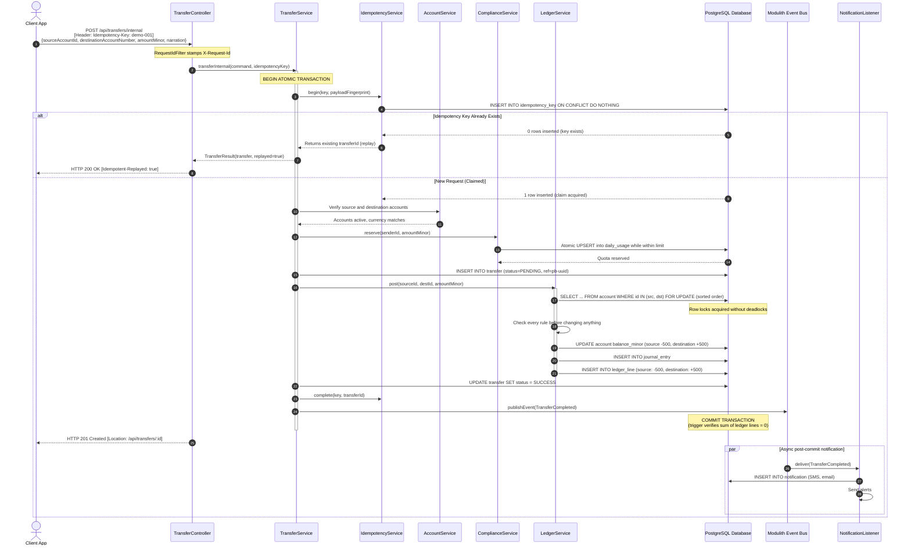
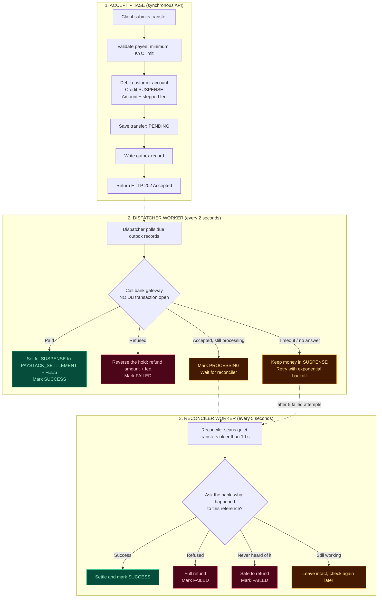
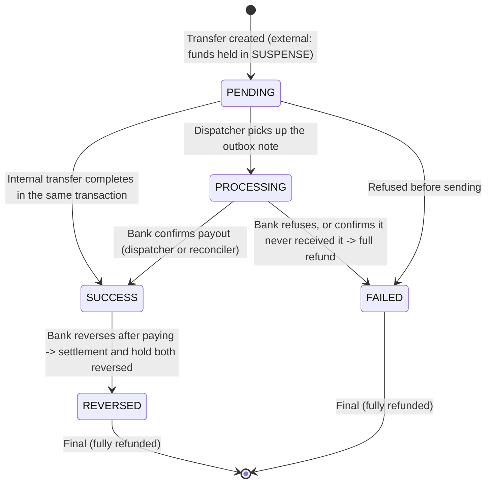

# PayBridge

[](https://openjdk.org/)
[](https://spring.io/projects/spring-boot)
[](https://spring.io/projects/spring-modulith)
[](https://www.postgresql.org/)
[](https://maven.apache.org/)
[](#-testing--verification)

> **A Core Banking & Settlement Engine engineered as a Spring Boot Modular Monolith.**
> Built to model real-world financial infrastructure: double-entry bookkeeping, zero-overdraft concurrency locking, strict idempotency, an asynchronous outbox gateway dispatcher with reconciliation, and tiered compliance limits.

**Status (2026-10-13):** Phase 1, local NGN-to-NGN transfers, is built. Internal transfers are complete; external transfers run end to end against a **simulated bank**. The real Paystack connection, webhooks and API-key authentication are **not built yet**. See [Project Status](#-project-status) for the honest list, and [`BUILD-LOG.md`](BUILD-LOG.md) for every decision and the reasoning behind it.

---

## Table of Contents

1. [Architectural Highlights](#-architectural-highlights)
2. [Module Architecture](#-module-architecture)
3. [Transfer Workflows & Flowcharts](#-transfer-workflows--flowcharts)
   - [1. Internal Account-to-Account Transfer](#1-internal-account-to-account-transfer)
   - [2. External Transfer with Simulated Gateway & Reconciler](#2-external-transfer-with-simulated-gateway--reconciler)
4. [External Bank Simulation (Deterministic Behavioral Profiles)](#-external-bank-simulation-profiles)
5. [API Specification](#-api-specification)
6. [Observability & Request Logging](#-observability--request-logging)
7. [Configuration](#-configuration)
8. [Getting Started](#-getting-started)
9. [Testing & Verification](#-testing--verification)
10. [Project Status](#-project-status)
11. [Further Reading](#-further-reading)

---

## 🏛️ Architectural Highlights

PayBridge is architected around foundational financial engineering principles:

* **Append-Only Double-Entry Bookkeeping:** Money is never created or destroyed out of thin air. Every movement is a balanced journal entry where debits and credits sum to zero ($\sum \text{lines} = 0$). PostgreSQL triggers enforce that `journal_entry` and `ledger_line` records can **never** be edited or deleted (`UPDATE`/`DELETE` prohibited), and a deferred constraint trigger rejects an unbalanced entry at commit. Mistakes are fixed with a reversing entry, never an eraser.
* **Integer Kobo Arithmetic:** Floating-point numbers are not used in any money pathway. Values are 64-bit signed integers in minor units (kobo: $100\text{ kobo} = ₦1.00$), held in an immutable `Money` value object that refuses to mix currencies and throws on overflow.
* **Pessimistic Row Locking in Canonical Order:** Simultaneous transfers acquire pessimistic write locks (`SELECT ... FOR UPDATE`) sorted strictly by account id, which removes the classic opposite-direction deadlock. An `@Version` column is a second safety net.
* **Database Check Constraints as a Second Line of Defense:** Even if the code-level validation failed, the schema rejects a negative customer balance through the check constraint `ck_account_customer_not_negative`.
* **Request Fingerprinting & Idempotency:** The client sends an `Idempotency-Key` header. PayBridge claims it with `INSERT ... ON CONFLICT DO NOTHING` and stores a SHA-256 fingerprint of the request. A duplicate request returns `HTTP 200 OK` with `Idempotent-Replayed: true` and the original receipt, without moving funds twice. Reusing a key with a different body is refused (`422`). A refused attempt rolls back entirely, so its key is not burned.
* **The Three Rules of External Settlement:**
  1. *Never call an external banking API inside a database transaction* (it would hold locks and risk paying without a record, or recording without paying).
  2. *A gateway timeout means "unknown", never "failed"* (the funds stay safely held in a `SUSPENSE` account while the system finds out).
  3. *Applying a bank's answer must be idempotent* (a repeated poll or webhook can never pay out twice).
* **Spring Modulith Boundaries:** Modules interact only through their public `api/` packages. A cross-module leak fails the build's tests (`ModularityTests`).
* **Events After Commit:** Customer alerts are delivered through Spring Modulith events (`@ApplicationModuleListener`): they run after the transaction commits, asynchronously, and are persisted until handled. A failed alert can never undo a transfer.

---

## 🧩 Module Architecture

PayBridge avoids distributed-microservice overhead by enforcing hard module boundaries inside a single deployable application:

```
src/main/java/com/academy/paybridge/
├── customer/      # Onboarding, phone normalisation (+234), KYC verification tiers
├── account/       # Account lifecycle, check-digit NUBAN generation (bank code 999), system accounts
├── ledger/        # Append-only journal entries and lines, statements, dev-only funding
├── transfer/      # Internal transfers, external outbox + dispatcher + reconciler, idempotency, payees
│   └── client/    #   TransferGateway interface + FakeTransferGateway (the simulated bank)
├── compliance/    # Atomic per-tier daily and per-transaction limit reservations
├── notification/  # Asynchronous SMS and email alerts delivered through domain events
├── shared/        # Immutable Money, error model, auditing, request-id and access-log filters
└── [fx / remittance / settlement]   # Planned later phases, not started
```

Each module is split into layers: `api/` (the public front desk), `domain/`, `repository/`, `service/` and `web/`.

### Module Responsibilities

| Module | Responsibility | Public Interface | Persistence |
|---|---|---|---|
| **`customer`** | Customer identity, phone normalisation, KYC tiers | `CustomerApi` | `customer` |
| **`account`** | Customer and system accounts (`FUNDING_SOURCE`, `SUSPENSE`, `PAYSTACK_SETTLEMENT`, `FEES`), cached balances | `AccountApi` | `account`, `account_number_seq` |
| **`ledger`** | Balanced double-entry postings, reversals, statements | `LedgerApi` | `journal_entry`, `ledger_line` |
| **`transfer`** | Internal transfers, external outbox, payees, idempotency | `TransferApi` | `transfer`, `idempotency_key`, `beneficiary`, `transfer_outbox` |
| **`compliance`** | Tiered daily and per-transaction quota reservations | `ComplianceApi` | `daily_usage` |
| **`notification`** | Customer alerts, decoupled through Modulith events | `@ApplicationModuleListener` | `notification` |
| **`shared`** | `Money` value object, error codes, auditing, request correlation | Open module (used by all) | `event_publication` |

The database schema is versioned with Flyway migrations `V1` to `V8` (`src/main/resources/db/migration`), and Hibernate runs in `validate` mode: it checks the tables but never changes them.

---

## 🔄 Transfer Workflows & Flowcharts

### 1. Internal Account-to-Account Transfer

An internal transfer moves funds between two PayBridge accounts inside a **single atomic database transaction**.

#### Sequence Diagram



A refused request (overdraw, over the limit, missing key, key reuse, transfer to oneself) rolls the whole transaction back: no allowance is used up, no key is burned and no row is written.

---

### 2. External Transfer with Simulated Gateway & Reconciler

External transfers reach banks outside our perimeter. Because remote calls can fail, hang or arrive late, PayBridge uses a **3-phase outbox and reconciliation pattern**:

1. **Phase 1: ACCEPT (one fast transaction)**: the amount plus a stepped fee is moved from the sender into the internal `SUSPENSE` account, a `PENDING` transfer and an outbox "to-do note" are saved, and the API answers `HTTP 202 Accepted` in milliseconds.
2. **Phase 2: DISPATCHER (background worker, every 2 s)**: picks up pending outbox notes and calls the bank gateway **strictly outside any database transaction**.
3. **Phase 3: RECONCILER (background worker, every 5 s)**: asks the bank about transfers that have stayed unresolved for more than $10\text{ seconds}$, to reach eventual settlement or an automatic refund.

#### Architecture Flowchart



#### Transfer State Machine



`FAILED` and `REVERSED` are final, and `TransferStatus.canMoveTo` refuses any illegal move, so a failed transfer can never become a success.

#### The Money Trail (a ₦2,000 transfer with a ₦10 fee, in kobo)

| Stage | Ledger entry | Customer | `SUSPENSE` | `PAYSTACK_SETTLEMENT` | `FEES` |
|---|---|---|---|---|---|
| Accepted | `EXTERNAL_HOLD` | **−201000** | **+201000** | | |
| Bank pays | `EXTERNAL_SETTLEMENT` | | −201000 | +200000 | +1000 |
| *or* bank refuses | `REVERSAL` of the hold | **+201000** | −201000 | | |
| *or* bank reverses later | reverse the settlement, then the hold | **+201000** | | −200000 | −1000 |

At every moment the books balance and every naira is accounted for. `SUSPENSE` returns to zero once every transfer has finished, and the sum of all account balances is always exactly zero.

A late "success" for a transfer that was already refunded raises a *MANUAL REVIEW NEEDED* error and moves no money: it is the one case where the books and the bank genuinely disagree, and a human has to decide.

---

## 🧪 External Bank Simulation Profiles

To test the hard cases reliably, without an unpredictable third-party sandbox, `FakeTransferGateway` decides how to behave from the **last four digits of the payee's account number**:

| Account Suffix | Bank Gateway Reaction | Resolved By | Final Status | Typical Timing |
|---|---|---|---|---|
| `...3333` | **Immediate payout:** the bank accepts and pays | Dispatcher | `SUCCESS` | $\sim 2\text{ s}$ |
| `...1111` | **Immediate refusal** | Dispatcher | `FAILED` *(refunded)* | $\sim 3\text{ s}$ |
| `...1234` (or any other number) | **Accepted, still processing:** the bank queues the payout | Reconciler | `SUCCESS` | $\sim 14\text{ s}$ |
| `...5555` | **Timeout AFTER receipt:** the request was processed but the answer was lost; the retry carries the same reference and is paid exactly once | Dispatcher retry, then Reconciler | `SUCCESS` *(paid exactly once)* | $\sim 19\text{ s}$ |
| `...2222` | **Timeout BEFORE receipt:** the bank never saw the request; after 5 attempts the reconciler learns "never heard of it" | Reconciler | `FAILED` *(refunded)* | $\sim 34\text{ s}$ |
| `...4444` | Accepted, then fails | Reconciler | `FAILED` *(refunded)* | covered by tests |
| `...6666` | Stays pending forever | none | stays `PROCESSING` | covered by tests |
| `...7777` | Succeeds, then the bank reverses it | Reversal handling | `REVERSED` *(refunded)* | covered by tests |
| `...9999` | **Name enquiry failure:** the account does not exist | Web layer | `404 Not Found` | Instant |

The timings were measured on the default settings (`application.yml`): dispatcher every 2 s, reconciler every 5 s for transfers quiet for 10 s, retries after 2, 4, 8 and 16 seconds, giving up on the 5th attempt. The `7777` reversal cannot be triggered by hand until webhooks exist; it is proven by the automated test `aTransferTheBankReversesAfterSucceedingIsFullyRefunded`.

**Fees** are charged on top of the amount (internal transfers are free): up to ₦5,000 costs ₦10, up to ₦50,000 costs ₦25, above that ₦50. The minimum external transfer is ₦100. These are placeholder figures, not Paystack's real pricing.

---

## 📖 API Specification

All amounts are integer **kobo** ($100\text{ kobo} = ₦1.00$). Every transfer needs an `Idempotency-Key` header (8 to 100 characters: letters, digits, `.` `_` `:` `-`).

### 1. Customers
* `POST /api/customers`: onboard a customer (`firstName`, `lastName`, `email`, `phone`). Starts `UNVERIFIED` and `ACTIVE`; the phone is normalised to `+234...`. `201 Created`.
* `GET /api/customers/{id}`: customer profile and KYC tier.
* `PATCH /api/customers/{id}/kyc-tier`: change tier (`UNVERIFIED`, `BASIC`, `FULL`).

### 2. Accounts
* `POST /api/accounts`: open an account with an auto-generated check-digit NUBAN (`customerId`, `currency`, NGN only for now).
* `GET /api/accounts/{id}`: account and cached balance.
* `GET /api/accounts/by-number/{accountNumber}`: look up by 10-digit NUBAN.
* `GET /api/accounts?customerId={id}`: list a customer's accounts.

### 3. Money Transfers
* `POST /api/transfers/internal`: instant account-to-account transfer. `201 Created`, or `200 OK` with `Idempotent-Replayed: true` on a replay.
  * *Headers:* `Idempotency-Key: <unique-string>`
  * *Body:* `{"sourceAccountId": "uuid", "destinationAccountNumber": "1000000024", "amountMinor": 50000, "narration": "rent"}`
* `POST /api/transfers/external`: accept a transfer to another bank. `202 Accepted` (poll the transfer for the outcome), or `200 OK` on a replay.
  * *Headers:* `Idempotency-Key: <unique-string>`
  * *Body:* `{"sourceAccountId": "uuid", "beneficiaryId": "uuid", "amountMinor": 100000, "narration": "invoice"}`
* `GET /api/transfers/{id}`: poll the outcome of a transfer.
* `GET /api/transfers?accountId={id}`: transfers sent or received by an account, newest first.

### 4. Beneficiaries (Name Enquiry)
* `POST /api/beneficiaries/resolve`: name enquiry (`bankCode`, `accountNumber`). Saves nothing.
* `POST /api/beneficiaries`: save a verified payee (`customerId`, `bankCode`, `accountNumber`). Saving the same payee twice is harmless.
* `GET /api/beneficiaries?customerId={id}`: list a customer's saved payees.

### 5. Ledger & Dev Scaffolding
* `GET /api/accounts/{accountId}/entries`: chronological double-entry statement.
* `POST /api/dev/accounts/{accountId}/fund`: **test only**: inject money through a balanced ledger entry from `FUNDING_SOURCE` (`amountMinor`). Controlled by `paybridge.dev.funding-enabled`.

### 6. Compliance & Alerts
* `GET /api/compliance/customers/{customerId}/limits`: daily usage and remaining limit.
* `GET /api/notifications?customerId={customerId}`: SMS and email alerts sent to a customer.

### 7. Operations
* `GET /actuator/health`: health check.

### Error Format

Every error has the same JSON shape (RFC 9457 problem detail):

```json
{
  "detail": "The Idempotency-Key header is required (a unique value per transfer, 8 to 100 characters)",
  "instance": "/api/transfers/internal",
  "status": 400,
  "title": "Bad Request",
  "code": "VALIDATION_FAILED",
  "requestId": "1d8986f7-d2d4-4e8c-a7d0-2e69e7a7cb24"
}
```

`code` is for programs, `detail` is for people, `requestId` is for support. Field-level validation failures add an `errors` map.

| `code` | HTTP | Meaning |
|---|---|---|
| `VALIDATION_FAILED` | 400 | Bad input, missing `Idempotency-Key`, transfer to oneself, below the minimum |
| `RESOURCE_NOT_FOUND` | 404 | Unknown customer, account, transfer or payee |
| `INSUFFICIENT_FUNDS` | 422 | The balance does not cover the amount (plus the fee, for external transfers) |
| `LIMIT_EXCEEDED` | 422 | Over the KYC tier's per-transaction or daily limit |
| `IDEMPOTENCY_KEY_REUSED` | 422 | The same key was sent with a different request |
| `IDEMPOTENCY_KEY_IN_PROGRESS` | 409 | The first request with that key is still running |
| `ACCOUNT_NOT_ACTIVE`, `INVALID_STATE`, `CURRENCY_MISMATCH`, `CONFLICT`, `GATEWAY_ERROR` | various | Account, state-machine, currency, conflict and provider problems |
| `INTERNAL_ERROR` | 500 | Anything unexpected; the real cause is only logged, never returned |

---

## 🔍 Observability & Request Logging

Every request the application handles is logged by `AccessLogFilter`, one line per request, after it finishes:

```
INFO  ... [3f9a1c52-...] c.a.p.s.c.AccessLogFilter : POST /api/transfers/internal -> 201 (347 ms)
WARN  ... [bdfd6ba9-...] c.a.p.s.c.AccessLogFilter : GET /api/does-not-exist -> 404 (16 ms)
```

* **Request id on every line:** `RequestIdFilter` gives each request an id (the caller's `X-Request-Id` if it is safe, otherwise a fresh UUID). It appears in the log line, the `X-Request-Id` response header and the `requestId` field of every error, so one id ties together a caller's report and the server's logs.
* **Levels:** `5xx` is `ERROR`, `4xx` is `WARN`, everything else `INFO`. A successful `/actuator/health` is `DEBUG` (pollers hit it every few seconds and would bury real traffic); a failing one is still `ERROR`.
* **What is never logged:** request bodies and headers, because they will hold personal data and, once authentication exists, API keys.
* **Known gap:** the request id is not yet carried onto background threads (dispatcher, reconciler, asynchronous notification listeners), so their lines show `[]`.

Both filters are registered with `FilterRegistrationBean` and are deliberately **not** `@Component`s: Spring Modulith's observability support wraps module beans in proxies, which breaks a servlet filter that is a bean.

---

## ⚙️ Configuration

Settings live in `src/main/resources/application.yml`.

| Setting | Meaning |
|---|---|
| `paybridge.dev.funding-enabled` | Switches the test funding endpoint. **Turn it off anywhere but a private machine:** it creates money. |
| `paybridge.gateway` | Which bank sits behind external transfers. `fake` is the built-in simulated bank; `paystack` arrives in Step 11. |
| `paybridge.account.bank-code` | A fictional bank code (`999`) used for the NUBAN check digit. |
| `paybridge.compliance.limits` | Per-tier limits in kobo. UNVERIFIED: ₦50,000 per transfer, ₦100,000 per day. BASIC: ₦200,000 / ₦500,000. FULL: ₦5,000,000 / ₦10,000,000. Placeholder figures. |
| `paybridge.transfer.external-min-minor`, `external-fees` | Minimum external transfer (₦100) and the fee bands. Placeholder figures. |
| `paybridge.dispatcher.*` | `enabled`, `interval` (2 s), `batch-size`, `max-attempts` (5), `base-delay` (2 s, doubling). |
| `paybridge.reconciler.*` | `enabled`, `interval` (5 s), `min-age` (10 s), `batch-size`. |
| `logging.pattern.correlation` | Puts the request id on each log line. Uses Log4j2 syntax (`%X{requestId}`). |

The test profile (`src/test/resources/application-test.yml`) switches the dispatcher and reconciler timers off so tests can drive them step by step.

---

## 🚀 Getting Started

### Prerequisites
* **Java 25**
* **Docker Desktop**, running (Spring starts PostgreSQL for you from `compose.yaml`, and the tests start a throwaway one)
* The Maven Wrapper (`mvnw`) is included; no separate Maven install is needed

### Run the Backend

1. **Start the application:**
   ```bash
   ./mvnw spring-boot:run
   ```
   Spring Boot starts the PostgreSQL container from `compose.yaml` automatically, applies Flyway migrations `V1` to `V8`, and boots on port `8080`. Wait for the line containing `Started PayBridgeApplication`.

   The database is mapped to host port **5433** (not 5432), so it does not clash with a PostgreSQL already installed on the machine.

2. **Verify health:**
   ```bash
   curl -s http://localhost:8080/actuator/health
   # {"groups":["liveness","readiness"],"status":"UP"}
   ```

3. **Try it.** Create a customer, open an account, fund it and transfer:
   ```bash
   BASE=http://localhost:8080; H='Content-Type: application/json'
   curl -s -X POST $BASE/api/customers -H "$H" \
     -d '{"firstName":"Ada","lastName":"Obi","email":"ada1@example.com","phone":"08012345678"}'
   ```
   Then follow the response ids through the endpoints in the [API Specification](#-api-specification).

If `Port 8080 was already in use`, an earlier copy of the app is still running: find it with `netstat -ano | grep 8080` and stop it.

> **Warning:** there is no authentication yet. Anyone who can reach the app can create customers and move money, and the dev funding endpoint creates money. Run it only on a private machine, with fake data.

---

## 🧪 Testing & Verification

```bash
./mvnw test
```

**217 tests, all passing.** Most start a real PostgreSQL through Testcontainers, so **Docker must be running**. If many tests fail at once with "ApplicationContext failure threshold exceeded", check Docker first.

### Key Test Suites

* **Concurrency Race Tests (`ConcurrencyTest`, 5 tests):** fires 40 and 200 simultaneous transfers (including opposite directions) and proves no account is overdrawn, there is no deadlock, and all balances still sum to exactly zero.
* **Duplicate Request Race (`DuplicateRequestRaceTest`):** sends concurrent requests with the same `Idempotency-Key` and verifies only one transfer executes while the rest receive replays.
* **Internal Transfers (`InternalTransferTest`, 21 tests):** the happy path, replays, key reuse, limits, overdraw, and the rollback of every refused request.
* **Ledger (`LedgerServiceTest`, 19 tests, plus `LedgerEndpointsTest`):** balanced postings, reversals, replay safety, and the append-only database triggers.
* **External Transfers (`ExternalTransferTest`, 28 tests; `BeneficiaryTest`, 8):** outbox dispatch, timeout handling, retries with backoff, refunds, reversal after success, late success after a refund, and every fake-bank profile.
* **Modularity (`ModularityTests`):** verifies the Spring Modulith boundaries, so no unauthorised cross-module dependency exists.
* **Access Log (`AccessLogFilterTest`, 9 tests):** listens to the filter's real logger and checks each level, the query string, the exception case, and that bodies and headers never appear. Needs no Docker.
* **Unit tests:** `Money`, `Nuban`, error codes and exceptions, the transfer state machine, fee bands, compliance and notifications.

The shared database is reused across tests, so each test creates its own customers and accounts, and the key invariant (all balances sum to zero) is checked after money-moving tests.

---

## 📌 Project Status

| Step | What | Status |
|---|---|---|
| 1 | Project skeleton: build, config, database, foundation tests | ✅ |
| 2 | `shared`: `Money`, error model, auditing, correlation ids | ✅ (small `MoneyTest` gaps open) |
| 3 | `customer` | ✅ |
| 4 | `account`: NUBAN numbers, balances, system accounts | ✅ |
| 5 | `ledger`: balanced, append-only posting | ✅ |
| 6 | Concurrency hardening | ✅ |
| 7 | Internal transfers with idempotency | ✅ |
| 8 | `compliance`: per-tier limits | ✅ |
| 9 | `notification`: event-driven alerts | ✅ |
| 10 | External transfers: fake gateway, outbox, fees, reversals | ✅ |
| 11 | Real Paystack client | ⏸ on hold (needs a Paystack test account) |
| 12 | Webhooks and reconciliation | ⏳ |
| 13 | Hardening: API-key authentication, rate limiting, metrics | 🔄 request logging done; authentication, rate limiting and metrics not started |

### Not built yet

* **The real bank connection (Step 11):** `paybridge.gateway` is `fake`. The code talks to a `TransferGateway` interface, so the real provider is one new class.
* **Webhooks (Step 12):** signature checking on the raw body, de-duplication by event id, then applying the result.
* **Authentication, rate limiting, metrics (Step 13):** until then the API is open.
* **Request id on background threads.**
* **`MoneyTest` gaps:** `negate`, sign checks, equality and `hashCode`, `compareTo`, and immutability.
* **Later phases:** `fx`, `remittance`, `settlement` and full AML screening.
* **Placeholders to check before trusting:** the fee bands, the per-tier limits and the fictional bank code `999`.

### Not part of this copy

This copy is the backend only. A React front end, Swagger UI, Docker and Render deployment files, and the step-by-step demo guides exist in the separate `paybridge(learning copy)` folder and have not been brought across.

---

## 📚 Further Reading

* [`BUILD-LOG.md`](BUILD-LOG.md): every decision with its reason, the problems met and how they were solved, the testing strategy, what is left, and a glossary.
* [`Sandbox.md`](Sandbox.md): from the assignment, a list of payment providers' free test environments.
* `compose.yaml`: the local PostgreSQL container; `src/main/resources/db/migration`: the Flyway migrations.
