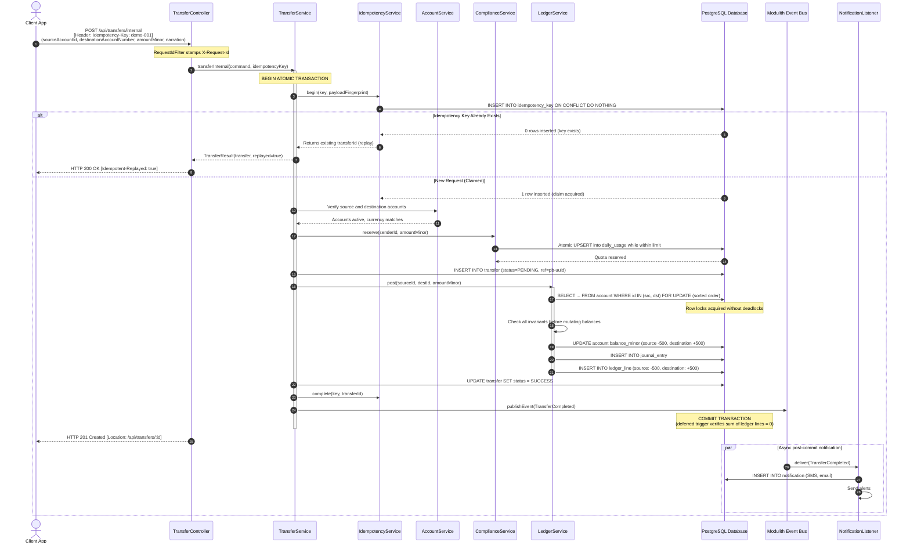
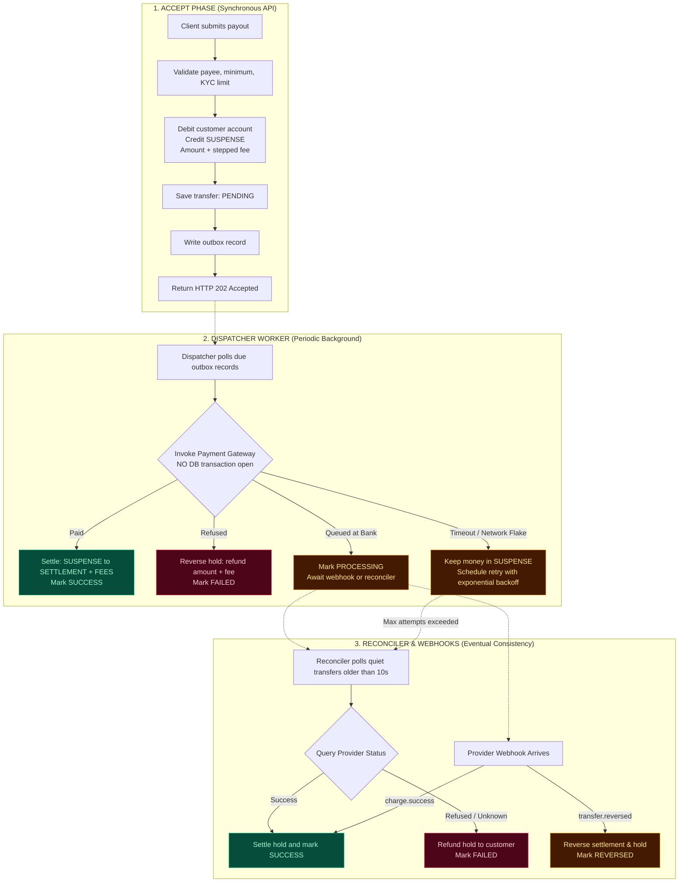
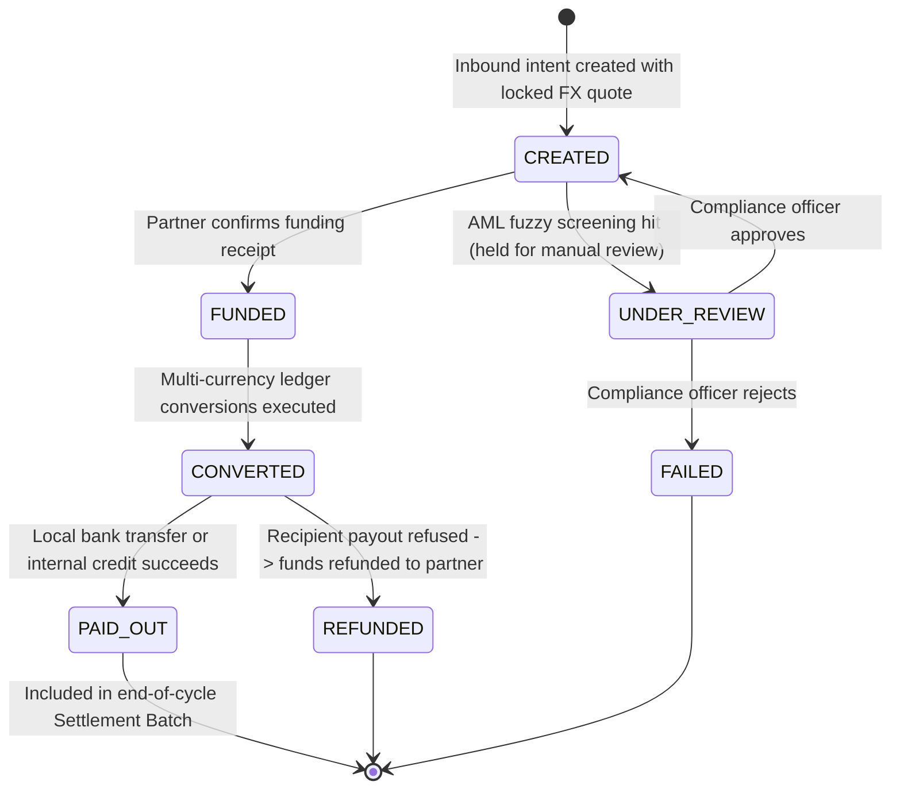

# PayBridge

[](https://openjdk.org/)
[](https://spring.io/projects/spring-boot)
[](https://spring.io/projects/spring-modulith)
[](https://www.postgresql.org/)
[](https://maven.apache.org/)
[](#-testing--verification)

> **A Core Banking, Remittance & Settlement Engine engineered as a Spring Boot Modular Monolith.**  
> Built to model real-world financial infrastructure: double-entry bookkeeping, zero-overdraft concurrency locking, strict idempotency, an asynchronous outbox gateway dispatcher with reconciliation, real and simulated Paystack integration, multi-currency FX quotes, inbound cross-border remittances, and automated statement reconciliation batches.

**Status (October 2026):** All 28 engineering steps across Phase 1 (Local Transfers & Hardening) and Phase 2 (Multi-Currency Ledger, FX, Remittance, AML Screening, and Batch Settlement) are fully implemented and verified with **865 passing automated tests (1 live-Paystack smoke test skipped)**. See [Project Status](#-project-status) for the complete milestone breakdown, [`test.md`](test.md) for the live test debt and coverage catalog, and [`BUILD-LOG.md`](BUILD-LOG.md) for architectural decisions and reasoning.

---

## Table of Contents

1. [Architectural Highlights](#-architectural-highlights)
2. [Module Architecture](#-module-architecture)
3. [Core Financial Workflows & Flowcharts](#-core-financial-workflows--flowcharts)
   - [1. Internal Account-to-Account Transfer](#1-internal-account-to-account-transfer)
   - [2. External Transfer with Outbox Dispatcher & Reconciler](#2-external-transfer-with-outbox-dispatcher--reconciler)
   - [3. Cross-Border Remittance & Settlement Lifecycle](#3-cross-border-remittance--settlement-lifecycle)
4. [External Bank & Payment Gateway Integration](#-external-bank--payment-gateway-integration)
5. [API Specification](#-api-specification)
6. [Observability & Request Logging](#-observability--request-logging)
7. [Configuration](#-configuration)
8. [Getting Started](#-getting-started)
9. [Testing & Verification](#-testing--verification)
10. [Project Status](#-project-status)
11. [Further Reading](#-further-reading)

---

## 🏛️ Architectural Highlights

PayBridge is architected around foundational financial engineering principles:

* **Append-Only Double-Entry Bookkeeping:** Money is never created or destroyed out of thin air. Every movement is a balanced journal entry where debits and credits sum to zero ($\sum \text{lines} = 0$). PostgreSQL triggers enforce that `journal_entry` and `ledger_line` records can **never** be edited or deleted (`UPDATE`/`DELETE` prohibited), and deferred database constraints verify balance integrity at transaction commit. Mistakes are fixed with reversing entries, never an eraser.
* **Per-Currency Balance Conservation:** Cross-currency operations (e.g., USD-to-NGN conversion) post as two distinct, linked double-entry journal entries via internal currency position accounts (`POSITION_USD`, `POSITION_NGN`). Every currency balance sums to zero independently across the system.
* **Integer Minor-Unit Arithmetic:** Floating-point numbers are strictly forbidden in all financial code. Values are 64-bit signed integers in minor units (kobo: $100\text{ kobo} = ₦1.00$; cents: $100\text{ cents} = \$1.00$), encapsulated within an immutable `Money` value object that guards against mixed-currency operations and throws on arithmetic overflow.
* **Pessimistic Row Locking in Canonical Order:** Simultaneous transfers acquire pessimistic write locks (`SELECT ... FOR UPDATE`) sorted strictly by account UUID, eliminating deadlocks across concurrent transfers. An `@Version` optimistic locking column provides a redundant safety net.
* **Database Check Constraints as Defense-in-Depth:** Even if application validation were bypassed, database-level check constraints (`ck_account_customer_not_negative`) enforce that customer accounts cannot drop below zero.
* **Request Fingerprinting & Idempotency:** Endpoints creating financial transactions require an `Idempotency-Key` header. PayBridge claims keys atomically with `INSERT ... ON CONFLICT DO NOTHING` alongside a SHA-256 fingerprint of the request payload. Replays return `HTTP 200 OK` with `Idempotent-Replayed: true` and the original response without moving funds twice. Mutated payloads trigger `422 Unprocessable Entity`.
* **The Three Rules of External Settlement:**
  1. *Never invoke external payment APIs inside an open database transaction* (it holds locks and risks debits without payouts or payouts without records).
  2. *Gateway timeouts signify "unknown", never "failed"* (funds remain safely held in `SUSPENSE` until resolved).
  3. *Applying a bank's webhook or polling response must be idempotent* (duplicate webhooks never move funds twice).
* **Spring Modulith Boundaries:** Modules interact exclusively through public `api/` interfaces marked with `@NamedInterface("api")`. Cross-boundary domain leaks are caught and failed at build time via `ModularityTests`.
* **API-Key Authentication Hashed at Rest:** Every endpoint except `/actuator/health` requires an `X-API-Key` header. Keys carry 256 bits of cryptographic entropy, and only their SHA-256 hash is persisted. Keys are role-scoped (`CLIENT`, `ADMIN`).
* **Sliding-Window Rate Limiting & Guess Protection:** Per-key token buckets enforce request and transfer limits. IP addresses presenting unknown keys are temporarily throttled to mitigate brute-force attempts.
* **Asynchronous Post-Commit Events:** Customer SMS and email notifications are dispatched asynchronously after database transaction commits via Spring Modulith event publication registries. Alerting failures cannot roll back financial transfers.

---

## 🧩 Module Architecture

PayBridge maintains strict modular borders inside a unified Spring Boot application:

```
src/main/java/com/academy/paybridge/
├── customer/      # Onboarding, phone normalisation (+234), KYC verification tiers
├── account/       # Multi-currency accounts (NGN, USD), check-digit NUBAN generation, system accounts
├── ledger/        # Append-only double-entry journal entries, multi-currency balance conservation
├── transfer/      # Internal transfers, external outbox + dispatcher + reconciler, Paystack client, webhooks
│   └── client/    #   TransferGateway interface, PaystackTransferGateway, FakeTransferGateway
├── compliance/    # Per-tier daily & single limits, AML watchlist screening with fuzzy matching, velocity rules
├── fx/            # Multi-currency rates, quotes, spreads, and two-legged conversion postings
├── remittance/    # Inbound cross-border remittance lifecycle (funded, converted, paid, refunded, under review)
├── settlement/    # Inbound/outbound batch generation, statement CSV/JSON parsing, reconciliation matching, breaks
├── notification/  # Asynchronous SMS and email alerts delivered through domain events
├── security/      # API keys (SHA-256 hashed), roles, authentication + rate-limit filters, key admin
└── shared/        # Immutable Money, RFC 9457 errors, auditing, request-id and access-log filters, MDC correlation
```

### Module Responsibilities

| Module | Responsibility | Public Interface | Persistence Tables |
|---|---|---|---|
| **`customer`** | Customer identity, phone normalisation, KYC verification tiers | `CustomerApi` | `customer` |
| **`account`** | Customer and system accounts (`FUNDING_SOURCE`, `SUSPENSE`, `PAYSTACK_SETTLEMENT`, `FEES`, `POSITION_*`), cached balances | `AccountApi` | `account`, `account_number_seq` |
| **`ledger`** | Multi-currency balanced double-entry postings, reversals, account statements | `LedgerApi` | `journal_entry`, `ledger_line` |
| **`transfer`** | Internal transfers, external payout outbox, Paystack integration, payees, webhooks | `TransferApi`, `PayoutApi` | `transfer`, `idempotency_key`, `beneficiary`, `transfer_outbox`, `webhook_event` |
| **`compliance`** | Tiered daily & single limits, AML screening with fuzzy name matching (`NameSimilarity`), case management | `ComplianceApi` | `daily_usage`, `compliance_case` |
| **`fx`** | Real-time rate stores, locked conversion quotes, corridor margin spreads | `FxApi` | `fx_rate`, `fx_quote`, `fx_spread`, `fx_conversion` |
| **`remittance`** | Inbound remittance orchestration, partner funding, conversion, recipient payouts, refunds | `RemittanceApi` | `remittance`, `remittance_event` |
| **`settlement`** | Partner batches, bank statement parsing (CSV/JSON), rule-based matching engine, breaks management | Internal Admin Service | `settlement_batch`, `settlement_statement`, `statement_entry`, `settlement_break` |
| **`notification`** | Customer SMS & email alerts decoupled via domain events | `@ApplicationModuleListener` | `notification` |
| **`security`** | API key authentication, roles, rate-limiting filters, admin key bootstrap | HTTP Filters | `api_key` |
| **`shared`** | `Money` value object, error handling, auditing, request tracing, log correlation | Open Module | `event_publication` |

Schema migrations are versioned with Flyway (`V1` to `V19` in `src/main/resources/db/migration`), and Hibernate validates schema integrity on boot without auto-altering tables.

---

## 🔄 Core Financial Workflows & Flowcharts

### 1. Internal Account-to-Account Transfer

Moves funds between two PayBridge accounts within a single atomic database transaction:



---

### 2. External Transfer with Outbox Dispatcher & Reconciler

External payouts interact with outside banking networks (e.g., Paystack). PayBridge isolates external risk through an outbox and reconciliation pattern:



---

### 3. Cross-Border Remittance & Settlement Lifecycle

Inbound remittance flows from foreign corridor partners (e.g., USD received abroad to payout in NGN) follow an audited state machine:



---

## 🔌 External Bank & Payment Gateway Integration

PayBridge supports both live external gateways and deterministic simulation profiles through its [`TransferGateway`](file:///C:/Users/CHUKWUMA/projects/paybridge/paybridge/src/main/java/com/academy/paybridge/transfer/client/TransferGateway.java) interface:

### 1. Real Paystack Integration (`PaystackTransferGateway`)
- Enabled by configuring `paybridge.gateway: paystack` and supplying `PAYSTACK_SECRET_KEY=sk_test_...`.
- Implements name enquiry (account resolution), recipient creation, transfer initiation, and transfer status polling.
- Backed by full unit test suites using Spring's MockRestServiceServer (`PaystackTransferGatewayTest`), Spring wiring tests (`PaystackWiringTest`), and conditional live sandbox smoke tests (`PaystackLiveSmokeTest`).
- Webhook signature verification uses HMAC-SHA512 against raw payload bytes before deserialization.

### 2. Deterministic Simulated Bank (`FakeTransferGateway`)
When running in `fake` mode (default), the gateway simulates banking conditions based on the **last four digits of the payee's account number**:

| Account Suffix | Bank Gateway Reaction | Final Status | Behavioral Scenario |
|---|---|---|---|
| `...3333` | Immediate payout success | `SUCCESS` | Ideal fast path |
| `...1111` | Immediate refusal by recipient bank | `FAILED` *(refunded)* | Invalid account or bank freeze |
| `...1234` | Queued at bank, delayed confirmation | `SUCCESS` | Eventual settlement via reconciler |
| `...5555` | Timeout after payment execution | `SUCCESS` *(paid once)* | Network drop; retry resolved idempotently |
| `...2222` | Timeout before payment receipt | `FAILED` *(refunded)* | Provider unreachable; safe refund |
| `...7777` | Success, followed by bank reversal | `REVERSED` *(refunded)* | Bounced payment clawback |
| `...9999` | Account resolution failure | `404 Not Found` | Name enquiry rejection |

---

## 📖 API Specification

All monetary values are integer **minor units** (kobo for NGN, cents for USD). Financial mutation endpoints require an `Idempotency-Key` header (8 to 100 characters: letters, digits, `.` `_` `:` `-`).

### 1. Customers & Identity
* `POST /api/customers`: Onboard a customer (`firstName`, `lastName`, `email`, `phone`). Normalises phone to `+234...`.
* `GET /api/customers/{id}`: Retrieve customer profile and current KYC tier.
* `PATCH /api/customers/{id}/kyc-tier`: Update customer tier (`UNVERIFIED`, `BASIC`, `FULL`).

### 2. Multi-Currency Accounts
* `POST /api/accounts`: Open an account (`customerId`, `currency`: `NGN` or `USD`). Generates compliant check-digit NUBAN.
* `GET /api/accounts/{id}`: View account details and cached balance.
* `GET /api/accounts/by-number/{accountNumber}`: Look up account by 10-digit NUBAN.
* `GET /api/accounts?customerId={id}`: List accounts owned by a customer.

### 3. Local Transfers (Internal & External)
* `POST /api/transfers/internal`: Instant atomic account-to-account transfer.
* `POST /api/transfers/external`: Asynchronous payout to a Nigerian commercial bank.
* `GET /api/transfers/{id}`: Poll transfer outcome and status history.
* `GET /api/transfers?accountId={id}`: View chronological transfer receipts for an account.

### 4. FX Rates & Quotes
* `GET /api/fx/rates`: Query current market rates, effective timestamps, and spread margins.
* `POST /api/fx/quotes`: Lock a guaranteed conversion rate for a fixed window (`sourceCurrency`, `targetCurrency`, `amountMinor`).
* `POST /api/fx/conversions`: Execute a locked quote into two-legged double-entry ledger postings.
* `POST /api/admin/fx/rates/refresh`: Force refresh of upstream rate provider.
* `POST /api/admin/fx/spreads`: Update corridor margin in basis points (admin only).

### 5. Inbound Remittances (Cross-Border)
* `POST /api/remittances`: Book an inbound remittance with locked quote and sender/recipient details.
* `GET /api/remittances/{id}`: Retrieve remittance lifecycle state and audit log.
* `POST /api/admin/remittances/{id}/review`: Approve or reject a remittance flagged by AML screening (admin only).

### 6. Settlement & Reconciliation
* `POST /api/admin/settlement/batches`: Generate cut-off settlement batch for a corridor partner.
* `POST /api/admin/settlement/statements`: Upload provider or partner statement file (CSV or JSON).
* `POST /api/admin/settlement/match`: Trigger matching engine to reconcile statements against internal batches.
* `GET /api/admin/settlement/breaks`: Inspect open breaks categorized by age buckets (`0-1d`, `2-7d`, `>7d`).
* `POST /api/admin/settlement/breaks/{id}/resolve`: Record manual resolution and explanation for an open break.

### 7. Beneficiaries & Ledger
* `POST /api/beneficiaries/resolve`: External name enquiry (`bankCode`, `accountNumber`).
* `POST /api/beneficiaries`: Save verified payee under customer profile.
* `GET /api/accounts/{accountId}/entries`: Chronological double-entry account statement.
* `POST /api/dev/accounts/{accountId}/fund`: **Dev/Test Only**: Inject test funds via balanced entry from `FUNDING_SOURCE`.

### 8. Authentication & Webhooks
* `POST /api/admin/api-keys`: Create an API key (`name`, `role`: `CLIENT` or `ADMIN`). Key displayed once.
* `GET /api/admin/api-keys`: List active keys and prefixes.
* `DELETE /api/admin/api-keys/{id}`: Revoke an API key.
* `POST /api/webhooks/paystack`: Paystack signed webhook receiver (HMAC-SHA512).
* `POST /api/webhooks/monnify`: Monnify signed webhook receiver.

### Authentication Matrix

Every address except `/actuator/health` requires an API key in the `X-API-Key` header:

| Route Path | Permission Required | Description |
|---|---|---|
| `/actuator/health` | Public | Liveness and readiness health checks |
| `/api/webhooks/**` | Public (Signed) | Verified via provider HMAC signatures |
| `/api/**` (general) | `CLIENT` or `ADMIN` | Account, customer, transfer, quote endpoints |
| `/api/admin/**`, `/api/dev/**`, `/actuator/**` | `ADMIN` only | Key management, AML cases, settlement, metrics |

---

## 🔍 Observability & Request Logging

Every request handled by PayBridge is logged after completion via [`AccessLogFilter`](file:///C:/Users/CHUKWUMA/projects/paybridge/paybridge/src/main/java/com/academy/paybridge/shared/config/AccessLogFilter.java):

```text
INFO  ... [3f9a1c52-...] c.a.p.s.c.AccessLogFilter : POST /api/transfers/internal -> 201 (347 ms) client=mobile-app
WARN  ... [bdfd6ba9-...] c.a.p.s.c.AccessLogFilter : GET /api/customers/... -> 401 (13 ms)
INFO  ... [3f9a1c52-...] c.a.p.n.s.LoggingNotificationSender : [SMS] to +234...: You sent NGN 500.00 ...
INFO  ... [dispatcher-30d7157c] c.a.p.n.s.LoggingNotificationSender : [SMS] ... Your transfer of NGN 2,000.00 was successful
```

* **Correlation IDs Across Threads:** [`RequestIdFilter`](file:///C:/Users/CHUKWUMA/projects/paybridge/paybridge/src/main/java/com/academy/paybridge/shared/config/RequestIdFilter.java) propagates `X-Request-Id` (or a secure UUID fallback) to the MDC, response headers, and RFC 9457 problem details. Micrometer context propagation ensures asynchronous event handlers retain the correlation ID of the originating request.
* **Sensitive Data Redaction:** Request payloads and authorization headers are never logged. Log lines report authenticated key names (`client=mobile-app`), never tokens.
* **Production Metrics (`/actuator/metrics`):**
  - `paybridge.transfers`: Committed transfer counts tagged by `type` and `outcome`.
  - `paybridge.remittance.transitions`: Remittance status updates.
  - `paybridge.settlement.breaks.open`: Gauges tracking open settlement breaks by age (`0-1d`, `2-7d`, `>7d`).
  - `paybridge.security.rejections` & `paybridge.ratelimit.rejections`.

---

## ⚙️ Configuration

Application settings reside in [`application.yml`](file:///C:/Users/CHUKWUMA/projects/paybridge/paybridge/src/main/resources/application.yml):

| Configuration Property | Default Value | Description |
|---|---|---|
| `paybridge.security.enabled` | `true` | Enables API key authentication and rate limits |
| `paybridge.security.bootstrap-admin-key` | `${PAYBRIDGE_ADMIN_API_KEY:}` | Root admin key loaded from environment variable |
| `paybridge.gateway` | `fake` | Outbound transfer provider: `fake` or `paystack` |
| `paybridge.paystack.secret-key` | `${PAYSTACK_SECRET_KEY:}` | Paystack API secret key (`sk_test_...`) |
| `paybridge.paystack.base-url` | `https://api.paystack.co` | Paystack endpoint URL |
| `paybridge.webhooks.paystack.secret-key` | `${PAYSTACK_SECRET_KEY:}` | Webhook HMAC validation secret |
| `paybridge.webhooks.monnify.secret-key` | `${MONNIFY_SECRET_KEY:}` | Monnify webhook validation secret |
| `paybridge.dispatcher.interval` | `2s` | Polling frequency for pending outbox payout items |
| `paybridge.reconciler.interval` | `5s` | Polling frequency for unresolved payout items |
| `paybridge.dev.funding-enabled` | `false` | Enables test account funding endpoint (keep false in prod) |

---

## 🚀 Getting Started

### Prerequisites
* **Java 25** (LTS)
* **Docker Desktop** (running, used by Testcontainers and local PostgreSQL)
* Maven Wrapper (`mvnw` / `mvnw.cmd` included in repo)

### Running the Application

1. **Set your bootstrap admin key and start the server:**
   ```bash
   export PAYBRIDGE_ADMIN_API_KEY=$(openssl rand -hex 24)
   ./mvnw spring-boot:run
   ```
   *Windows PowerShell:*
   ```powershell
   $env:PAYBRIDGE_ADMIN_API_KEY = [System.Convert]::ToHexString((1..24 | ForEach-Object { Get-Random -Maximum 256 }))
   .\mvnw.cmd spring-boot:run
   ```

   Spring Boot automatically boots PostgreSQL via Docker Compose on host port **5433** (preventing clashes with standard 5432 ports) and applies migrations `V1` to `V19`.

2. **Verify application health:**
   ```bash
   curl -s http://localhost:8080/actuator/health
   # {"groups":["liveness","readiness"],"status":"UP"}
   ```

3. **Create a client API key:**
   ```bash
   curl -s -X POST http://localhost:8080/api/admin/api-keys \
     -H "Content-Type: application/json" \
     -H "X-API-Key: $PAYBRIDGE_ADMIN_API_KEY" \
     -d '{"name":"mobile-app","role":"CLIENT"}'
   ```

---

## 🧪 Testing & Verification

Execute the complete automated test suite:

```bash
./mvnw test
```

### Test Suite Highlights (**865 tests passing, 1 skipped, across 71 test files**):
* **Concurrency & Race Conditions (`ConcurrencyTest`):** Executes 40 to 200 simultaneous multi-threaded transfers (including circular transfers) to verify zero overdrawing, deadlock immunity, and strict balance conservation.
* **Idempotency Races (`DuplicateRequestRaceTest`):** Fires parallel threads with identical idempotency keys; exactly one succeeds while others receive replay responses.
* **Double-Entry & Multi-Currency Ledger (`LedgerServiceTest`, `MultiCurrencyLedgerTest`):** Verifies zero-sum journal line enforcement and independent currency balance isolation.
* **External Payouts & Mocked Gateway (`PaystackTransferGatewayTest`, `ExternalTransferTest`):** Validates outbox dispatch, backoff retries, error truncation, and Paystack REST responses using MockRestServiceServer.
* **FX & Remittance Lifecycle (`FxConversionTest`, `RemittanceFlowTest`):** Tests full corridor funding, AML screening gates, currency conversions, recipient payouts, and partner refunds.
* **Settlement Engine (`SettlementBatchTest`, `SettlementBreakTest`, `StatementMatcherTest`):** Validates batch aggregation, CSV/JSON statement ingestion, automated reconciliation matching, and break age tracking.
* **Architecture Integrity (`ModularityTests`):** Verifies Spring Modulith module boundaries, ensuring strict decoupling across contexts.

---

## 📌 Project Status

| Step | Milestone Description | Status |
|---|---|:---:|
| **1** | Project skeleton, Flyway migrations, Testcontainers PostgreSQL baseline | ✅ Complete |
| **2** | `shared`: Immutable `Money` arithmetic, RFC 9457 error model, auditing | ✅ Complete |
| **3** | `customer`: Onboarding, phone normalisation, KYC verification tiers | ✅ Complete |
| **4** | `account`: Check-digit NUBAN generation, system accounts, balance caching | ✅ Complete |
| **5** | `ledger`: Double-entry append-only balanced postings, database triggers | ✅ Complete |
| **6** | Concurrency hardening: Parallel load testing, deadlock prevention | ✅ Complete |
| **7** | `transfer` (internal): Atomic transfers, SHA-256 idempotency fingerprinting | ✅ Complete |
| **8** | `compliance`: Per-tier single and daily quota reservations | ✅ Complete |
| **9** | `notification`: Asynchronous event-driven customer alerts | ✅ Complete |
| **10** | `transfer` (external): Outbox dispatcher, reconciler, stepped fees, reversals | ✅ Complete |
| **11** | Real Paystack gateway: `PaystackTransferGateway`, MockRestServiceServer & live tests | ✅ Complete |
| **12** | Payment webhooks: Paystack & Monnify HMAC verification, deduplication | ✅ Complete |
| **13** | Hardening: Hashed API keys, sliding-window rate limiting, MDC tracing | ✅ Complete |
| **14–18** | Multi-currency foundation & FX: Rates, locked quotes, position accounts | ✅ Complete |
| **19–23** | Cross-border Remittance: State machine, AML screening, corridor payouts | ✅ Complete |
| **24–27** | Settlement Engine: Cut-off batches, statement matching, breaks tracking | ✅ Complete |
| **28** | Full system end-to-end integration flows and verification | ✅ Complete |

---

## 📚 Further Reading

* [`BUILD-LOG.md`](BUILD-LOG.md): Comprehensive chronicle of all architectural decisions, design rationales, troubleshooting logs, and domain concepts.
* [`test.md`](test.md): The live test debt register, coverage metrics, and ready-to-run test snippets catalog.
* [`plans/fx-remittance-settlement.plan.md`](plans/fx-remittance-settlement.plan.md): Architectural design blueprints and execution plans for cross-border settlement.
* `compose.yaml`: Local PostgreSQL 17 multi-container orchestration.
* `src/main/resources/db/migration`: Versioned Flyway database migrations (`V1` to `V19`).


---

## Deployment (Docker and Render)

The repository ships a multi-stage `Dockerfile` (custom jlink Java runtime plus a class-data-sharing archive for faster start), `docker-entrypoint.sh`, and two Render blueprints: `render.yaml` (free tier) and `render.paid.yaml`. `demo/demo.sh` walks the deployed sandbox end to end.

Free-tier facts: the service sleeps after 15 minutes idle and takes about 4-5 minutes to wake; the free database expires after 30 days and has no backups. Set `PAYBRIDGE_ADMIN_API_KEY` (32+ characters of letters, digits, `_`, `-`) before the first start, or every protected endpoint answers 401.
