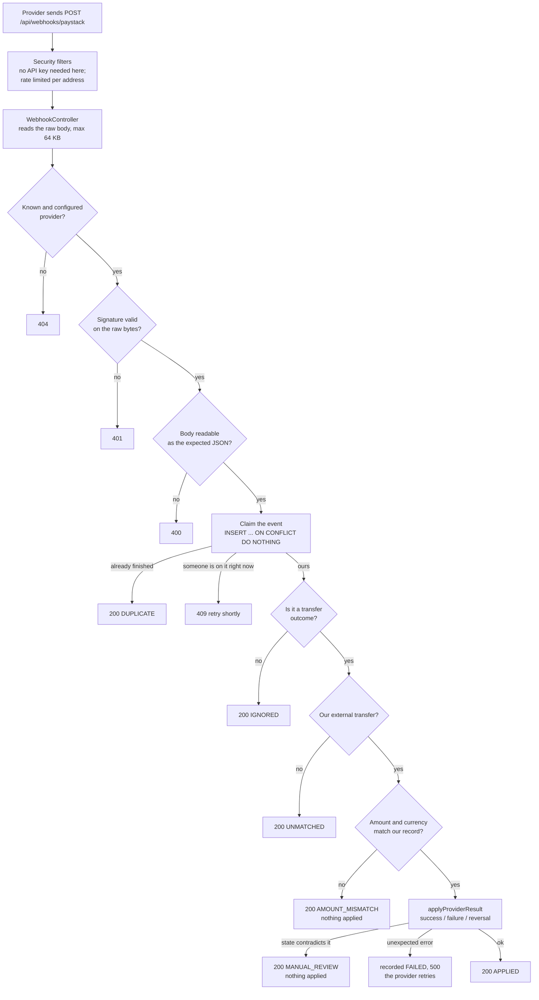

# Step 12 Guide: Webhooks (Paystack and Monnify compatible)

What was written in Step 12, **why**, **how it connects** to what already existed, and a **line-by-line analysis** of the code, with analogies.

> **Status (2026-10-14):** built and tested. **488 tests pass** (350 before, 138 new, including 36 new `MoneyTest` cases that closed the last open test debt). Every behaviour was also checked by hand against the real running application, sending real signed HTTP requests (signatures computed with `openssl`). Nothing is committed yet.
>
> **Read [section 8](#8-what-is-verified-and-what-is-not) before connecting a real provider.** The signature recipes and event names are well supported, but the exact JSON field names for each provider come from third-party guides and memory, and Monnify's own documentation contradicts itself about its signature recipe. The adapters are built so that fixing a field name is a one-line change.

**Contents**

1. [What Step 12 adds, in one page](#1-what-step-12-adds-in-one-page)
2. [The big picture: a recorded-delivery desk](#2-the-big-picture-a-recorded-delivery-desk)
3. [The journey of one webhook](#3-the-journey-of-one-webhook)
4. [Map of every new and changed file](#4-map-of-every-new-and-changed-file)
5. [Key ideas, defined](#5-key-ideas-defined)
6. [Line-by-line walkthrough](#6-line-by-line-walkthrough)
7. [How it fits the existing system](#7-how-it-fits-the-existing-system)
8. [What is verified and what is not](#8-what-is-verified-and-what-is-not)
9. [Tests: what each one proves](#9-tests-what-each-one-proves)
10. [How to use it (and demo it)](#10-how-to-use-it-and-demo-it)
11. [Adding another provider](#11-adding-another-provider)
12. [Honest limits](#12-honest-limits)
13. [Self-test questions](#13-self-test-questions)

---

## 1. What Step 12 adds, in one page

Until now PayBridge found out what became of an external transfer in two ways: the dispatcher's immediate answer, and the reconciler **asking** every few seconds. A webhook is the third way: **the provider tells us**, the moment it knows. It is faster, and it is the only way to learn that the bank **reversed a transfer after it had succeeded**.

| Feature | What it does | Why it exists |
|---|---|---|
| **`POST /api/webhooks/{provider}`** | One endpoint per provider (`paystack`, `monnify`) | Providers need a fixed address to call |
| **Signature check on the raw bytes** | The provider's signature is verified before a single field is read | Anyone on the internet can POST to this address; only the provider can sign |
| **A provider-neutral pipeline** | Verify, read, de-duplicate, cross-check, apply | Everything after the first step is identical for every provider |
| **Two thin adapters** | `PaystackWebhookProvider`, `MonnifyWebhookProvider` | Each provider's header names, signature recipe and JSON live in one small class |
| **De-duplication** | Table `webhook_event`, unique on (provider, event id) | Providers send the same event more than once |
| **Cross-checking** | The transfer must exist, be external, and the amount and currency must match our record | A payload is never trusted on its own |
| **Manual-review path** | A "success" for a transfer we already refunded is recorded, flagged and moves no money | The one case where the books and the bank genuinely disagree |
| **Retry safety** | A failed or abandoned delivery is retaken on the provider's next try | A crash cannot lose an event |
| **Open, but rate limited** | The address is public to providers, capped per caller address | Providers cannot send our API key |
| **Metrics and log lines** | `paybridge.webhooks{provider,result}` | You can see what is arriving |

Plus, in the same task: **`MoneyTest` gaps closed** (9 tests became 45).

---

## 2. The big picture: a recorded-delivery desk

Picture the bank branch again. External transfers are parcels sent out through a courier (the provider). The courier sometimes calls to say "your parcel was delivered / bounced / was returned".

| At the branch | In the code | Technical term |
|---|---|---|
| The **courier's wax seal** on every message, made with a secret only we and the courier know | the signature header | HMAC signature |
| The **desk clerk** who checks the seal before reading a word | `Provider.hasValidSignature` | Authenticity check |
| The **interpreter** who turns each courier's language into the branch's own words | `PaystackWebhookProvider`, `MonnifyWebhookProvider` | Adapter (strategy pattern) |
| The **delivery log** that records every call, so a repeated call is spotted | table `webhook_event` | Idempotency record |
| The **cross-check** against the branch's own parcel register | amount and currency comparison | Reconciliation / defence in depth |
| The **supervisor's tray** for calls that contradict the register | `MANUAL_REVIEW` / `AMOUNT_MISMATCH` | Manual review queue |
| The **shared counter** where the news is finally acted on | `ExternalTransferService.applyProviderResult` | The existing, idempotent "apply" |

The key design move: **the webhook does not invent a new way to change money.** It calls the same `applyProviderResult` that the dispatcher and reconciler already use, which was written to be safe to call twice. So a webhook and the reconciler racing each other can never double-pay or double-refund.

---

## 3. The journey of one webhook



**Why this order matters**

| Check | Must come before | Reason |
|---|---|---|
| Provider known | everything | An unknown address reveals nothing |
| Signature | reading the JSON | Never parse, log or trust a body whose origin is unproven |
| Claim (de-duplicate) | acting | The same event must act once, even when two copies arrive at the same instant |
| Cross-check | applying | Money moves only when the provider's claim agrees with our own books |

**Why almost everything answers 200.** An error status makes the provider send the message again, and again. A duplicate, an ignored event, an unknown reference and a flagged mismatch are all *final answers*, so they are acknowledged. Only "I could not process this, try again" (409, 500) invites a retry.

---

## 4. Map of every new and changed file

Paths are under `src/main/java/com/academy/paybridge/` unless stated. **Bold** = new.

| File | Layer | Job |
|---|---|---|
| **`resources/db/migration/V10__create_webhook_event.sql`** | database | The delivery log table |
| **`transfer/domain/WebhookStatus`** | domain | The states a delivery moves through |
| **`transfer/domain/WebhookEvent`** | domain | One row of the delivery log |
| **`transfer/repository/WebhookEventRepository`** | repository | The race-free claim, the lookup, the retake |
| **`transfer/client/Hmac`** | client | Signature maths; constant-time comparison |
| **`transfer/client/WebhookProvider`** | client | The interface every provider adapter implements |
| **`transfer/client/ProviderEvent`** | client | A webhook in PayBridge's own vocabulary |
| **`transfer/client/PaystackWebhookProvider`** | client | Paystack's header, recipe, events and JSON |
| **`transfer/client/MonnifyWebhookProvider`** | client | Monnify's header, recipes, events and JSON (amounts in naira) |
| **`transfer/client/MonnifySignatureScheme`** | client | The two recipes Monnify's docs describe |
| **`transfer/client/WebhookProperties`** | client | Secrets and limits from configuration |
| **`transfer/client/WebhookJson`** | client | Careful JSON reading helpers |
| **`transfer/client/MalformedWebhookException`** | client | "Signed, but not the JSON we expect" (400) |
| **`transfer/service/WebhookRecorder`** | service | The delivery-log bookkeeping, one short transaction per call |
| **`transfer/service/WebhookService`** | service | The pipeline in section 3 |
| `transfer/service/TransferConfig` | service | **Changed:** also registers `WebhookProperties` |
| **`transfer/web/WebhookController`** + **`WebhookAck`** | web | `POST /api/webhooks/{provider}` |
| `shared/exception/ErrorCode` | shared | **Changed:** `PAYLOAD_TOO_LARGE` (413) |
| `security/web/AccessPolicy` | security | **Changed:** a new kind of address, `SIGNED_WEBHOOK` |
| `security/web/ApiKeyAuthFilter` | security | **Changed:** lets `SIGNED_WEBHOOK` through without an API key |
| `security/web/RateLimitFilter` | security | **Changed:** rate limits webhooks per caller address |
| `security/service/SecurityProperties` | security | **Changed:** `webhooks-per-minute` (default 600) |
| `security/web/SecurityFilterConfig` | security | **Changed:** builds the webhook limiter |
| `resources/application.yml` | config | **Changed:** `paybridge.webhooks.*` |
| `src/test/resources/application-test.yml` | test config | **Changed:** fake test secrets |

No existing money code was changed. `ExternalTransferService` is untouched.

---

## 5. Key ideas, defined

| Term | Plain meaning | Analogy |
|---|---|---|
| **Webhook** | The provider calling *us* with news, instead of us asking | The courier ringing the doorbell |
| **HMAC-SHA512** | A signature made by mixing the message with a shared secret and scrambling it one way | A wax seal pressed with a stamp only two people own |
| **Raw body** | The request bytes exactly as they arrived | The sealed envelope, not a retyped copy |
| **Constant-time comparison** | Comparing without stopping at the first wrong character | Checking every digit of a lock code so the time taken reveals nothing |
| **Idempotent** | Doing it twice has the same effect as once | A light switch set to "on" |
| **Event id** | What makes one delivery recognisable when repeated | The tracking number on a parcel |
| **`INSERT ... ON CONFLICT DO NOTHING`** | Insert unless it already exists; say which happened | Writing a name in a visitors' book only if it is not already there |
| **Adapter / strategy pattern** | One interface, one small class per provider | A travel plug adapter |
| **Cross-check (defence in depth)** | Trusting two independent records, not one | Checking the courier's slip against your own order |
| **Manual review** | A case the software refuses to decide | Passing it up to a supervisor |
| **Acknowledge (2xx)** | Telling the sender "got it, stop resending" | Signing for the parcel |

---

## 6. Line-by-line walkthrough

### 6.1 `V10__create_webhook_event.sql`: the delivery log

```sql
CREATE TABLE webhook_event
(
    id             UUID                     NOT NULL,
    provider       VARCHAR(20)              NOT NULL,
    event_id       VARCHAR(200)             NOT NULL,
    event_type     VARCHAR(100)             NOT NULL,
    reference      VARCHAR(100),
    outcome        VARCHAR(20),
    amount_minor   BIGINT,
    status         VARCHAR(30)              NOT NULL,
    detail         VARCHAR(500),
    payload_sha256 VARCHAR(64)              NOT NULL,
    attempts       INTEGER                  NOT NULL,
    created_at     TIMESTAMP WITH TIME ZONE NOT NULL,
    updated_at     TIMESTAMP WITH TIME ZONE NOT NULL,

    CONSTRAINT pk_webhook_event PRIMARY KEY (id),
    CONSTRAINT uq_webhook_event UNIQUE (provider, event_id),
    CONSTRAINT ck_webhook_event_status CHECK (status IN (...))
);
CREATE INDEX idx_webhook_event_reference ON webhook_event (reference);
```

| Line | What it does | Why |
|---|---|---|
| `provider`, `event_id` | Who sent it, and its recognisable id | Together they identify one delivery |
| `event_type` | The provider's own name (`transfer.success`) | For the record and for debugging |
| `reference`, `outcome`, `amount_minor` (nullable) | What it said, for later investigation | Some events carry none of these |
| `status` | `RECEIVED`, `APPLIED`, `IGNORED`, `UNMATCHED`, `AMOUNT_MISMATCH`, `MANUAL_REVIEW`, `FAILED` | The state machine of a delivery |
| `detail` | A short sentence saying why (for the person reviewing) | "The provider says 999 kobo but the transfer is 200000 kobo" |
| `payload_sha256` | A fingerprint of the body | **The body itself is deliberately not stored**: it holds the recipient's name and account details |
| `attempts` | How many times it has been tried | A retaken event counts up |
| `UNIQUE (provider, event_id)` | The same event cannot be recorded twice | **This is the real guard against double-processing.** The database enforces it even if the code had a bug |
| `CHECK (status IN ...)` | Only the known states | A second line of defence |
| `INDEX ... (reference)` | Finds the deliveries for one transfer fast | Investigation |

### 6.2 `WebhookStatus` and `WebhookEvent`

`WebhookStatus` is an `enum`. `isFinal()` is `this != RECEIVED && this != FAILED`: a delivery in any other state is finished, so a repeat is ignored. `RECEIVED` (in progress) and `FAILED` (to be tried again) are the only two that can be picked up.

`WebhookEvent` is a JPA entity. Notes:
- `extends AuditableEntity` gives `created_at` / `updated_at` automatically.
- It has **no `@GeneratedValue`** and no public constructor: rows are created by the native insert in the repository, not by `save()`.
- Most columns are `updatable = false`: once recorded, who/what/when never changes. Only `status`, `detail` and `attempts` move.
- `finish(newStatus, why)` sets the state and shortens `why` to 500 characters so it always fits the column.

### 6.3 `WebhookEventRepository`: the race-free claim

```java
@Modifying(clearAutomatically = true)
@Query(value = """
        insert into webhook_event (...)
        values (gen_random_uuid(), :provider, :eventId, :eventType, cast(:reference as varchar),
                cast(:outcome as varchar), cast(:amountMinor as bigint), 'RECEIVED', :payloadSha256, 1, now(), now())
        on conflict (provider, event_id) do nothing
        """, nativeQuery = true)
int claim(...);
```

| Line | What it does |
|---|---|
| `@Modifying` | This query changes data (it is not a `select`) |
| `clearAutomatically = true` | Empties Hibernate's cache afterwards, because a native query bypasses it |
| `gen_random_uuid()`, `now()` | The database makes the id and timestamps (a native insert skips Hibernate's auditing) |
| `cast(:reference as varchar)` etc. | Postgres cannot guess the type of a bare `null` parameter; the cast says what it is |
| `'RECEIVED'`, `1` | A new row starts as "in progress", attempt 1 |
| `on conflict (provider, event_id) do nothing` | If this event is already recorded, do nothing |
| returns `int` | **1 = we inserted it (we own it); 0 = it was already there.** If two identical events arrive at the same instant, one waits for the other to commit, then gets 0. Exactly one caller ever gets 1 |

`retake(id, staleBefore)` is an `update ... where id = :id and (status = 'FAILED' or (status = 'RECEIVED' and updated_at < :staleBefore))`. It takes over an event for another attempt only if it **failed** last time, or was claimed so long ago that whoever had it must have crashed. Returns 1 if we now own it. Because the condition is inside the SQL, two callers cannot both retake it.

### 6.4 `Hmac`: the signature maths

| Method | What it does |
|---|---|
| `hmacSha512Hex(secret, message)` | `Mac.getInstance("HmacSHA512")`, keyed with the secret, over the message bytes; result as lower-case hex (128 characters). Checked against the official **RFC 4231** test vector |
| `sha512OfSecretThenMessageHex` | Plain SHA-512 of secret followed by message: the second recipe Monnify's prose describes |
| `sha256Hex` | A fingerprint, used for `payload_sha256` and as an event id fallback |
| `signatureMatches(expectedHex, presented)` | Compares in **constant time** |

`signatureMatches` step by step:
1. `null` on either side → `false`.
2. `trim()` the presented text (stray spaces).
3. If the length differs from the expected, or it contains a non-hex character → `false` (bad input is "no", never an exception).
4. Decode both to bytes and use `MessageDigest.isEqual`, which takes the same time however many bytes match. An ordinary `equals` stops at the first difference, and the time taken could leak how much of a guess was right.

### 6.5 `WebhookProvider`, `ProviderEvent`, `WebhookProperties`

- **`WebhookProvider`** (interface): `name()`, `isConfigured()`, `hasValidSignature(rawBody, header)` and `parse(rawBody)`. The header argument is a `Function<String,String>` so the interface does not depend on the web layer, and the unit tests can pass a plain lambda.
- **`ProviderEvent`** (record): `eventId`, `eventType`, `outcome` (a `GatewayOutcome` or `null`), `reference` (**our** reference), `providerReference`, `amountMinor`, `currency`, `message`. `isActionable()` is `outcome != null`. This is the translation point: both providers become the same shape.
- **`WebhookProperties`**: `maxBodyBytes` (default 65,536), `paystack.secretKey`, `monnify.secretKey`, `monnify.signatureScheme`. `@DefaultValue` makes every setting safe if missing: an empty secret means "provider switched off". The secrets come from the environment (`PAYSTACK_SECRET_KEY`, `MONNIFY_SECRET_KEY`), never a file.

### 6.6 `PaystackWebhookProvider`

| Line (quoted) | What it does |
|---|---|
| `static final String SIGNATURE_HEADER = "x-paystack-signature"` | Paystack puts its signature in this header |
| `Map.of("transfer.success", SUCCESS, "transfer.failed", FAILED, "transfer.reversed", REVERSED)` | Paystack's three transfer events → our `GatewayOutcome` |
| `isConfigured()` | The secret is non-blank |
| `hasValidSignature` | Not configured → `false`. Otherwise: HMAC-SHA512 of the raw body keyed with the secret, compared in constant time to the header |
| `parse`: `WebhookJson.parseObject(rawBody)` | Reads the JSON object; not JSON, or not an object → `MalformedWebhookException` |
| `String event = text(root, "event")`; `if (event == null) throw ...` | An event name is mandatory |
| `JsonNode data = root.path("data")` | The payload (missing is safe: `path` never returns `null`) |
| `eventId = dataId != null ? event + ":" + dataId : "sha256:" + hash` | The recognisable id is the event name plus Paystack's id for the transfer. Including the name matters: a transfer can legitimately have both `transfer.success` and a later `transfer.reversed`, and those must be treated as different events. With no id, a fingerprint of the body still recognises an exact repeat |
| `reference = text(data, "reference")` | **Our** reference: the one we gave Paystack when we asked it to send |
| `amountMinor = wholeNumber(data, "amount")` (only for actionable events) | Paystack amounts are whole kobo |
| `reason = firstNonBlank(complete_message, reason)` | The failure explanation, if any |
| `messageFor(...)` | A plain default sentence if the provider gave no reason, then `WebhookJson.clean` removes control characters and limits it to 200 characters |

### 6.7 `MonnifyWebhookProvider`

Same shape, with Monnify's vocabulary:
- Header `monnify-signature`; events `SUCCESSFUL_DISBURSEMENT`, `FAILED_DISBURSEMENT`, `REVERSED_DISBURSEMENT`; the body is `{"eventType": ..., "eventData": {...}}`.
- `hasValidSignature` chooses the recipe from `signatureScheme`: `HMAC_SHA512` (default) or `SHA512_SECRET_PREFIX`. **Why two?** Monnify's documentation describes the signature two different ways (see section 8). A one-line setting switches between them, so a mismatch found in the sandbox is a configuration change, not a code change.
- The event id is `eventType:transactionReference`.
- **Amounts are in naira with decimals.** `WebhookJson.nairaToKobo` converts them exactly with `BigDecimal`: `movePointRight(2)`, then `setScale(0, RoundingMode.UNNECESSARY)`, so `2000.50` → `200050` and `10.005` is **refused** instead of rounded. Floating point is never used for money.

### 6.8 `WebhookJson`: reading untrusted JSON carefully

Every method returns a clean value, returns `null`, or throws `MalformedWebhookException`; none ever returns something unchecked.

| Method | Behaviour |
|---|---|
| `parseObject` | Jackson 3 `readTree`; a `JacksonException` or a non-object becomes `MalformedWebhookException` |
| `text(node, field)` | Missing, `null`, an object/array, or blank → `null`; numbers come back as their text |
| `wholeNumber` | An integer, or a text of digits; a fraction or words → malformed |
| `nairaToKobo` | Exact decimal conversion (above); negative or more than two decimal places → malformed |
| `firstNonBlank` | The first usable value |
| `clean` | Replaces control characters, trims, caps at 200 characters (safe to store and log) |

### 6.9 `WebhookRecorder`: the bookkeeping, one short transaction per call

*Real line numbers.*

| Lines | What they do |
|---|---|
| 25-27 | `@Component @Transactional`: every method is its own transaction. Package-private: only the webhook service uses it |
| 30 | `STALE_AFTER = 2 minutes`: a claim older than this and never finished was abandoned by a crash |
| 32-40 | The repositories and the clock (injected so tests can control time) |
| 43-53 | `Claim(eventRowId, kind)` with three kinds: `OWNED` (yours), `DUPLICATE` (already handled), `IN_PROGRESS` (someone else is on it right now) |
| 56-57 | `TransferFacts`: the few facts about our transfer a webhook is checked against (amount, currency, type, status) |
| 63-77 | `claim`: **try the race-free insert (64-65)**, then read the row back (66-67). Inserted → `OWNED` (69-71). Already there and **final** → `DUPLICATE` (72-74). Otherwise it is in progress or failed: try to **retake** it (75); success → `OWNED`, failure → `IN_PROGRESS` (76) |
| 79-84 | `transferFacts`: read-only lookup of our transfer by reference |
| 87-89 | `finish`: record where the event ended up |

**Why a separate bean from `WebhookService`?** `applyProviderResult` runs in its own transaction; if it throws, *its* work rolls back. The record that "we received this and it failed" must **survive** that rollback, so it is written by this bean, in its own transactions, before and after.

### 6.10 `WebhookService`: the pipeline

*Real line numbers.*

| Lines | What they do |
|---|---|
| 48-49 | `@Service`, public class |
| 54-56 | `Result`: the outcomes handed back to the controller |
| 58-69 | Dependencies. The constructor turns the list of provider adapters into a map by name. **Adding a provider needs no change here**: any `WebhookProvider` bean is picked up |
| 76-83 | **Step 1, whose is it?** Lower-case the name; unknown or unconfigured → count it and answer `404`. The name came from the caller, so it is never used as a metric label (line 81) |
| 85-89 | **Step 2, is it genuine?** `hasValidSignature` on the raw bytes. No → count, log, `401`. Nothing has been read yet |
| 91-98 | **Step 3, can we read it?** `parse`. A signed but unreadable body → `400` |
| 100-112 | **Step 4, is it new?** `recorder.claim`. `DUPLICATE` → acknowledge. `IN_PROGRESS` → `409` ("send again shortly"). `OWNED` → carry on |
| 114-117 | **Step 5, do we act on it?** Not a transfer outcome (for example `charge.success`) → record `IGNORED` |
| 119-125 | **Step 6a, is it ours?** No reference, or no such transfer, or it is an *internal* transfer → record `UNMATCHED`. (An internal transfer's reference must never be touched by a webhook) |
| 127-131 | **Step 6b, does it agree?** `disagreement` compares the amount and currency; a difference → record `AMOUNT_MISMATCH` and **do not apply** |
| 133-148 | **Step 7, apply it** through the existing `applyProviderResult`. `INVALID_STATE` (for example a success for a transfer already refunded) → record `MANUAL_REVIEW`, move no money, answer 200. Any other failure → record `FAILED`, count it, **re-throw** so the answer is a `500` and the provider retries |
| 150-151 | Success → record `APPLIED` |
| 155-163 | `disagreement`: the amount (in kobo) and the currency, returning a sentence saying how they differ |
| 165-177 | `done`: counts the result and logs it: `ERROR` for mismatch and manual review (a person must look), `WARN` for unmatched, `INFO` otherwise |
| 179-181 | `count`: one meter, `paybridge.webhooks`, tagged by provider and result |
| 184-186 | `safe`: strips control characters from outside text before it reaches a log |

> **Analogy:** the clerk checks the seal, reads the message, looks in the log to see whether it was already dealt with, checks it against the parcel register, and only then hands it to the counter. Anything odd goes in the supervisor's tray with a note.

### 6.11 `WebhookController`

| Line (quoted) | What it does |
|---|---|
| `@RequestMapping("/api/webhooks")` + `@PostMapping("/{provider}")` | `POST /api/webhooks/paystack`, `/api/webhooks/monnify`, and so on |
| `HttpServletRequest request` (not `@RequestBody`) | We read the body ourselves, as raw bytes, so nothing re-formats it before the signature check |
| `readBody`: `getContentLengthLong() > maxBodyBytes` → reject | Refuse a declared-huge body without reading it |
| `in.readNBytes(maxBodyBytes + 1)` | Read **at most one byte past the limit**; a hostile caller cannot make us hold a giant body in memory. More than the limit → `413 PAYLOAD_TOO_LARGE` |
| `webhookService.handle(provider, rawBody, request::getHeader)` | Hand over the bytes and a header lookup (servlet header names are case-insensitive) |
| `return new WebhookAck(result.name())` | `{"result":"APPLIED"}` with `200`. Providers only read the status code; the text helps whoever is debugging |

### 6.12 The security changes

- **`AccessPolicy`** gains `SIGNED_WEBHOOK` for `/api/webhooks` and everything below it (the address is cleaned first, so `/api/webhooks/../admin/api-keys` is still `ADMIN`, and `/api/webhooksx` is not mistaken for it).
- **`ApiKeyAuthFilter`** lets `SIGNED_WEBHOOK` through without an API key: a provider cannot send ours. Its proof is the signature.
- **`RateLimitFilter`**: for a webhook address there is no API key to count against, so it rate limits by the **caller's address** with a separate limiter (`webhooks-per-minute`, default 600), answering `429` with `Retry-After` and counting `paybridge.ratelimit.rejections{limiter=webhooks}`. This bounds the work an attacker can force (each request costs one HMAC computation).
- **`SecurityProperties.RateLimit`** gains `webhooksPerMinute`; **`SecurityFilterConfig`** builds the limiter.

> **The open door is only as safe as its lock.** This address is deliberately reachable by anyone. What stops a forger is that nothing is read, and nothing is done, until the signature has been verified. That is why the signature check is step 2 and everything else follows it.

---

## 7. How it fits the existing system

```
 provider --POST--> WebhookController
                         |
                    WebhookService ---- WebhookRecorder ---- webhook_event table
                         |
                         v
        ExternalTransferService.applyProviderResult   <---- TransferDispatcher (immediate answer)
                         ^                              <---- TransferReconciler (asks every 5 s)
                         |
        the SAME door: idempotent, so all three can arrive in any order
```

| Existing part | How Step 12 uses it |
|---|---|
| `ExternalTransferService.applyProviderResult` | The only thing that changes a transfer. Unchanged |
| `GatewayOutcome` | The shared vocabulary both adapters translate into |
| `TransferRepository.findByReference` | The cross-check lookup |
| The ledger, holds, settlement, reversal | Reused as they are; the webhook only decides *which* of them to trigger |
| Security (Step 13) | The webhook address is the single exception to "every address needs an API key", with its own rate limit |
| Access log and request id | A webhook gets a request id and an access-log line like any other request (without a `client=`) |
| Metrics | New `paybridge.webhooks` meter |
| The fake bank | Unchanged. Payee ending `6666` stays "still processing" for ever, so only a webhook can finish it; `7777` pays at once and can be reversed afterwards **only** by a webhook. This is what makes the whole path demonstrable without any real provider |

**The three ways of learning an outcome can race, safely.** Suppose the reconciler and a webhook both report success within the same second. `applyProviderResult` locks the transfer row, and the second to arrive finds it already `SUCCESS` and does nothing. A *late* success after a refund is the one real disagreement, and it ends in `MANUAL_REVIEW`.

---

## 8. What is verified and what is not

| Item | Status |
|---|---|
| Paystack signature: HMAC-SHA512 of the raw body, keyed with the secret key, hex, in `x-paystack-signature` | **Consistent across every source found** |
| Paystack events `transfer.success`, `transfer.failed`, `transfer.reversed`; body `{"event", "data"}` | Consistent across sources |
| Paystack field names (`data.reference`, `data.amount` in kobo, `data.currency`, `data.id`, `data.transfer_code`, `data.reason` / `complete_message`) | **From third-party guides, not from a delivery to this application.** Compare with your first real test-mode delivery |
| Monnify header `monnify-signature`, events `SUCCESSFUL_DISBURSEMENT` / `FAILED_DISBURSEMENT` / `REVERSED_DISBURSEMENT`, body `{"eventType", "eventData"}` | Found in Monnify's documentation and docs index |
| **Monnify signature recipe** | **Monnify's own documentation contradicts itself**: the prose says SHA-512 of (secret + body), the sample code uses HMAC-SHA512. HMAC is the default; `paybridge.webhooks.monnify.signature-scheme=sha512-secret-prefix` switches. One third-party write-up also claims the **sandbox does not sign at all** (unconfirmed): if so, sandbox webhooks will be refused with `401` by design, because an unsigned webhook cannot be trusted |
| Monnify field names (`eventData.reference`, `transactionReference`, `amount` in **naira**, `currency`) | Only the success sample was found; failed and reversed payloads were not. Compare with real deliveries |
| Paystack source-IP allow-list | Not implemented (optional hardening, see section 12) |

**What the tests prove, and what they do not.** The fixtures were written from the understanding above, so the tests prove *PayBridge does what it intends with those payloads*, not that the providers send exactly those payloads. Closing that gap takes one real sandbox delivery per provider.

**If the first real delivery is refused or ignored**, work down this list:
1. `401`: the signature recipe or the secret is wrong (Monnify: try the other scheme; check you are using the right key for the right environment).
2. `200 IGNORED`: the event name is not one we map. The log shows the exact `eventType` received (never the body).
3. `200 UNMATCHED`: the field that carries our reference has a different name. Fix it in the adapter's `parse`.
4. `200 AMOUNT_MISMATCH`: check the unit (kobo vs naira) and the currency field.

---

## 9. Tests: what each one proves

**488 tests, all passing** (350 before this task; 138 new).

| Test class | Tests | Needs Docker? | What it proves |
|---|---|---|---|
| `MoneyTest` (extended) | 45 (+36) | No | `negate` (positive, negative, zero, twice, currency, plus its own negation is zero); the sign checks incl. extremes; equality and `hashCode`; `compareTo` ordering incl. overflow-safe extremes and sorting; currency mismatch on `subtract` and `compareTo` with both currencies named; immutability of originals, even after a failed operation; the factories |
| `HmacTest` | 12 | No | Matches the **RFC 4231** HMAC-SHA512 test vector; stable and secret/body sensitive; constant-time comparison accepts upper-case and spaces, refuses one wrong character, wrong length, non-hex and `null` |
| `PaystackWebhookProviderTest` | 20 | No | Signature accepted/refused (wrong, missing, wrong key, different body, re-formatted body); success, failure, reversal read; event ids; ignored events; malformed amounts, bodies, non-objects; clean, short messages |
| `MonnifyWebhookProviderTest` | 13 | No | Both signature recipes accepted only for their own recipe; naira → kobo exactly (`0.10`, `19.99`, `2000`, `"150.5"`); `10.005` and negatives refused; collection events not actionable |
| `WebhookRecorderTest` | 9 | Yes | Who owns an event; in-progress vs duplicate for every final state; a failed event is retaken (attempts 2); an abandoned one is retaken; the same id from another provider is separate; no body column exists; long detail shortened |
| `WebhookTest` | 37 | Yes | **Paystack:** success finishes a processing transfer (balances, settlement, fee, suspense exact); failure refunds amount and fee; **reversal after success** refunds everything; a repeat changes nothing; **20 simultaneous identical deliveries apply exactly once**; a forged, missing, other-body or other-provider signature is refused and leaves no record; pretty-printed JSON works when signed as sent; unknown provider is 404, name case-insensitive; unknown reference, an internal transfer's reference, a disagreeing amount or currency, a late success after refund (manual review), ignored events and a missing reference are each handled and recorded; signed garbage and non-objects are 400; an oversized body is 413 and one at the limit is read; GET is 405. **Monnify:** success (naira), failure, reversal, mismatch, repeats, wrong signature, cross-provider signature. Metrics are counted. **Through the real security filters:** a provider needs no API key; the open address opens nothing else (`/api/webhooks/../admin/api-keys`, look-alike `/api/webhooksx`); one address cannot flood it |
| `AccessPolicyTest` (+9) | 44 | No | `SIGNED_WEBHOOK` addresses, disguised forms (`//`, upper case, `%77`) and the `..` escapes to `ADMIN` |
| `ErrorCodeTest` (+1 row) | | No | `PAYLOAD_TOO_LARGE` maps to 413 |

Every test that moves money also runs the invariant **"all account balances still sum to zero"** afterwards.

Run them: `./mvnw test` (Docker Desktop running).

---

## 10. How to use it (and demo it)

### 10.1 Turn a provider on

A provider is **off until its secret is set**. Set it in the environment, then start the app:

```bash
export PAYSTACK_SECRET_KEY=<your Paystack secret key>     # sk_test_... in test mode
export MONNIFY_SECRET_KEY=<your Monnify client secret>
./mvnw spring-boot:run
```

Then, in the provider's dashboard, set the webhook URL to `https://<your-public-host>/api/webhooks/paystack` (or `/monnify`). Webhooks need a **public address**: for local work, expose the app with a tunnel such as ngrok (`ngrok http 8080`) and use the address it prints.

### 10.2 Demo it with no provider at all

You can play the provider yourself. The fake bank's payee ending `6666` stays "processing" for ever; `7777` pays at once.

```bash
BASE=http://localhost:8080; H='Content-Type: application/json'
# 1. create a customer, an account, fund it (admin key), save a payee ending 6666, send an external transfer
#    (see README step 3 and the demo commands); note the transfer's "reference" (it starts "pb-")
REF=pb-....

# 2. build the webhook body and sign it exactly as Paystack would
BODY='{"event":"transfer.success","data":{"id":12345,"reference":"'$REF'","amount":200000,"currency":"NGN","transfer_code":"TRF_demo"}}'
SIG=$(printf '%s' "$BODY" | openssl dgst -sha512 -hmac "$PAYSTACK_SECRET_KEY" -hex | awk '{print $NF}')

# 3. deliver it (note: no API key)
curl -s -X POST $BASE/api/webhooks/paystack -H "$H" -H "x-paystack-signature: $SIG" --data-binary "$BODY"
# {"result":"APPLIED"}     run it again: {"result":"DUPLICATE"}
```

Try the others: change a character of `$SIG` (→ `401`); change `amount` to `999` and re-sign (→ `AMOUNT_MISMATCH`); use `"event":"transfer.reversed"` on a `7777` transfer (→ `APPLIED`, the customer has everything back). **`printf '%s'`, not `echo`**, so no extra newline changes the bytes that are signed.

For Monnify: header `monnify-signature`, body `{"eventType":"SUCCESSFUL_DISBURSEMENT","eventData":{"reference":"'$REF'","transactionReference":"MFDS|1","amount":2000.00,"currency":"NGN"}}`, signed with `MONNIFY_SECRET_KEY` the same way.

### 10.3 Look at the record

```bash
docker exec <database-container> psql -U paybridge -d paybridge \
  -c "select provider, event_type, status, left(coalesce(detail,''),50) detail, attempts from webhook_event order by created_at"
```

Anything in `AMOUNT_MISMATCH` or `MANUAL_REVIEW` needs a person. Metrics (admin key): `/actuator/metrics/paybridge.webhooks`, tagged by `provider` and `result`.

### 10.4 What a webhook looks like in the log

```
INFO  [9774b54a-...] WebhookService : Webhook paystack transfer.success for pb-8ee8... -> APPLIED
INFO  [68373c2f-...] WebhookService : Webhook paystack transfer.success for pb-8ee8... -> DUPLICATE
WARN  [636c5d09-...] WebhookService : Webhook from 'paystack' refused: the signature is missing or wrong
ERROR [ebd17a7e-...] WebhookService : Webhook paystack transfer.success for pb-e8ef... -> AMOUNT_MISMATCH (a person must look at this)
```

Secrets, signatures and bodies never appear in the log.

---

## 11. Adding another provider

1. Write a class that implements `WebhookProvider` in `transfer/client` (header name, signature recipe, `parse`), and mark it `@Component`.
2. Add its secret to `WebhookProperties` and `application.yml` (from an environment variable).
3. Add fixtures and a unit test like `PaystackWebhookProviderTest`.

That is all. `WebhookService` collects every `WebhookProvider` bean by name, so the address `/api/webhooks/<name>` exists automatically, and the pipeline (signature first, de-duplication, cross-check, manual review) is inherited.

---

## 12. Honest limits

| Limit | Detail |
|---|---|
| **Provider payloads not verified against live deliveries** | See section 8. The first real delivery per provider is the real test |
| **No source-IP allow-list** | Paystack publishes the addresses its webhooks come from. Restricting to them is extra protection, but needs the app to see real client addresses (behind a proxy, `forward-headers-strategy` matters, and that is not yet tested behind a real proxy) |
| **The rate limit is per address, in memory** | Right for one running copy. Many providers behind one proxy address share a bucket unless forwarded addresses are right |
| **A 409 invites a retry** | If a delivery is claimed and its owner is still working (or crashed), a second copy gets `409` until the claim is 2 minutes old, then takes over. Providers retry, so this resolves itself |
| **Only transfer outcomes** | Pay-ins (collections), refunds and other event types are recorded as `IGNORED`. A future inbound-remittance feature would add adapters for them |
| **Retention** | `webhook_event` grows without limit. A clean-up job (delete finished rows after, say, 90 days) is not written |
| **No admin view of flagged events** | `MANUAL_REVIEW` and `AMOUNT_MISMATCH` rows are found with SQL and the `ERROR` log lines. A small admin endpoint to list them would be a natural next step |
| **The Monnify sandbox may not sign** | If confirmed, sandbox webhooks cannot be accepted safely; use the reconciler there |

---

## 13. Self-test questions

1. **Why is the signature checked before the JSON is read?**
   *Because anyone can POST to this address. Until the signature proves the sender knows the secret, no field of the body can be trusted, so none is read, logged or acted on.*
2. **Why must the signature be checked on the raw bytes?**
   *The signature is computed over the exact bytes sent. Parsing the JSON and writing it out again can change a byte (spacing, key order), and then no signature would ever match. A test proves a re-formatted body is refused and a pretty-printed one signed as sent is accepted.*
3. **Why compare signatures in constant time?**
   *A normal comparison stops at the first wrong character, and how long it took could leak how much of a forged guess was right.*
4. **Two identical webhooks arrive at the same instant. How is double-processing prevented?**
   *Both try `INSERT ... ON CONFLICT DO NOTHING` on a table with a unique (provider, event id). One waits for the other, then gets 0 rows inserted. Only the caller that inserted owns the event; the other is told "duplicate" or "in progress".*
5. **Why does almost every outcome answer 200?**
   *A non-2xx status makes the provider resend. Duplicates, ignored events, unknown references and flagged mismatches are final answers; resending them would change nothing.*
6. **Why is the amount cross-checked when the signature already proves the sender?**
   *Defence in depth. A signed message can still be wrong (a bug, a replay for a different transfer, a unit mix-up such as naira versus kobo). Money moves only when the provider's claim agrees with our own record.*
7. **A success webhook arrives for a transfer we already refunded. What happens, and why?**
   *`applyProviderResult` refuses (invalid state), the event is recorded as `MANUAL_REVIEW`, no money moves, and the answer is 200. The books and the bank genuinely disagree, and only a person can decide.*
8. **Why is the delivery record written by a separate bean?**
   *The apply step runs in its own transaction and rolls back on failure. The record that the event arrived and failed must survive that rollback, so it is written in its own transactions.*
9. **Why can this endpoint be open to the internet without an API key?**
   *Its protection is the provider's signature, checked first, plus a per-address rate limit so a flood cannot force unlimited work. The rest of the API still needs a key, and a test shows the open address opens nothing else.*
10. **Why does Monnify have a setting for its signature recipe?**
    *Monnify's documentation describes the signature two different ways. Rather than guess, the recipe is a configuration value, so a mismatch found in the sandbox is fixed without changing code.*
11. **How does the "reversal after success" case get demonstrated without a real provider?**
    *The fake bank pays payees ending `7777` immediately, so the transfer reaches `SUCCESS`. You then deliver a correctly signed `transfer.reversed` webhook yourself; the transfer becomes `REVERSED` and the customer has everything back.*
12. **What would you do to support a third provider?**
    *Implement `WebhookProvider` (header, recipe, parse), add its secret to the properties, and add tests. The pipeline needs no change.*
