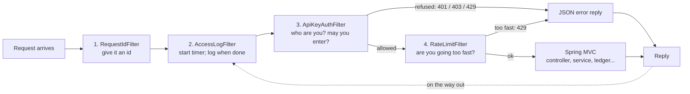

# Step 13 Guide: Security, Rate Limiting and Observability

What was written in Step 13, **why** it was written, **how it connects** to the rest of PayBridge, and a **line-by-line analysis** of the code, with analogies.

> **Status (2026-10-14):** all code is written, **350 tests pass** (217 before this step, 133 new), and every behaviour was also checked by hand against the real running application (real HTTP, a real database) on a spare port. Nothing in this step has been committed or pushed yet.

**Contents**

1. [What Step 13 adds, in one page](#1-what-step-13-adds-in-one-page)
2. [The big picture: a bank branch](#2-the-big-picture-a-bank-branch)
3. [The journey of one request](#3-the-journey-of-one-request)
4. [Map of every new and changed file](#4-map-of-every-new-and-changed-file)
5. [Key ideas, defined](#5-key-ideas-defined)
6. [Line-by-line walkthrough](#6-line-by-line-walkthrough)
7. [End-to-end traces](#7-end-to-end-traces)
8. [Problems found while building, and how they were solved](#8-problems-found-while-building-and-how-they-were-solved)
9. [Tests: what each one proves](#9-tests-what-each-one-proves)
10. [How to use it](#10-how-to-use-it)
11. [Honest limits](#11-honest-limits)
12. [Self-test questions](#12-self-test-questions)

---

## 1. What Step 13 adds, in one page

Before this step, **anyone who could reach PayBridge could create customers, move money, and use an endpoint that creates money out of nothing** (`/api/dev/.../fund`). Step 13 closes that, and adds the operating tools a real service needs.

| Feature | What it does | Why it exists |
|---|---|---|
| **API-key authentication** | Every request (except health checks) must carry an `X-API-Key` header with a valid key | Only known callers may use the API |
| **Keys stored as hashes** | The database holds a SHA-256 fingerprint of each key, never the key | A stolen copy of the database cannot be used to call the API |
| **Roles** (`CLIENT`, `ADMIN`) | Admin keys manage keys, use the dev funding endpoint and read metrics; client keys use the business endpoints | Least privilege: most callers must not be able to mint money or create keys |
| **Key management endpoints** | `POST/GET/DELETE /api/admin/api-keys` | Create, list and revoke keys without touching the database by hand |
| **Bootstrap admin key** | The first admin key comes from an environment variable | Solves "you need an admin key to create keys, but have no keys yet" |
| **Rate limiting** | Each key gets a request budget; transfers get a tighter one | One caller (or a bug) cannot flood the service or hammer the money endpoints |
| **Guess protection** | An address that presents too many invalid keys is blocked | Makes guessing keys pointless |
| **Caller in the access log** | Each log line says which key made the request | An audit trail: who did what |
| **Request id on background threads** | Alert log lines now carry the id of the request that caused them | You can follow one action through the whole system |
| **Job ids for timers** | Dispatcher and reconciler runs get tagged ids such as `dispatcher-30d7157c` | Timer log lines are no longer anonymous |
| **Metrics** | Counters for transfer outcomes, security rejections and rate-limit rejections, at `/actuator/metrics` (admin only) | You can see how the service is behaving |

---

## 2. The big picture: a bank branch

Think of PayBridge as a bank branch.

| In the branch | In the code | Technical term |
|---|---|---|
| The **doorman** at the entrance, checking every visitor's pass | `ApiKeyAuthFilter` | Authentication filter |
| The **rulebook** on the wall: "lobby open to all, tellers' area needs a staff pass, vault needs a manager's pass" | `AccessPolicy` | Authorisation rules |
| The **pass register**, holding a *fingerprint* of each pass but not the pass itself | table `api_key` | Hashed credential store |
| The **queue marshal** who stops one person making endless requests at the counter | `RateLimitFilter` + `RateLimiter` | Rate limiting (token bucket) |
| The **visitors' book**, recording who came, where they went and how long they stayed | `AccessLogFilter` | Access log |
| The **name tag** that stays on a staff member as they go from room to room, so a complaint can be traced | request id carried by `RequestIdThreadLocalAccessor` | Correlation id / context propagation |
| The **tally counter** at the door clicking each time something happens | `TransferMetrics`, the `paybridge.*` counters | Metrics |
| The **manager's master pass**, handed over by the owner when the branch first opens | the bootstrap admin key | Bootstrap credential |

The doorman works in front of the whole branch. The counter staff (the controllers and services you built in Steps 3 to 10) are **not changed at all**; they just no longer see anyone the doorman refused. That is the point of using a *filter*: security wraps the application instead of being tangled through it.

---

## 3. The journey of one request

Every HTTP request now passes through four filters, in this order, before it reaches a controller:



**Why this order matters**

| Step | Must come before | Reason |
|---|---|---|
| Request id first | everything | Even a refusal needs an id to put in its reply and in the log |
| Access log second | the security filters | It wraps them, so **refused requests are logged too** (a 401 shows up in the log) |
| Authentication third | rate limiting | You must know *who* is calling before you can limit *them* |
| Rate limit fourth | the controllers | A rejected request costs almost nothing; it never reaches the database |

The order numbers are set in code with `Ordered.HIGHEST_PRECEDENCE`, `+1`, `+2`, `+3`. A test (`SecurityFilterRegistrationTest`) checks them.

---

## 4. Map of every new and changed file

Paths are under `src/main/java/com/academy/paybridge/` unless stated. **Bold** = new.

| File | Layer | Job | Used by |
|---|---|---|---|
| **`resources/db/migration/V9__create_api_key.sql`** | database | Creates the `api_key` table | Flyway at startup |
| `shared/exception/ErrorCode.java` | shared | Added `UNAUTHORIZED` (401), `FORBIDDEN` (403), `RATE_LIMITED` (429) | the security filters, `ProblemJson` |
| **`security/domain/ApiKeyRole.java`** | domain | `CLIENT` or `ADMIN` | `ApiKey`, the filters |
| **`security/domain/ApiKey.java`** | domain | The database record for one key (hash, never the key) | `ApiKeyRepository`, `ApiKeyService` |
| **`security/repository/ApiKeyRepository.java`** | repository | Looks keys up by hash | `ApiKeyService` |
| **`security/service/ApiKeyHasher.java`** | service | SHA-256 | `ApiKeyService` |
| **`security/service/ApiKeyService.java`** | service | Create / check / revoke / list keys | the filters, the admin controller, the bootstrap |
| **`security/service/AuthenticatedClient.java`** | service | "Who is calling" (id, name, role) | filters, access log |
| **`security/service/ApiKeyView.java`**, **`CreatedApiKey.java`** | service | Safe-to-show views of a key | the admin controller |
| **`security/service/SecurityProperties.java`**, **`SecurityConfig.java`** | service | Reads `paybridge.security.*` from `application.yml` | the filters, the bootstrap |
| **`security/service/AdminKeyBootstrap.java`** | service | Registers the first admin key at startup | Spring (it is an `ApplicationRunner`) |
| **`security/service/RateLimiter.java`** | service | Token-bucket limiter | `ApiKeyAuthFilter`, `RateLimitFilter` |
| **`security/web/AccessPolicy.java`** | web | Which address needs which kind of key | `ApiKeyAuthFilter`, `RateLimitFilter` |
| **`security/web/ProblemJson.java`** | web | Writes the standard JSON error from inside a filter | both security filters |
| **`security/web/ApiKeyAuthFilter.java`** | web | The doorman | the web server |
| **`security/web/RateLimitFilter.java`** | web | The queue marshal | the web server |
| **`security/web/SecurityFilterConfig.java`** | web | Registers both filters, in order | Spring |
| **`security/web/ApiKeyAdminController.java`** + 3 DTO records | web | `/api/admin/api-keys` endpoints | admin callers |
| `shared/config/AccessLogFilter.java` | shared | **Changed:** names the caller on each line | the web server |
| **`shared/logging/RequestIdThreadLocalAccessor.java`** | shared | Carries the request id to background threads | Spring's executor, via Micrometer |
| **`resources/META-INF/services/io.micrometer.context.ThreadLocalAccessor`** | resource | Registers that accessor | Java `ServiceLoader` |
| **`shared/logging/JobCorrelation.java`** | shared | Gives a timer run its own id | `DispatcherSchedule`, `ReconcilerSchedule` |
| `transfer/service/TransferSchedules.java` | transfer | **Changed:** wraps each timer run in `JobCorrelation` | Spring's scheduler |
| **`transfer/service/TransferMetrics.java`** | transfer | Counts committed transfer outcomes | Spring events |
| `resources/application.yml` | config | **Changed:** `paybridge.security`, metrics exposure, forwarded headers | everything |
| `pom.xml` | build | **Changed:** added `io.micrometer:context-propagation` | the build |

**The new `security` module** depends only on `shared`. Nothing depends on `security`. So it respects the module rule (Spring Modulith's `ModularityTests` still passes), and it can be changed or removed without touching the money code.

---

## 5. Key ideas, defined

| Term | Plain meaning | Analogy |
|---|---|---|
| **Authentication** | Proving *who you are* | Showing your staff pass |
| **Authorisation** | Deciding *what you may do* | The pass opens the tellers' area but not the vault |
| **API key** | A long secret string sent with each request | A pass number |
| **Hash** | A one-way scramble: easy to compute, impossible to reverse | A fingerprint: you can compare, but cannot rebuild the finger |
| **SHA-256** | The scrambling method used here | The specific fingerprint scanner |
| **Salt / slow hash (bcrypt)** | Extra defences needed for *human-chosen* passwords | Not needed here: our keys are 256 bits of pure randomness, so there is nothing to guess |
| **Servlet filter** | Code that every web request passes through before and after the controller | A security gate everyone walks through |
| **Filter chain / order** | Several filters in a fixed sequence | A row of gates |
| **`FilterRegistrationBean`** | The way to install a filter with an explicit order | Hiring the gatekeeper and assigning the gate number |
| **Rate limiting** | Capping how fast a caller may make requests | A queue marshal |
| **Token bucket** | A bucket holding N tokens; each request takes one; tokens drip back steadily | A bucket of tickets with a tap slowly refilling it |
| **Brute force** | Trying many keys hoping one works | Trying every combination on a padlock |
| **HTTP 401 / 403 / 429** | Not identified / identified but not allowed / too many requests | "Who are you?" / "Not for you" / "Slow down" |
| **MDC** | A per-thread notepad the logging system reads when writing a line | A sticky note on each worker's desk |
| **Context propagation** | Copying that notepad to another thread when work is handed over | Handing a colleague the file *and* the name tag |
| **`ApplicationRunner`** | Code that runs once, just after the application starts | A morning checklist |
| **Bootstrap** | Setting up the very first item that everything else depends on | The owner hands the manager the first master key |
| **Metric / counter** | A number the program keeps, such as "transfers completed" | A tally counter |

---

## 6. Line-by-line walkthrough

Line numbers refer to the files as they are now. For the larger files they are the real line numbers; for small files each numbered point quotes the line.

### 6.1 `V9__create_api_key.sql`: the pass register

```sql
CREATE TABLE api_key
(
    id         UUID                     NOT NULL,
    name       VARCHAR(100)             NOT NULL,
    key_prefix VARCHAR(12)              NOT NULL,
    key_hash   VARCHAR(64)              NOT NULL,
    role       VARCHAR(20)              NOT NULL,
    revoked_at TIMESTAMP WITH TIME ZONE,
    created_at TIMESTAMP WITH TIME ZONE NOT NULL,
    updated_at TIMESTAMP WITH TIME ZONE NOT NULL,

    CONSTRAINT pk_api_key PRIMARY KEY (id),
    CONSTRAINT uq_api_key_hash UNIQUE (key_hash),
    CONSTRAINT ck_api_key_role CHECK (role IN ('CLIENT', 'ADMIN'))
);
```

| Line | What it does | Why |
|---|---|---|
| `CREATE TABLE api_key` | A new table, one row per key | Flyway applies this as migration **9**; migrations are never edited once applied |
| `id UUID` | The key's identity | A UUID cannot be guessed or counted, like every other id in PayBridge |
| `name VARCHAR(100)` | A label such as "mobile-app" | So humans can tell keys apart, and so the access log can say who called |
| `key_prefix VARCHAR(12)` | The first few characters of the key | Shown in lists, so you can recognise a key without being able to use it |
| `key_hash VARCHAR(64)` | The SHA-256 hash, as 64 hex characters | **The only thing that identifies the key.** `VARCHAR`, not `CHAR`, because Hibernate's schema check expects `VARCHAR` for a Java `String` |
| `role VARCHAR(20)` | `CLIENT` or `ADMIN` | What the key may do |
| `revoked_at ... ` (nullable) | When the key was switched off; empty means still active | Revoking is a *date*, not a delete, so history is kept |
| `created_at`, `updated_at` | Audit stamps | Filled in automatically by `AuditableEntity` |
| `uq_api_key_hash UNIQUE` | No two rows may share a hash | Also makes the lookup by hash fast (a unique constraint creates an index) |
| `ck_api_key_role CHECK` | Only the two known roles | The database refuses a bad role even if the code had a bug (same "second line of defence" idea as `ck_account_customer_not_negative`) |

> **Analogy:** the pass register lists, for each pass, a fingerprint of the pass number, the holder's name, their level and whether it has been cancelled. A thief who steals the register cannot make a pass from a fingerprint.

### 6.2 `ErrorCode.java`: three new words for the error vocabulary

```java
UNAUTHORIZED(HttpStatus.UNAUTHORIZED),
FORBIDDEN(HttpStatus.FORBIDDEN),
RATE_LIMITED(HttpStatus.TOO_MANY_REQUESTS),
```

| Line | Meaning |
|---|---|
| `UNAUTHORIZED` → 401 | "I don't know who you are": no key, or an invalid one. (The HTTP name is historical; it really means *unauthenticated*.) |
| `FORBIDDEN` → 403 | "I know who you are, and the answer is no": a client key on an admin address |
| `RATE_LIMITED` → 429 | "Too many requests": over a rate limit, or an address blocked for guessing |

Every error in PayBridge has a stable `code` that programs can rely on. The existing `ErrorCodeTest` checks that every code maps to an error status; three rows were added for the new codes.

### 6.3 `ApiKeyRole.java` and `ApiKey.java`: the record of one key

**`ApiKeyRole`** is an `enum` with two values, `CLIENT` and `ADMIN`. An enum means a role can only ever be one of these two; nothing else compiles.

**`ApiKey`** (a JPA *entity*: Java class mapped to the table above):

| Line (quoted) | What it does |
|---|---|
| `@Entity @Table(name = "api_key")` | This class is the `api_key` table |
| `extends AuditableEntity` | Inherits `createdAt` / `updatedAt`, stamped automatically (the same mechanism as `Customer`) |
| `@Id @GeneratedValue(strategy = GenerationType.UUID) private UUID id;` | The primary key; Hibernate generates a random UUID |
| `private String name; private String keyPrefix; private String keyHash;` | The label, the visible start, and the fingerprint |
| `@Enumerated(EnumType.STRING) private ApiKeyRole role;` | Stored as the *word* `ADMIN`, not a number, so it stays readable and safe if the enum is reordered |
| `private Instant revokedAt;` | `null` = active |
| `protected ApiKey() {}` | JPA needs a no-argument constructor; `protected` stops other code using it |
| `public ApiKey(name, keyPrefix, keyHash, role)` | The only way application code creates one. There is **no parameter for the plain key**: the class cannot hold it |
| `isActive()` → `revokedAt == null` | Active unless revoked |
| `revoke(Instant when)` → `if (revokedAt == null) revokedAt = when;` | Revoking twice changes nothing (**idempotent**, like everything else in PayBridge) |
| `equals` / `hashCode` | Two records are the same if they have the same id (the same pattern as `Customer`) |

> **Design point:** "no field for the plain key" is a safety feature. You cannot accidentally log, serialise or save a secret that the class has no room for.

### 6.4 `ApiKeyRepository.java`: asking the database

```java
Optional<ApiKey> findByKeyHash(String keyHash);
boolean existsByKeyHash(String keyHash);
boolean existsByRoleAndRevokedAtIsNull(ApiKeyRole role);
List<ApiKey> findAllByOrderByCreatedAtDesc();
```

Spring Data builds the SQL from the method names ("derived queries"):
- `findByKeyHash` → `... WHERE key_hash = ?`. **The core of authentication.** `Optional` forces the caller to handle "no such key".
- `existsByKeyHash` → "is this hash already registered?" (used by the bootstrap).
- `existsByRoleAndRevokedAtIsNull(role)` → "is there an *active* admin key?" (`...IsNull` on `revokedAt`).
- `findAllByOrderByCreatedAtDesc` → the key list, newest first.

### 6.5 `ApiKeyHasher.java`: the fingerprint scanner

| Line (quoted) | What it does |
|---|---|
| `public final class ApiKeyHasher` / `private ApiKeyHasher() {}` | A utility class: no instances, nothing to override |
| `MessageDigest.getInstance("SHA-256")` | Asks Java for the SHA-256 algorithm |
| `digest.digest(value.getBytes(StandardCharsets.UTF_8))` | Turns the key to bytes (always UTF-8, so the result is the same on any machine) and hashes them |
| `HexFormat.of().formatHex(...)` | Writes the 32 result bytes as 64 hex characters, matching the `VARCHAR(64)` column |
| `catch (NoSuchAlgorithmException e) { throw new IllegalStateException(...) }` | Every Java platform must support SHA-256, so this "cannot happen"; if it ever did, it is a broken installation, not a user error |

> **Why a fast hash is correct here.** Slow hashes (bcrypt) protect *passwords people invent*, which are guessable, by making each guess expensive. Our keys are 32 random bytes: there are 2²⁵⁶ of them. Nobody can guess one, however fast the hash. A fast hash keeps every request cheap.

### 6.6 The small value types

| Type | Fields | Why it exists |
|---|---|---|
| `AuthenticatedClient(UUID keyId, String name, ApiKeyRole role)` | who is calling | Passed from the doorman to the queue marshal. **Never holds the key.** `isAdmin()` asks "is this role ADMIN?" |
| `ApiKeyView(id, name, prefix, role, active, createdAt, revokedAt)` | what may be *shown* about a key | There is simply no field for the key or its hash, so a listing cannot leak them. `from(ApiKey)` copies the safe fields |
| `CreatedApiKey(ApiKeyView key, String plaintext)` | the details **plus** the one-time plain key | The only moment the key exists readably. Returned by `create`, and then it is gone |

Each is a Java `record`: an immutable bundle of values with a constructor, accessors, `equals` and `toString` written for you. (`ApiKeyView.toString()` therefore cannot print a secret.)

### 6.7 `SecurityProperties.java` and `SecurityConfig.java`: the settings

```java
@ConfigurationProperties(prefix = "paybridge.security")
public record SecurityProperties(
        @DefaultValue("true") boolean enabled,
        @DefaultValue("") String bootstrapAdminKey,
        @DefaultValue RateLimit rateLimit) {

    public record RateLimit(
            @DefaultValue("120") int requestsPerMinute,
            @DefaultValue("30") int transfersPerMinute,
            @DefaultValue("10") int failedAuthPerMinute) { }
}
```

| Line | What it does |
|---|---|
| `@ConfigurationProperties(prefix = "paybridge.security")` | Fills this record from the `paybridge.security.*` section of `application.yml` |
| `@DefaultValue("true") boolean enabled` | **Secure by default:** if the setting is missing, security is ON |
| `@DefaultValue("") String bootstrapAdminKey` | Empty means "no bootstrap key" |
| `@DefaultValue RateLimit rateLimit` | If the `rate-limit` block is missing, build one from its own defaults |
| `requestsPerMinute` 120, `transfersPerMinute` 30, `failedAuthPerMinute` 10 | The three budgets (see 6.9) |

`SecurityConfig` is three lines: `@Configuration @EnableConfigurationProperties(SecurityProperties.class)`. It is the switch that tells Spring "build and register this properties record", the same pattern as `TransferConfig` and `ComplianceConfig`.

> **Property names:** `requestsPerMinute` in Java is written `requests-per-minute` in YAML. Spring matches them ("relaxed binding").

### 6.8 `ApiKeyService.java`: the pass office

*Real line numbers.*

| Lines | What they do |
|---|---|
| 24-26 | `@Service` makes it a Spring bean. `@Transactional` on the class: every public method runs in a database transaction (default read-write) |
| 29 | `KEY_FORMAT = ^[A-Za-z0-9_-]{20,200}$`: what a key *looks like*: 20 to 200 letters, digits, `_` or `-` |
| 31-33 | `KEY_PREFIX = "pb_"`; show the first 11 characters of generated keys; the fixed label `(operator)` for operator-chosen keys |
| 35-37 | The repository, the `Clock`, and a `SecureRandom` (a cryptographically strong random generator; the ordinary `Random` must **never** be used for secrets) |
| 39-42 | Constructor injection of the repository and clock |
| 45-49 | `create`: generate a key, build a record (hash only), save it, and return the view **plus the plaintext**. The plaintext is returned and never stored |
| 56-63 | `ensureKey` (for the bootstrap key): if the hash is already registered, do nothing and return `false` (so restarts are harmless). Otherwise save it with the fixed prefix `(operator)` and return `true` |
| 60 | Comment: an operator-chosen key is not random, so none of its characters are ever shown |
| 66 | `@Transactional(readOnly = true)`: a read-only transaction is cheaper; the database knows nothing will change |
| 67-70 | `authenticate`: if the text is `null` or **does not look like a key**, return "nobody" *without touching the database* (a cheap guard against junk and against SQL-injection-looking text) |
| 71-73 | The core: hash what was presented → look up the hash → keep it only if still active (`filter(ApiKey::isActive)`) → turn it into an `AuthenticatedClient`. Unknown and revoked keys both yield `Optional.empty()`, so the caller cannot tell the difference |
| 77-82 | `revoke`: load the key (or throw "API key not found" → 404), mark it revoked with the current time, return the view. Because `ApiKey.revoke` ignores a second call, repeating is safe |
| 85-87 | `list`: all keys newest first, each converted to a safe `ApiKeyView` |
| 90-92 | `hasActiveAdminKey`: used at startup to warn if nobody can administer the system |
| 95-97 | `hasValidShape`: a public static helper to test whether text looks like a key (used to refuse a weak bootstrap key) |
| 99-102 | `newRecord`: take the first 11 characters as the visible prefix, hash the whole key, build the entity |
| 104-108 | `generateKey`: 32 random bytes → URL-safe Base64 without padding (43 characters) → prefixed with `pb_`. Result: 46 characters, 256 bits of randomness |

> **Analogy:** the pass office prints a new pass with a long random number, hands it to the holder, writes only the fingerprint in its register, and shreds its copy. To check a pass later it takes the fingerprint of whatever is presented and looks it up.

### 6.9 `RateLimiter.java`: the bucket of tickets

*Real line numbers.*

| Lines | What they do |
|---|---|
| 17 | `public final class RateLimiter`: `final` so it cannot be subclassed and weakened |
| 20-22 | `Decision(boolean allowed, long retryAfterSeconds)`: the answer, as a record. `ALLOWED` is one shared "yes" |
| 24-25 | If more than 10,000 callers are tracked, forget those idle for over two minutes (so memory cannot grow without bound) |
| 27-29 | The limit, the clock (injected so tests can move time without waiting), and a `ConcurrentHashMap` of buckets: **thread-safe**, because many requests arrive at once |
| 31-37 | Constructor: refuses a limit below 1 |
| 40-44 | `tryAcquire(key)`: find (or create, full) the caller's bucket and **take one token** |
| 47-50 | `peek(key)`: **look without taking**. A caller with no bucket yet is allowed |
| 52-56 | The tidy-up from lines 24-25 |
| 58-61 | Each caller's `Bucket`: a count of tokens (a `double`, so fractions of a token can build up) and when it was last topped up |
| 68-75 | `take`: refill first; if at least one whole token, spend it and say yes; else say no |
| 77-80 | `look`: the same without spending |
| 68, 77, 82 | `synchronized`: only one thread at a time may change a bucket, so two simultaneous requests cannot both take the last token |
| 86-90 | `refill`: tokens grow by `elapsed time × limit ÷ 60,000 ms`, capped at the limit; a limit of 6 per minute earns one token every 10 seconds |
| 92-95 | `denied`: how long until one whole token returns: `(1 − tokens) × 60 ÷ limit`, rounded up, at least 1 second. This becomes the `Retry-After` header |

> **Analogy:** each visitor holds a bucket of 120 tickets that starts full. Each request costs one ticket. A tap refills 2 tickets a second. Visit in bursts and you may use all 120 at once, then you must wait for the tap. That is "burst, then average rate".

**Why a bucket and not "120 per calendar minute"?** A fixed-minute window lets a caller send 120 requests at 11:59:59 and 120 more at 12:00:00. The bucket has no such cliff.

### 6.10 `AccessPolicy.java`: the rulebook

*Real line numbers.*

| Lines | What they do |
|---|---|
| 19 | `final class AccessPolicy` (package-private): only the security package uses it |
| 21-28 | `enum Requirement { PUBLIC, ANY_KEY, ADMIN }`: the three kinds of address |
| 31-32 | The **only** public addresses: three exact health-check paths (used by hosting platforms and the front end) |
| 37-49 | `requirementFor(path)`: clean the address; if it cannot be understood, demand an **admin** key (fail closed); exact health path → `PUBLIC`; anything under `/actuator`, `/api/admin` or `/api/dev` → `ADMIN`; everything else → `ANY_KEY` |
| 52-76 | `normalise`: **clean up the address the way the web server would** before judging it |
| 57 | Decode `%64` style codes (`%64ev` is `dev`) |
| 58 | Treat `\` as `/` |
| 59 | Drop `;parameter` parts (`/api/dev;x=1/...`) |
| 61-71 | Walk the address piece by piece: skip empty pieces and `.`; `..` goes up one level (`pollLast`); lower-case everything |
| 72 | Join back into one clean path |
| 73-75 | A malformed `%` code → `null` → admin-only |
| 78-80 | `isUnder(path, prefix)`: the address *is* the prefix, or is below it (`/api/dev` or `/api/dev/...`, but not `/api/devices`) |

**Why all the cleaning?** Imagine only checking the raw text. The address `/actuator/health/../metrics` *starts with* the public health path, so a naive rule calls it public, but the web server resolves the `..` and serves `/actuator/metrics`, an admin page. Cleaning first closes that whole family of tricks (`//`, `;`, `%64`, upper case, `..`). `AccessPolicyTest` has 35 cases, including every one of these.

> **Analogy:** the rulebook is read against the room the visitor will actually *end up in*, not the sign on the door they walked through.

### 6.11 `ProblemJson.java`: writing an error from inside a filter

Filters run **before** Spring MVC, so the usual `GlobalExceptionHandler` never sees their refusals. This class writes the same JSON shape by hand.

| Line (quoted) | What it does |
|---|---|
| `response.setStatus(status.value())` | Sets 401/403/429 |
| `response.setContentType("application/problem+json")` | The standard media type for this error format, the same as Spring MVC's own errors |
| `response.setCharacterEncoding("UTF-8")` | So non-ASCII text survives |
| `json.append("{\"detail\":").append(quote(detail))...` | Builds `{"detail":…,"instance":…,"status":…,"title":…,"code":…}` |
| `String requestId = MDC.get(RequestIdFilter.MDC_KEY)` / `if (requestId != null) ...` | Adds the `requestId` field when there is one, so a refusal can be traced like any other error |
| `response.getWriter().write(json.toString())` | Sends it |
| `quote(String text)` | Wraps text in quotes and **escapes** `"`, `\`, newline, tab, carriage return and any control character as `\uXXXX` |

Why escape? The `instance` field holds the request address, which the *caller* controls. Without escaping, a crafted address could break out of the JSON string and forge fields. `ProblemJsonTest` proves an awkward address with quotes, backslashes and control characters round-trips safely.

### 6.12 `ApiKeyAuthFilter.java`: the doorman

*Real line numbers.*

| Lines | What they do |
|---|---|
| 33 | `extends OncePerRequestFilter`: Spring's base class that guarantees the filter runs **once** per request |
| 35 | The header name callers use: `X-API-Key` |
| 38 | `CLIENT_ATTRIBUTE`: the name under which the filter leaves "who is calling" on the request for later filters |
| 40-51 | Dependencies, passed in by the constructor: the key service, the settings, the "wrong guesses" limiter, the metrics registry. **No Spring annotations**: it is created by hand in `SecurityFilterConfig` (see 6.14) |
| 57-60 | If security is switched off (`enabled=false`), let everything through |
| 62-66 | Look up the rule for this address. Public (health) → straight through |
| 68-74 | **Guess protection, checked first.** Has this caller's address spent its allowance of wrong keys? `peek` looks without spending. If blocked → `429`, with a `Retry-After` header |
| 76-81 | No key (missing or blank) → `401`. This does **not** count as guessing: forgetting the header is not an attack |
| 83-89 | Hash and look up the key. Not found/revoked/malformed → **spend one token from this address's "wrong guesses" bucket** (line 85), then `401` |
| 91-95 | Valid key, but the address needs an admin and this is a client key → `403` |
| 97-99 | Success. Record **who** is calling on the request (once for the rate limiter, once by name for the access log), then continue down the chain |
| 102-112 | `reject(...)`: one place for all refusals. Counts it in metrics (`paybridge.security.rejections` tagged by reason), adds `WWW-Authenticate` on 401, adds `Retry-After` when given, and writes the JSON error |

**The most important subtlety, lines 68-74 vs 83-89:** the block is checked *before* the key is examined. So once an address has made ten wrong guesses, even its *eleventh, correct* guess is refused until the bucket refills. That is what makes guessing worthless. (Live check: 10 wrong keys, then a correct admin key from the same address answered `429`.)

**Another detail:** the response never repeats the key that was sent (`SecurityFilterTest` checks), and the caller is told only "not valid", never *why* (unknown versus revoked).

> **Analogy:** the doorman first checks a list of people who have tried too many wrong passes today and turns them away; then asks for a pass; then looks it up; then checks the pass opens *this* door; and finally writes the visitor's name on their badge for the staff inside.

### 6.13 `RateLimitFilter.java`: the queue marshal

*Real line numbers.*

| Lines | What they do |
|---|---|
| 22 | `extends OncePerRequestFilter` |
| 24-32 | Two limiters (general and transfer) and the metrics registry |
| 38-42 | Ask: did the doorman leave a caller on this request? If not (health check, or security disabled) → not limited here |
| 44 | The bucket key is the **API key's id**: each key has its own budget |
| 46-51 | Take a token from the general bucket. If that succeeded **and** this is a transfer submission, also take from the tighter transfer bucket. `limitHit` remembers which limit applied (for the metric) |
| 53-59 | Over a limit → count it (`paybridge.ratelimit.rejections`, tagged `api` or `transfers`), set `Retry-After`, write a `429` JSON error saying how long to wait |
| 61 | Otherwise continue to the controller |
| 64-70 | `isTransferSubmission`: `POST` to `/api/transfers...`, using the same cleaned-up path as the policy (so `/API//transfers/` cannot dodge it) |

> **Why a tighter transfer limit?** Reading data is cheap; submitting a transfer moves money and touches the ledger, locks and database. It deserves its own, smaller allowance.

### 6.14 `SecurityFilterConfig.java`: hiring and placing the gatekeepers

```java
@Bean
FilterRegistrationBean<ApiKeyAuthFilter> apiKeyAuthFilterRegistration(...) {
    RateLimiter failedAuthLimiter = new RateLimiter(properties.rateLimit().failedAuthPerMinute(), clock);
    FilterRegistrationBean<ApiKeyAuthFilter> registration =
            new FilterRegistrationBean<>(new ApiKeyAuthFilter(apiKeyService, properties, failedAuthLimiter, meters));
    registration.setOrder(Ordered.HIGHEST_PRECEDENCE + 2);
    return registration;
}
```

| Line | What it does |
|---|---|
| `@Configuration class SecurityFilterConfig` | A class of bean definitions |
| `@Bean FilterRegistrationBean<ApiKeyAuthFilter> ...` | Declares "install this filter in the web server" |
| method parameters (`ApiKeyService`, `SecurityProperties`, `Clock`, `MeterRegistry`) | Spring supplies these (**dependency injection**) |
| `new RateLimiter(... failedAuthPerMinute(), clock)` | Builds the guess-protection limiter from the setting |
| `new ApiKeyAuthFilter(...)` | Creates the filter **by hand** |
| `setOrder(HIGHEST_PRECEDENCE + 2)` | Third gate. The second bean does the same with `+ 3`, and builds the two request limiters |

**Why `FilterRegistrationBean` and not `@Component`?** A hard-won lesson from Step 2: Spring Modulith wraps module beans in proxies, and a proxy of a servlet filter crashes at startup (`NullPointerException ... "this.logger" is null`). A filter that is *not* a bean avoids it. The same rule is followed by `RequestIdFilter` and `AccessLogFilter`.

### 6.15 `AdminKeyBootstrap.java`: the owner hands over the first master key

*(An `ApplicationRunner`: runs once, just after startup.)*

| Line (quoted) | What it does |
|---|---|
| `@Component class AdminKeyBootstrap implements ApplicationRunner` | Spring runs `run(...)` once the application is up |
| `if (!properties.enabled()) { log.warn("API-key security is DISABLED ..."); return; }` | A loud warning if security is off |
| `String bootstrapKey = properties.bootstrapAdminKey(); if (bootstrapKey != null && !bootstrapKey.isBlank())` | Was a key supplied through `PAYBRIDGE_ADMIN_API_KEY`? |
| `registerBootstrapKey(bootstrapKey)` | Yes → register it |
| `else if (!apiKeyService.hasActiveAdminKey()) log.warn("No admin API key exists ...")` | No key supplied and no admin exists → warn that nobody can administer or create keys |
| `if (bootstrapKey.length() < 32 \|\| !ApiKeyService.hasValidShape(bootstrapKey)) throw new IllegalStateException(...)` | **Refuse to start** with a weak or oddly shaped admin key. The message says what is wrong but **never repeats the key** |
| `apiKeyService.ensureKey(bootstrapKey, "bootstrap-admin", ApiKeyRole.ADMIN)` | Register its hash as an admin key named `bootstrap-admin` |
| `log.info(added ? "Registered..." : "...already registered.")` | Says what happened (without the key) |

Why "refuse to start"? A guessable admin key is worse than a service that will not boot. Failing at startup is loud and impossible to miss.

If you later *revoke* the bootstrap key, it stays revoked on restart: its hash is already on file, so it is not re-added. To rotate, set a new value.

### 6.16 `ApiKeyAdminController.java` and its three DTOs

```java
@RestController
@RequestMapping("/api/admin/api-keys")
public class ApiKeyAdminController { ... }
```

| Endpoint | What it does |
|---|---|
| `POST /api/admin/api-keys` | Body `{"name": "mobile-app", "role": "CLIENT"}` → `201 Created` with the **plain key once** and `Cache-Control: no-store` (so nothing along the way may cache it) |
| `GET /api/admin/api-keys` | The list: no keys, no hashes |
| `DELETE /api/admin/api-keys/{id}` | Revoke. `204 No Content`; repeating is harmless; unknown id → `404` |

There is **no security code in the controller**. It does not check the caller is an admin. `/api/admin/**` is protected by `AccessPolicy` and the doorman *before the request ever arrives here*. (Security in one place, not sprinkled through every method.)

DTO records:
- `CreateApiKeyRequest(name, role)`: `@NotBlank`, `@Size(max = 100)`, `@Pattern("^[A-Za-z0-9 ._-]*$")` on `name` (so a name cannot inject odd characters into logs), `@NotNull` on `role`. A bad request gets the usual `400` with an `errors` map.
- `ApiKeyResponse`: the safe list view.
- `CreatedApiKeyResponse`: the safe view **plus** `apiKey` and a `notice`: "Copy this key now. It is not stored and cannot be shown again."

### 6.17 `AccessLogFilter.java` (changed): naming the caller

Two edits:

```java
public static final String CLIENT_ATTRIBUTE = "paybridge.client";
...
private static String clientSuffix(HttpServletRequest request) {
    Object client = request.getAttribute(CLIENT_ATTRIBUTE);
    if (client == null) { return ""; }
    return " client=" + client.toString().replaceAll("\\p{Cntrl}", "?");
}
```

| Line | What it does |
|---|---|
| `CLIENT_ATTRIBUTE` | The agreed name under which the doorman leaves the key's **name** (never the key) |
| `request.getAttribute(CLIENT_ATTRIBUTE)` | By the time the log line is written (after the request), the doorman has left the name |
| `if (client == null) return ""` | Unauthenticated requests simply have no `client=` part |
| `replaceAll("\\p{Cntrl}", "?")` | Replaces control characters (such as a newline) so a client name can never forge an extra log line |

Resulting line: `POST /api/transfers/internal -> 201 (302 ms) client=mobile-app`.

> **Why does the access log see the name even though it runs *before* the doorman?** It logs *after* the request finishes (in a `finally` block), by which time the doorman has already left the name on the request.

### 6.18 Carrying the request id to background threads

**The problem.** The request id sits in the **MDC** (a sticky note on one thread's desk). When the transfer commits, the alerts are sent by a *different* thread (`task-1`), whose desk is blank. The alert log lines showed `[]`.

**What was tried first, and why it failed (see section 8):** a `TaskDecorator` bean. Spring Modulith *replaces* any decorator on the default executor with its own. So the solution works *with* Modulith instead:

**`RequestIdThreadLocalAccessor`** teaches Spring's `ContextPropagatingTaskDecorator` (the decorator Modulith installs) how to copy the request id.

| Line (quoted) | What it does |
|---|---|
| `implements ThreadLocalAccessor<String>` | Micrometer's interface: "I know how to read, write and clear one thread-local value" |
| `key()` → `"paybridge.requestId"` | A unique name for this value |
| `getValue()` → `MDC.get(RequestIdFilter.MDC_KEY)` | **Capture:** what is the id on the submitting thread right now? Called when work is handed over |
| `setValue(String value)` → `MDC.put(...)` | **Restore on the worker:** put the captured id on the worker thread just before the task runs |
| `setValue()` and `reset()` → `MDC.remove(...)` | **Clean up:** clear it afterwards, because worker threads are reused and must not keep another request's id |

**`META-INF/services/io.micrometer.context.ThreadLocalAccessor`** is a one-line file naming that class. Java's `ServiceLoader` finds it automatically; there is nothing to call.

**`pom.xml`:** added `io.micrometer:context-propagation` (version supplied by Spring Boot). Without the library on the classpath, Spring's decorator quietly did nothing, which is exactly why the first attempt silently failed.

> **Analogy:** a colleague takes over a case in another room. The accessor makes sure the case file arrives *with the name tag still pinned on*, and the tag is taken off again when they finish.

**`JobCorrelation.run(jobName, work)`** is for the timers, which have no request to inherit an id from:

| Line (quoted) | What it does |
|---|---|
| `String previous = MDC.get(...)` | Remember any id already on this thread |
| `MDC.put(..., jobName + "-" + UUID.randomUUID().toString().substring(0, 8))` | Tag this run, e.g. `dispatcher-30d7157c` |
| `try { work.run(); } finally { ... }` | Run the job; whatever happens, **put things back** (`finally`) |

`TransferSchedules` now calls `JobCorrelation.run("dispatcher", dispatcher::dispatchDue)` and `JobCorrelation.run("reconciler", reconciler::reconcile)`. Every log line from one run shares a tag, **and** the alert for a transfer the dispatcher completes inherits it (live check: the alert said `[dispatcher-30d7157c]`).

### 6.19 `TransferMetrics.java`: the tally counter

```java
@TransactionalEventListener(phase = TransactionPhase.AFTER_COMMIT)
void on(TransferCompleted event) { count(event.type().name(), "success"); }
```

| Line | What it does |
|---|---|
| `@Component class TransferMetrics` | A bean that listens to the transfer module's own events |
| `MeterRegistry meters` | Micrometer's store of numbers, the thing `/actuator/metrics` reads |
| `@TransactionalEventListener(phase = AFTER_COMMIT)` | Run **only after the transaction commits** |
| `on(TransferCompleted)` / `on(TransferFailed)` / `on(TransferReversed)` | One handler per outcome |
| `meters.counter("paybridge.transfers", "type", type, "outcome", outcome).increment()` | Add one to the counter named `paybridge.transfers`, labelled by type (`INTERNAL`/`EXTERNAL`) and outcome (`success`/`failed`/`reversed`) |

Why *after commit*? A transfer that is rolled back never happened. Counting inside the transaction would over-count every refused attempt. `TransferMetricsTest` proves a refused transfer is not counted and a replayed request counts once.

### 6.20 `application.yml` (changed)

```yaml
server:
  forward-headers-strategy: native
management:
  endpoints:
    web:
      exposure:
        include: health,metrics
paybridge:
  security:
    enabled: true
    bootstrap-admin-key: ${PAYBRIDGE_ADMIN_API_KEY:}
    rate-limit:
      requests-per-minute: 120
      transfers-per-minute: 30
      failed-auth-per-minute: 10
```

| Setting | Meaning |
|---|---|
| `server.forward-headers-strategy: native` | Behind a hosting proxy, the caller's real address arrives in `X-Forwarded-For`. This makes the web server report it, so guess protection counts each caller separately instead of lumping everyone behind the proxy together. **Not yet tested behind a real proxy** (see section 11) |
| `include: health,metrics` | Exposes the metrics endpoint. The rulebook makes `/actuator/metrics` admin-only; only `/actuator/health` stays open |
| `security.enabled: true` | On by default. `false` lets everything through (private machine only) |
| `bootstrap-admin-key: ${PAYBRIDGE_ADMIN_API_KEY:}` | Read the first admin key from that environment variable; the `:` followed by nothing means "empty if not set". **No real key is ever written in a file** |
| `rate-limit.*` | The three budgets (per key per minute, per key per minute for transfers, wrong guesses per address per minute) |

---

## 7. End-to-end traces

### 7.1 A valid client creates a customer

1. `POST /api/customers` with header `X-API-Key: pb_…` arrives.
2. `RequestIdFilter` gives it an id and puts it in the MDC and the `X-Request-Id` response header.
3. `AccessLogFilter` starts a timer.
4. `ApiKeyAuthFilter`: the address needs `ANY_KEY` → this address has no recent bad guesses → the key is present → `ApiKeyService.authenticate` hashes it, finds the row, checks it is active → the role is fine → the caller (`mobile-app`) is recorded on the request.
5. `RateLimitFilter` takes one token from `mobile-app`'s general bucket.
6. Spring MVC → `CustomerController` → `CustomerService` → database. `201 Created`.
7. On the way out, `AccessLogFilter` writes `POST /api/customers -> 201 (83 ms) client=mobile-app`.

### 7.2 A wrong key

1-3 as above. 4: `authenticate` finds no row → one token is spent from this address's guess bucket → `reject(401, "invalid_key")` → counter `paybridge.security.rejections{reason=invalid_key}` goes up → JSON `401` with `WWW-Authenticate`. Steps 5 and 6 **never happen**. The access log still records `-> 401` (no `client=`).

### 7.3 A client key tries the dev funding endpoint

`/api/dev/accounts/{id}/fund` → `AccessPolicy` says `ADMIN` → the key is valid but is a `CLIENT` → `403 FORBIDDEN`. The controller that creates money is never reached. (An admin key reaches it, and the old `paybridge.dev.funding-enabled` switch still applies as a second lock.)

### 7.4 A transfer, its alert, and the request id

1. `POST /api/transfers/internal` → the filters as in 7.1, **plus** the tighter transfer bucket.
2. `TransferService` runs its one transaction and publishes `TransferCompleted`.
3. The commit triggers (a) `TransferMetrics` (counts it), and (b) the asynchronous alert listener, handed to the background executor.
4. As the work is handed over, Spring's decorator asks `RequestIdThreadLocalAccessor.getValue()` for the id and carries it to thread `task-1`.
5. The alert logs `[SMS] to +234…` **with the same request id as the transfer request**. One id now follows the whole action.

### 7.5 An admin creates a key

`POST /api/admin/api-keys` with the admin key → `AccessPolicy`: `ADMIN` → ok → the controller → `ApiKeyService.create` → 32 random bytes → `pb_…` → only the SHA-256 is saved → the response carries the plain key **once**. A later `GET /api/admin/api-keys` shows the row with its prefix but nothing usable.

---

## 8. Problems found while building, and how they were solved

| # | What happened | Cause | Fix | Lesson |
|---|---|---|---|---|
| 1 | The request id **still showed `[]`** on alert log lines, even though the first version of the fix had a passing test | The first fix was a `TaskDecorator` bean. **Spring Modulith's observability module installs its own `ContextPropagatingTaskDecorator` on every executor, overwriting any decorator bean.** My unit test checked the decorator alone, not that the real executor used it | Replaced the decorator with a registered `ThreadLocalAccessor` (6.18), which Modulith's decorator honours, and added the `context-propagation` library | **A unit test of a part is not a test of the wiring.** `AsyncExecutorWiringTest` now submits work to the application's *real* executor, and I confirmed it fails before the fix and passes after |
| 2 | After that, the compiler said `package io.micrometer.context does not exist` | The library was in my local cache from another project but was **not a dependency of this one**. That is also why Spring's decorator had silently done nothing | Added `io.micrometer:context-propagation` to `pom.xml` (version managed by Spring Boot) | Check what is on *your* classpath, not what happens to be on your disk |
| 3 | `revokingTwiceChangesNothing` failed | The test compared a timestamp held in memory (nanoseconds) with the same one read back from PostgreSQL (microseconds) | The test reads both values back from the database | The code was right; the test compared two different precisions |
| 4 | `revokedKeysStayInTheListMarkedInactive` threw `ClassCastException` | A JSON-path filter returns a *list*, not a single value | Read it as a list | |
| 5 | My first "130 requests, expect the last 10 limited" check showed **no** limiting | One `curl` per request is slow; the bucket refilled as fast as it drained | Re-ran as a genuine burst (one connection, 200 requests): 123 allowed, 77 limited | The limiter was right; the experiment was wrong. A token bucket rewards slow callers by design |
| 6 | The operator-chosen admin key showed its first 11 characters (`local-admin`) in the key list | The prefix was always "first 11 characters", which is fine for random keys but reveals part of a *chosen* one | Operator keys store the fixed label `(operator)` instead | A "harmless" display field can leak a secret |
| 7 | A test planted a stale id on a worker thread and expected the library to clear it | The library only restores what it captured; in real use a worker never holds a stale id, because every task runs inside a scope that restores the previous state | The test now describes real behaviour | Test the behaviour that can actually occur |
| 8 | Docker was off again (an earlier session) | Testcontainers needs it | Start Docker Desktop | 124 identical errors usually mean one environment cause |

---

## 9. Tests: what each one proves

**350 tests, all passing** (the first 217 are the earlier steps; this step added 133).

| Test class | Tests | Needs Docker? | What it proves |
|---|---|---|---|
| `RateLimiterTest` | 9 | No | Bursts up to the limit; refusal with a wait time; tokens return over time; never exceeds the limit; separate callers independent; `peek` doesn't spend; **200 simultaneous threads never get more than 50 tokens** |
| `AccessPolicyTest` | 35 | No | Every address gets the right requirement, including `..`, `//`, `;`, `%64`, upper case, backslashes, malformed `%`, health look-alikes |
| `ProblemJsonTest` | 4 | No | The standard error shape; request id included only when present; awkward characters cannot break out of the JSON |
| `MdcPropagationTest` | 9 | No | The accessor carries the id across threads, takes it at hand-over, leaves workers clean, restores a worker's own id; `JobCorrelation` tags, restores and does not swallow exceptions |
| `AsyncExecutorWiringTest` | 1 | **Yes** | The application's **real** executor carries the request id (caught the Modulith override) |
| `ApiKeyServiceTest` | 18 | Yes | Keys are long, random, unique; **only the hash is stored**; valid, unknown, altered, hash-as-key, junk and revoked keys behave correctly; revoke is repeatable; lists leak nothing; operator keys are registered once and hide their characters |
| `AdminKeyBootstrapTest` | 6 | Yes | The bootstrap key becomes an admin; a weak or oddly shaped key stops startup **without echoing it**; blank and disabled cases |
| `SecurityFilterTest` | 25 | Yes | 401 for no/blank/unknown/malformed/revoked keys; error never echoes the key; client key works; 403 on admin and dev endpoints; admin allowed; **metrics admin-only**; path tricks don't escalate; **guess protection blocks even a right key and is per-address**; forgetting the key isn't "guessing"; per-key and transfer rate limits; health never limited; the access log can name the caller; rejections are counted |
| `ApiKeyAdminEndpointsTest` | 11 | Yes | Create shows the key once with `no-store`; the new key works; revoke stops it; revoke is repeatable; validation errors; clients cannot create keys; no key, no access |
| `SecurityFilterRegistrationTest` | 2 | Yes | The running app installs the four filters in the right order, as real classes (not proxies) |
| `TransferMetricsTest` | 3 | Yes | Committed transfers are counted; replays count once; refused transfers aren't counted |
| `AccessLogFilterTest` (+3) | 12 | No | The caller is named when known; a caller name cannot forge log lines |
| `ErrorCodeTest` (+3 rows) | 23 | No | The three new codes map to 401, 403, 429 |
| `ModularityTests` | 1 | Yes | The new `security` module breaks no boundary |

> **Note on how the security tests work.** The ordinary `mockMvc` in `AbstractIntegrationTest` deliberately has **no filters** (so the older tests need no API key). `AbstractSecurityTest` builds a second `MockMvc` with the same filters in the same order and lets a test choose small limits, so nothing waits a real minute.

Run them: `./mvnw test` (Docker Desktop running).

---

## 10. How to use it

### 10.1 First start (bootstrap)

Choose an admin key: at least 32 characters, letters, digits, `_` or `-`. Generate one, for example:

```bash
openssl rand -hex 24      # 48 hex characters
```

Put it in the environment (not in a file you commit), then start the app:

```bash
export PAYBRIDGE_ADMIN_API_KEY=<the value you generated>
./mvnw spring-boot:run
```

Look for `Registered the bootstrap admin API key.` in the log. If no key is set, the log warns `No admin API key exists...` and everything protected answers `401`.

### 10.2 Create a key for a caller

```bash
BASE=http://localhost:8080
ADMIN=$PAYBRIDGE_ADMIN_API_KEY

curl -s -X POST $BASE/api/admin/api-keys \
  -H 'Content-Type: application/json' -H "X-API-Key: $ADMIN" \
  -d '{"name":"mobile-app","role":"CLIENT"}'
```

Copy `apiKey` from the reply now; it is not shown again.

### 10.3 Call the API with it

```bash
CLIENT=<the apiKey you copied>
curl -s -X POST $BASE/api/customers -H 'Content-Type: application/json' -H "X-API-Key: $CLIENT" \
  -d '{"firstName":"Ada","lastName":"Obi","email":"ada@example.com","phone":"08012345678"}'
```

Every demo command from the earlier work needs `-H "X-API-Key: $CLIENT"` added. Money-creating test funding needs the **admin** key.

### 10.4 Other admin tasks

```bash
curl -s -H "X-API-Key: $ADMIN" $BASE/api/admin/api-keys                       # list (no secrets)
curl -s -X DELETE -H "X-API-Key: $ADMIN" $BASE/api/admin/api-keys/<id>        # revoke
curl -s -H "X-API-Key: $ADMIN" $BASE/actuator/metrics                         # metric names
curl -s -H "X-API-Key: $ADMIN" $BASE/actuator/metrics/paybridge.transfers     # transfer counts
curl -s -H "X-API-Key: $ADMIN" "$BASE/actuator/metrics/paybridge.transfers?tag=type:INTERNAL&tag=outcome:success"
```

### 10.5 Reading the log

```
INFO  [8278224c-...] AccessLogFilter : POST /api/transfers/internal -> 201 (302 ms) client=mobile-app
INFO  [8278224c-...] LoggingNotificationSender : [SMS] to +234...: You sent NGN 500.00 ...
INFO  [dispatcher-30d7157c] LoggingNotificationSender : [SMS] ... Your transfer of NGN 2,000.00 was successful
WARN  [f8ae029c-...] AccessLogFilter : GET /api/customers/... -> 401 (13 ms)
```

Search the log for one id to see everything that happened because of that request, including the alerts.

### 10.6 Switching it off (private machine only)

`paybridge.security.enabled: false` lets every request through and logs a warning at startup. Never do this where others can reach the app.

---

## 11. Honest limits

| Limit | Detail |
|---|---|
| **Rate limits are in memory** | Correct for one running copy. With several copies each would count separately; a shared store (such as Redis) would be needed |
| **Guess protection depends on the caller's address** | Behind a hosting proxy the address is only right if `X-Forwarded-For` is trusted. `forward-headers-strategy: native` is set, but it has **not been tested behind a real proxy** (for example Render) |
| **A rotated or revoked key takes effect at once** | There is no cache (each request does one indexed database lookup). That is simple and immediate, at the cost of one query per request |
| **No "last used" time on keys** | Writing it on every request would add a database write per request; it can be added with a throttled update |
| **No key expiry or rotation workflow** | Keys live until revoked. Rotation is: create a new key, switch callers, revoke the old one |
| **No TLS in the app** | Keys travel in a header. Use HTTPS (a hosting platform normally provides it); over plain HTTP a key can be read on the network |
| **The bootstrap key lives in an environment variable** | Anyone who can read the process environment can read it. Treat it like a database password |
| **Coarse roles** | Only `CLIENT` and `ADMIN`; no per-customer scoping (a client key can read any customer). Proper multi-tenant scoping is a larger design |
| **Timing** | The lookup is by hash in the database, not a constant-time comparison; for keys of 256 random bits this is not a practical attack |
| **Health stays open** | Deliberately, for hosting probes. It reveals only `UP`/`DOWN` |

---

## 12. Self-test questions

1. **Why does the database store a hash of each key instead of the key?**
   *If the database is copied or leaked, an attacker gets fingerprints, not usable keys. Hashes are one-way.*
2. **Why is SHA-256 acceptable here when bcrypt is recommended for passwords?**
   *Our keys are 256 random bits, so there is nothing to guess; a slow hash would only slow every request. Passwords chosen by people are guessable, so they need a deliberately slow hash.*
3. **What is the difference between 401, 403 and 429?**
   *401: not identified (no/invalid key). 403: identified but not allowed (client key on an admin address). 429: too many requests.*
4. **Why must the rate limiter run after the authentication filter?**
   *It limits per key, so it must first know whose key it is.*
5. **Why is the "wrong guesses" check done before the key is examined?**
   *So a blocked address cannot learn whether its next guess was right. Otherwise guessing could continue for free.*
6. **Why does `AccessPolicy` clean up the address before judging it?**
   *Because `/actuator/health/../metrics` looks public as text but resolves to an admin page. We judge where the request really goes.*
7. **Why are the security filters registered with `FilterRegistrationBean` and not `@Component`?**
   *Spring Modulith wraps module beans in proxies, which breaks servlet filters. Creating the filter by hand avoids the proxy and lets us set the order.*
8. **Why did a decorator bean not carry the request id to the background thread?**
   *Spring Modulith installs its own decorator on the executor and overwrites any other. The supported route is to register a `ThreadLocalAccessor` that its decorator copies.*
9. **Why does `TransferMetrics` count only after the commit?**
   *A rolled-back transfer never happened; counting earlier would over-count refused attempts.*
10. **How does the first admin key come to exist, and why can't it be hard-coded in `application.yml`?**
    *The operator supplies it in the `PAYBRIDGE_ADMIN_API_KEY` environment variable and the app registers its hash at startup. A secret in a committed file would be visible to everyone with the repository.*
11. **A client key calls `GET /api/admin/api-keys`. Name every component the request passes and where it stops.**
    *`RequestIdFilter` → `AccessLogFilter` → `ApiKeyAuthFilter` (valid key, but the address needs ADMIN → `403`). It never reaches `RateLimitFilter` or the controller; the access log still records the 403 on the way out.*
12. **Which test would have caught the request-id wiring bug, and why didn't the first test?**
    *`AsyncExecutorWiringTest`: it uses the application's real executor. The first test exercised the decorator class alone, which worked, but not the fact that the real executor never used it.*
