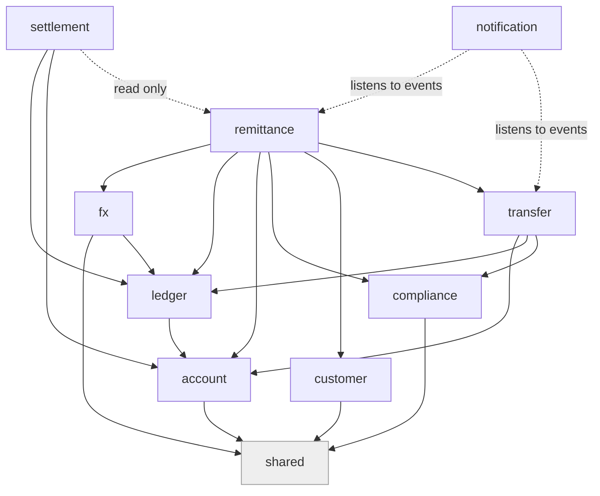
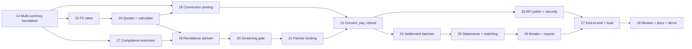

# Execution Plan: FX, Remittance and Settlement (Phase 2)

| | |
|---|---|
| **Objective** | Build the three deferred modules, `fx`, `remittance` and `settlement`, so that PayBridge can receive USD from abroad, convert it to naira at a quoted and locked rate, pay the recipient in Nigeria, and reconcile and settle with the corridor partners. |
| **Status** | **Proposed.** Nothing in this plan has been built or approved. It contains **no code**. |
| **Written** | 2026-10-14 |
| **Starting point** | `main` at Steps 1 to 13 plus Step 12 (webhooks): 488 tests passing, migrations V1 to V10 |
| **Numbering** | Continues the project's steps: this plan is Steps 14 to 28. Migrations continue from V11 |
| **Format** | The `blueprint` skill: every step has a self-contained context brief, tasks, tests first, verification commands, exit criteria and rollback, so any session can pick up any step cold |

**Skills used, and how**

| Skill (`~/.gemini/config/skills`) | Used for |
|---|---|
| `blueprint` | The plan's shape: context brief per step, dependency graph, parallel-step detection, rollback, an adversarial review gate, an anti-pattern catalog, a plan mutation protocol |
| `architecture-decision-records` | The ADR format for the nine decisions in [Appendix A](#appendix-a-decision-records-proposed). They are drafts inside this file; per that skill, nothing is written to `docs/adr/` without your approval |
| `database-migrations` | The migration rules in [section 9](#9-migration-plan): forward-only, immutable once applied, schema and data separate, safe defaults, concurrent indexes, expand-and-contract |
| `springboot-tdd` | The test-first workflow and layering in [section 8](#8-testing-and-verification-strategy), plus the JaCoCo coverage gate |
| `springboot-verification` | The build, static analysis, tests and security scan loop that every step must pass |
| `springboot-security` | Rules for the new endpoints (deny by default, validated input, secrets in the environment, no sensitive data in logs, rate limiting) |
| `customs-trade-compliance` | Only its **restricted-party screening workflow** (match quality, tiered outcomes, never proceed on an unresolved hit, document every adjudication). It is written for US/EU customs, so it is used as a *process pattern*, not as Nigerian regulation |
| `finance-billing-ops` | The "separate facts from claims" discipline: every figure a report shows must trace to ledger entries |

> **What this plan does not know.** It cannot tell you Nigerian rules for cross-border remittance (licensing, permitted corridors, reporting duties, record-retention periods, sanctions obligations). Those are **open questions for compliance counsel** (section 10). Every threshold below is a configurable placeholder.

---

## Contents

1. [Scope](#1-scope)
2. [The starting point, as the code stands today](#2-the-starting-point-as-the-code-stands-today)
3. [Project invariants (checked after every step)](#3-project-invariants-checked-after-every-step)
4. [Design](#4-design)
5. [Module map and allowed dependencies](#5-module-map-and-allowed-dependencies)
6. [The steps](#6-the-steps)
7. [Dependency graph and parallel work](#7-dependency-graph-and-parallel-work)
8. [Testing and verification strategy](#8-testing-and-verification-strategy)
9. [Migration plan](#9-migration-plan)
10. [Risks and open questions](#10-risks-and-open-questions)
11. [Review gate](#11-review-gate)
12. [Anti-patterns to avoid](#12-anti-patterns-to-avoid)
13. [Plan mutation protocol](#13-plan-mutation-protocol)
- [Appendix A: Decision records (proposed)](#appendix-a-decision-records-proposed)
- [Appendix B: Glossary](#appendix-b-glossary)

---

## 1. Scope

### In scope

| Module | What it will do |
|---|---|
| **`fx`** | Hold USD to NGN exchange rates from a provider; apply a spread; issue **quotes** that are locked for a short time and can be used **exactly once**; convert amounts exactly (no floating point) |
| **`remittance`** | The inbound flow: USD is received from a corridor partner for a sender abroad, converted to naira at the quoted rate, and paid to a recipient in Nigeria (to a PayBridge account or to another bank). Handles failure with a USD refund |
| **`settlement`** | Cross-border settlement and reconciliation with partners: batches, net positions, statement ingestion, matching, **breaks** (differences) and their resolution |
| **`compliance`** (extended) | AML for the new flows: party screening against sanctions lists, USD limits, velocity and structuring checks, a case queue for people to adjudicate |
| **Foundations** | Make the ledger, accounts and tests safe for **more than one currency** before anything else |

### Out of scope (stated so nobody assumes otherwise)

- Outbound remittance (Nigeria to abroad). The design leaves room for it but builds the inbound corridor only.
- Currencies other than USD and NGN, and corridors other than one USD-to-NGN corridor.
- Real money movement, real partner contracts, real sanctions-list licensing.
- A user interface. PayBridge stays a backend.
- Tax, accounting-standard reporting, regulatory filings (listed as open questions).
- Replacing the fake providers. Real adapters (for example Fincra or Flutterwave, as `Sandbox.md` suggests) are separate follow-ups that plug into interfaces this plan defines.

---

## 2. The starting point, as the code stands today

These are verified facts about the repository now, not assumptions. Each one shapes a step below.

| Fact | Where | Consequence |
|---|---|---|
| The database already allows `USD` accounts (`ck_account_currency CHECK currency IN ('NGN','USD')`), but `AccountService.openCustomerAccount` **rejects anything but NGN** and the request defaults to NGN | `V3__create_account.sql`, `account/service/AccountService` | Enabling USD accounts is a deliberate, tested change, not a schema change |
| A ledger **entry** must be in **one currency** and must sum to zero; an account's currency must equal the entry's | `LedgerService.validateShape` and the account check | A currency conversion **cannot be one entry**. It must be two balanced entries (Decision ADR-0002) |
| `EntryType` has five values: `FUNDING`, `TRANSFER`, `EXTERNAL_HOLD`, `EXTERNAL_SETTLEMENT`, `REVERSAL` | `ledger/api/EntryType` | New types are needed (conversion, remittance funding, settlement payment) |
| System accounts are four, all NGN: `FUNDING_SOURCE`, `SUSPENSE`, `PAYSTACK_SETTLEMENT`, `FEES` | `account/api/SystemAccount`, seeded in V3 | Per-currency system accounts are needed |
| **Four tests assert "all balances sum to zero" across the whole `account` table** (`ConcurrencyTest`, `LedgerServiceTest`, `ExternalTransferTest`, `WebhookTest`) | test sources | With USD present that sum is **not** zero (USD and NGN do not cancel). The invariant must become **zero per currency** *before* USD exists. This is Step 14 |
| Compliance limits are in kobo, per KYC tier, NGN only | `compliance` | USD limits and AML are new work |
| The external-transfer machinery assumes the **source is a customer account** (compliance reserve, owner check, fee) | `ExternalTransferService.initiate` | Paying a remittance recipient at another bank has no customer source account. Needs a decision (ADR-0006) |
| Webhooks (Step 12) act only on **transfer outcomes**; every other event type is recorded as `IGNORED` | `WebhookService` | Inbound pay-in events from a partner need the pipeline generalised (Step 21) |
| `fx`, `remittance`, `settlement` exist only as **empty package folders** (and the three have no `package-info.java`) | `src/main/java/.../fx` etc. | New `@NamedInterface("api")` markers are needed, like the other modules |
| Security: API keys with roles `CLIENT` and `ADMIN`; webhook addresses open with signature; rate limits per key | `security` module | New endpoints need role decisions; partner webhooks reuse the signed-webhook path |
| Patterns to reuse, not reinvent: idempotency key claim, transactional outbox, dispatcher and reconciler timers with `JobCorrelation`, `applyProviderResult`-style idempotent appliers, Micrometer counters | `transfer` and `shared` | Remittance and settlement follow the same shapes |

---

## 3. Project invariants (checked after every step)

A step is not finished unless **all** of these still hold. Each is already a test or becomes one.

| # | Invariant | How it is checked |
|---|---|---|
| I1 | **Per currency**, the balances of all accounts sum to exactly zero | A shared test helper; replaces the four global-sum assertions (Step 14) |
| I2 | A customer account balance is never negative | Database `CHECK` plus ledger pre-check (exists) |
| I3 | Ledger entries are balanced, in one currency, append-only | Postgres triggers (exist); new entry types go through the same path |
| I4 | The same request or event applied twice changes nothing | Idempotency keys, unique constraints, idempotent appliers; a repeat test for every new write path |
| I5 | Money is `long` minor units and exact decimals; **no floating point anywhere near money or rates** | Code review rule plus a test that converts known awkward values |
| I6 | A quote is used **at most once**, and never after it expires | Unique constraint plus a concurrency test |
| I7 | Anything an outside party sends is verified, bounded and cross-checked before it moves money | Signature, size limit, amount and currency cross-check (Step 12 pattern) |
| I8 | No secret, key, full document number, signature or raw payload in a log or an error | Log-capture tests (the Step 13 style) |
| I9 | Module boundaries hold (`ModularityTests`) and there are no cycles | Runs every time |
| I10 | All earlier tests still pass | `./mvnw test` |

---

## 4. Design

### 4.1 Rates, money and rounding (`fx`)

- **Rate representation.** A rate is an exact decimal "naira per one US dollar" (stored as `NUMERIC` with six decimal places; in Java a `BigDecimal`). Never a `double`.
- **Why minor units line up.** USD has 100 cents and NGN has 100 kobo, so `kobo = cents × rate`. The conversion is one exact multiplication followed by an explicit rounding step.
- **Rounding is a policy, not an accident.** The house never loses to rounding: the amount **paid out** is rounded **down** and any amount **charged** is rounded **up**. The rule lives in one class, with property-style tests over many amounts.
- **Rates have provenance.** Every stored rate records its source, the time it was retrieved and its mid-market value. Customer-facing rates are `mid ± spread`, with the spread configurable per corridor.
- **Rates go stale and can spike.** A rate older than a configured age is **refused** for new quotes. A new rate that moves more than a configured percentage from the previous one is held for human approval (a circuit breaker) instead of being used.
- **Rate sources sit behind an interface** (like `TransferGateway`), with a `FakeRateProvider` whose behaviour can be scripted (steady, stale, spiking, down) so tests and demos can force every case.

### 4.2 Quotes and rate lock (`fx`)

A **quote** is a promise: "for the next N seconds, X USD buys Y NGN at rate R."

| Property | Rule |
|---|---|
| Contents | corridor, sell amount (USD cents), buy amount (NGN kobo), mid rate, spread, customer rate, fee, the rate source and its timestamp, `expires_at` |
| Lifetime | a short, configurable TTL (placeholder: 5 minutes) |
| Single use | consuming a quote records which remittance used it; a database **unique constraint** makes a second use impossible even under a race (I6) |
| Expiry | an expired quote cannot be consumed. Expiry is checked in the same transaction as consumption, against the database clock, not only in application code |
| Idempotent creation | a repeated request with the same idempotency key returns the same quote |
| Audit | quotes are never edited or deleted; states are `OPEN`, `CONSUMED`, `EXPIRED`, `CANCELLED` |

### 4.3 Multi-currency ledger (the central design problem)

The ledger rule "an entry has one currency and sums to zero" is a strength and stays. It means a conversion is **two entries linked by a conversion id**:

1. **USD leg:** moves USD from the customer-side clearing account into the house's `FX_POSITION_USD`.
2. **NGN leg:** moves NGN out of `FX_POSITION_NGN` into the recipient-side clearing account.

Each leg balances in its own currency, so I1 holds per currency. The two `FX_POSITION` accounts hold the house's **open exposure**: what we are long or short in each currency. The spread is the difference between the rate used and the mid rate, and shows up as the gap in that exposure (it is recognised as revenue by a separate, later revaluation or sweep, which is out of scope here and noted in section 10).

Required changes: new `EntryType`s (`FX_CONVERSION_USD`, `FX_CONVERSION_NGN`, `REMITTANCE_FUNDING`, `REMITTANCE_PAYOUT`, `SETTLEMENT_PAYMENT`, and their reversals reuse `REVERSAL`); a `conversion_id` link on both legs; per-currency system accounts (see 4.4); and a statement query that can show the linked leg.

### 4.4 Accounts

- **USD customer accounts** are opened through the existing endpoint once the foundation step has made the system multi-currency safe. The account number scheme (NUBAN) is unchanged; whether a USD account needs a different bank-code range is an open question (section 10).
- **System accounts become per-currency.** New seeded accounts, each with a single currency: `FX_POSITION_USD`, `FX_POSITION_NGN`, `REMITTANCE_CLEARING_USD`, `REMITTANCE_CLEARING_NGN`, `PARTNER_SETTLEMENT_USD` (one per partner, created by data), and `SETTLEMENT_ROUNDING_NGN` / `_USD` for residue found during settlement. The existing four stay as they are.
- `SystemAccount` is an enum today. Per-partner accounts cannot be enum values, so partner accounts are looked up by code (`PARTNER_SETTLEMENT_USD:<partner>`) through a small addition to `AccountApi`, keeping the enum for the fixed ones.

### 4.5 Remittance (`remittance`)

**The story.** A partner abroad has collected USD from a sender. PayBridge is told (by signed webhook or partner API) that USD is on its way for a named recipient in Nigeria. PayBridge quotes, converts, and pays the recipient.

**State machine** (states only change through one method that checks the move, like `TransferStatus.canMoveTo`):

| State | Meaning |
|---|---|
| `CREATED` | The request is recorded and validated; a quote is attached |
| `SCREENING` | Sender and recipient are being screened; may rest in `UNDER_REVIEW` |
| `UNDER_REVIEW` | A screening hit or a velocity flag needs a person. **Nothing moves until a decision** |
| `FUNDED` | The partner confirmed the USD; the funding entry is posted |
| `CONVERTED` | The two conversion legs are posted |
| `PAYOUT_PENDING` | The naira payout has been started (internal credit or external transfer) |
| `PAID` | The recipient has the money. Final |
| `FAILED` | Rejected before funds moved. Final |
| `REFUND_PENDING` / `REFUNDED` | Payout failed after funding; the sender's USD is being returned. `REFUNDED` is final |
| `CANCELLED` | Cancelled by an admin before funding. Final |

**Flow.** Create (idempotent) → screen → *(hold for review if flagged)* → partner confirms funding → consume the quote → post funding entry → post the two conversion legs → pay out → `PAID`. Any failure after funding takes the refund path, and it must be as safe as the external-transfer release: a reversal entry, never an edit.

**Payout to the recipient** reuses what exists. For a recipient with a PayBridge account it is an internal credit from `REMITTANCE_CLEARING_NGN`. For a recipient at another bank it reuses the external-transfer dispatcher, reconciler and webhook machinery, which needs the "system-initiated" variant in ADR-0006.

**Recipient and sender data** are sensitive personal data. Store the minimum; never log full names with account numbers together; keep the identity-document number out of logs and responses (I8).

### 4.6 Compliance extension (AML)

Adopted from the screening workflow in `customs-trade-compliance`, adapted as a *process*:

| Element | Rule |
|---|---|
| **Screening port** | `ScreeningProvider` interface; a fake with a small **synthetic** list (never a real list in the repository). A real list import (UN, OFAC, local) is a follow-up |
| **Match quality** | Name similarity plus corroborators (country, date of birth where present). Thresholds are configuration; the placeholder is "below 85% similarity with no corroboration is a likely false positive", from the skill |
| **Tiered outcome** | `CLEAR` (proceed), `REVIEW` (hold for a person), `BLOCK` (stop and escalate). There is **no auto-clear of an ambiguous hit** |
| **Case record** | Every `REVIEW` or `BLOCK` creates a case with the match details, who decided, when, and the written reason. Cases are never deleted |
| **Never proceed on an unresolved hit** | The remittance stays in `UNDER_REVIEW`; the timers skip it |
| **Limits** | Per-transaction, daily and monthly limits in **USD** per sender and per recipient, by tier, reserved atomically like the NGN limits (the same single-statement approach) |
| **Velocity and structuring** | Counts and totals over rolling windows; many transfers just under a threshold raise a `REVIEW` |
| **Retention** | Configurable; the period is an **open question**, not assumed |

### 4.7 Settlement and reconciliation (`settlement`)

**What "settlement" means here.** PayBridge and a corridor partner each hold records of the same money movements. Periodically they must agree on **who owes whom, how much** and then pay the net. The existing `PAYSTACK_SETTLEMENT` account (money PayBridge has handed to the NGN provider) is the first, smaller instance of the same problem.

| Concept | Design |
|---|---|
| **Settlement cycle** | Per partner and currency, a window closes at a cut-off (configurable). Everything posted to that partner's settlement account in the window belongs to one **batch** |
| **Batch states** | `OPEN` → `CLOSED` (totals frozen) → `INSTRUCTED` (payment requested) → `CONFIRMED` (partner confirms) → `RECONCILED` (no open breaks) or `DISPUTED` |
| **Net position** | The sum of the batch's ledger movements. Positive: the partner owes us. Negative: we owe the partner |
| **Statement ingestion** | An admin (or a partner endpoint) uploads the partner's statement. Each upload is fingerprinted; **uploading the same file twice is a no-op** |
| **Matching engine** | Pass 1: exact on our reference. Pass 2: amount, currency and date within a tolerance for lines without our reference. Pass 3: group matches (one partner line covering several of ours). Each line ends `MATCHED`, `UNMATCHED_OURS`, `UNMATCHED_THEIRS` or `AMOUNT_DIFFERS` |
| **Breaks** | Every non-match becomes a **break** with a reason, an age and an owner. Breaks are never silently dropped; they are resolved by an adjustment entry (a normal ledger posting through `SETTLEMENT_ROUNDING` or a correcting entry) and a written note |
| **Tolerances** | Configurable amount and date tolerances, so a one-kobo rounding difference does not need a human |
| **Idempotence** | Re-running a close, an instruction or a reconciliation for the same batch changes nothing |
| **Reports** | A batch report: opening, movements, closing, matched, breaks by age. Every figure traces to ledger entries (the `finance-billing-ops` discipline) |

### 4.8 Cross-cutting reuse

- **Idempotency** keys on every new write endpoint, using the existing claim approach.
- **Outbox plus timers** for anything that calls a partner, with `JobCorrelation` ids and exponential backoff, exactly as the dispatcher does.
- **Webhooks:** partner pay-in events come in through the Step 12 pipeline, generalised to route by event kind (Step 21). Signature first, then de-duplication, then cross-check.
- **Security:** remittance creation and quotes are `CLIENT` operations; rate management, screening decisions, settlement closing and statement upload are `ADMIN`. Partner webhooks use the signed-webhook path. A dedicated `PARTNER` role is considered in ADR-0008.
- **Observability:** counters for quotes issued, expired, consumed; rate staleness; remittances by state; screening outcomes; settlement breaks by age. Access log and request ids already apply.
- **Notifications:** new events (`RemittancePaid`, `RemittanceRefunded`, `RemittanceUnderReview`) through the existing after-commit event mechanism.

---

## 5. Module map and allowed dependencies

Rules:
- Dependencies point one way (the river rule from the build log). **`fx` must not depend on `remittance`**; **`settlement` may only read `remittance` through its `api`**; **nothing depends on `settlement`**.
- Each new module gets a `package-info.java` with `@NamedInterface("api")` on its `api` package.
- `remittance` depends on `transfer` only through `TransferApi`/a new payout port (ADR-0006), never its repositories.
- `ModularityTests` is the referee (I9). A dependency it rejects is a design error, not something to suppress.

---

## 6. The steps

**Conventions for every step**
- **Test first** (red, then green, then refactor), per `springboot-tdd`.
- **Branch and PR per step** (`feat/step-NN-short-name`), small enough to review. Without git/GitHub it is direct mode: edit in place and commit locally.
- **Done means:** the step's exit criteria *and* the full verification loop in section 8 *and* invariants I1 to I10.
- **Model tier** is guidance: "strongest" for steps with subtle correctness (ledger, concurrency, state machines); "default" for routine work.
- Step docs: each step ends by updating `BUILD-LOG.md` and adding a short `STEP-NN-GUIDE.md` in the project's existing style.

### Phase A: Foundations

#### Step 14: Make the system multi-currency safe
- **Depends on:** nothing. **Parallel with:** nothing (everything else depends on it). **Tier:** strongest.
- **Context brief.** Today USD accounts are blocked in code only. Four tests assert one global balance sum, which becomes false the first time a USD account has money. The ledger already enforces one currency per entry. This step changes **no behaviour for NGN**.
- **Tasks**
  1. Write the per-currency invariant test helper first (sum of balances grouped by currency, each equal to zero) and switch the four tests to it. They must still pass with NGN only.
  2. Add a test that opens a USD account through the API **while the feature is off** and expects the current refusal, then add a configuration switch (`paybridge.fx.usd-accounts-enabled`, default off) that allows it. With it on, USD accounts open; with it off, behaviour is unchanged.
  3. Add the foundation `EntryType` values and the new per-currency system accounts (data migration V11, see section 9).
  4. Extend `AccountApi` with lookup of a system account **by code** for partner accounts (the enum stays for fixed ones).
  5. Ledger tests: a USD-only entry balances; a mixed-currency entry is refused (already true: prove it stays true); a USD funding and an NGN funding in the same test keep each currency summing to zero.
- **Files (new or changed):** the four test classes; `AccountService`, `AccountApi`; `EntryType`; a migration; a shared test support class for the invariant.
- **Verification:** `./mvnw test` (all existing tests green); the new invariant helper used in every money-moving test class.
- **Exit criteria:** all 488 earlier tests plus the new ones pass; USD accounts are openable only behind the switch; the invariant is per currency everywhere.
- **Rollback:** the switch stays off; the migration only adds rows and an enum value, so no data is lost by reverting the code.

### Phase B: FX

#### Step 15: `fx` skeleton and rates
- **Depends on:** 14. **Parallel with:** 17 (compliance), once 14 is done. **Tier:** default.
- **Context brief.** `fx` exists only as empty folders. Rates are exact decimals with provenance.
- **Tasks**
  1. Create `package-info.java` for the module and the `api` interface for reading the current rate for a corridor.
  2. Table `fx_rate` (append-only): corridor, mid rate, source, retrieved-at, status (`ACTIVE`, `HELD`). A trigger or constraint refuses updates and deletes, like the ledger.
  3. `RateProvider` interface plus `FakeRateProvider` with scriptable behaviours (steady, stale, spike, outage).
  4. A scheduled **rate refresher** with `JobCorrelation`, stale-rate refusal, and the spike circuit breaker (a spike becomes `HELD` and is not used until an admin approves).
  5. Admin endpoints: list rates, approve a held rate, set the spread. Role `ADMIN`.
  6. Metrics: rate age, refresh failures, held rates.
- **Tests first:** staleness refusal at the exact boundary; spike held vs normal move accepted; outage keeps the last good rate until it goes stale; rate rows cannot be updated or deleted; admin-only access.
- **Exit criteria:** a current rate can be read or the request is refused with a clear error; rates are immutable; tests green.
- **Rollback:** disable the refresher timer; the table is additive.

#### Step 16: Conversion calculator and quotes
- **Depends on:** 15. **Parallel with:** 17. **Tier:** strongest.
- **Context brief.** The calculator is the most reusable and most error-prone piece. Quotes are single-use and expire.
- **Tasks**
  1. A conversion calculator with the rounding policy of 4.1 (payout down, charge up), exact `BigDecimal`, and a hard refusal of results that overflow `long`.
  2. Table `fx_quote` with a **unique constraint on the consuming remittance** and an `expires_at`; consumption is a single conditional update that checks "open and not expired" against the database clock.
  3. Quote creation endpoint (`CLIENT`), idempotent, returning the amounts, rate, fee and expiry.
  4. Quote consumption exposed only through `FxApi` (called by `remittance`), never over HTTP.
  5. Metrics: quotes issued, expired, consumed.
- **Tests first:** known awkward amounts (a table of cents and rates with exact expected kobo); rounding direction; never-negative; maximum values; consume once; consume expired is refused; **two threads consuming the same quote: exactly one wins**; idempotent creation.
- **Exit criteria:** I5 and I6 proven by tests.
- **Rollback:** the endpoints are additive; remove them and the table is inert.

#### Step 17: Compliance extension: screening, USD limits, velocity, cases
- **Depends on:** 14. **Parallel with:** 15, 16. **Tier:** strongest (it decides whether money may move).
- **Context brief.** `compliance` today only does NGN limits. The new pieces follow the screening workflow in 4.6.
- **Tasks**
  1. `ScreeningProvider` interface and a fake with a **synthetic** list. The similarity function and thresholds are configuration.
  2. Table `screening_case` (never deleted) with match details, outcome, decision, decider, reason.
  3. USD per-transaction, daily and monthly limits per sender, reserved with the same one-statement approach as the NGN limits so two simultaneous requests cannot both pass.
  4. Velocity and structuring rules over rolling windows (counts and totals), producing `REVIEW`.
  5. Admin endpoints: list open cases, decide a case (with a mandatory reason). Decisions are idempotent and audited.
  6. `ComplianceApi` additions: `screen(party)`, `reserveUsd(...)`, `releaseUsd(...)`.
- **Tests first:** exact, near and weak matches against the synthetic list; each tier's outcome; an ambiguous hit is never auto-cleared; limits under concurrency; structuring pattern detected; a decision requires a reason; no personal data in logs.
- **Exit criteria:** screening and USD limits are usable through `ComplianceApi` and fully tested; nothing yet calls them from `remittance`.
- **Rollback:** additive tables and interface methods.

#### Step 18: Post a conversion to the ledger
- **Depends on:** 14, 16. **Tier:** strongest.
- **Context brief.** The two-entry conversion of 4.3, linked by a conversion id.
- **Tasks**
  1. Add the link column to the ledger (a **nullable** `conversion_id`; schema change only, no backfill in the same migration).
  2. A `FxApi.convert(...)` that, given a consumed quote and the clearing accounts, posts the USD leg and the NGN leg **in one transaction**, both or neither.
  3. A reversal path that reverses both legs together.
  4. Statement and entry views that show the linked leg.
- **Tests first:** both legs post and each currency still sums to zero; a failure on the second leg rolls back the first; reversing returns both positions exactly; the position accounts show the open exposure; replaying the same conversion changes nothing; concurrent conversions on the same accounts do not deadlock (sorted lock order is already in the ledger).
- **Exit criteria:** conversion is atomic, reversible and idempotent; I1 holds per currency under a parallel load test.
- **Rollback:** the column is nullable and unused by older code.

### Phase C: Remittance

#### Step 19: Remittance domain, state machine and persistence
- **Depends on:** 16, 17. **Tier:** strongest.
- **Context brief.** The state machine of 4.5, with a single transition method that rejects illegal moves, and an idempotent create.
- **Tasks**
  1. Entities and tables: `remittance`, sender and recipient details (minimal fields), corridor and partner reference, links to quote and screening case.
  2. The status enum with `canMoveTo`, `isFinal`, and a transition method on the entity (rich model).
  3. `RemittanceApi` and a `POST /api/remittances` (idempotent): validate, attach a quote, create in `CREATED`.
  4. Read endpoints: get one, list for a sender.
- **Tests first:** every legal transition passes; every illegal one throws; final states are final; idempotent create returns the same remittance; a missing, expired or already-used quote is refused; validation errors in the standard error shape; no personal data in logs.
- **Exit criteria:** a remittance can be created and read; no money moves yet.
- **Rollback:** additive.

#### Step 20: Screening gate and the review path
- **Depends on:** 19. **Tier:** strongest.
- **Tasks**
  1. On creation run sender and recipient screening and the USD limit reservation; set `SCREENING`, then `UNDER_REVIEW` for `REVIEW` and `BLOCK`, or continue for `CLEAR`.
  2. Admin approve or reject from a review (using the case decision from Step 17). Approval resumes; rejection moves to `FAILED` and releases the limit.
  3. The timers skip anything in `UNDER_REVIEW`.
- **Tests first:** each screening outcome moves to the right state; **nothing moves while a hit is unresolved**; approve resumes exactly once; reject releases the reserved limit; a repeated decision is a no-op.
- **Exit criteria:** compliance genuinely gates the flow.
- **Rollback:** feature flag around the gate for development only; it defaults to **on**.

#### Step 21: Partner funding, through the generalised webhook pipeline
- **Depends on:** 19, 20. **Tier:** strongest.
- **Context brief.** The partner tells PayBridge that USD has arrived. That event must be trusted exactly as much as a transfer webhook: signature first, de-duplicated, cross-checked.
- **Tasks**
  1. Generalise the Step 12 pipeline: a webhook event gets a **kind** (transfer outcome today; partner funding added) and `WebhookService` routes by kind. Existing behaviour and all existing webhook tests must be unchanged.
  2. A `FakeCorridorPartner` that can be scripted (funds, fails, funds twice, funds the wrong amount), plus the partner's adapter implementing `WebhookProvider`.
  3. On a funding event: cross-check amount and currency against the remittance, post the `REMITTANCE_FUNDING` entry, move to `FUNDED`.
  4. A reconciler-style safety net for fundings that never arrive (ask the partner, as the transfer reconciler does).
- **Tests first:** valid funding applies once; a repeat is a duplicate; wrong amount goes to review and is not applied; forged signature refused; funding for a remittance still `UNDER_REVIEW` is held, not applied; the generalisation leaves every Step 12 test green.
- **Exit criteria:** funding is idempotent, verified and cross-checked.
- **Rollback:** the new kind is additive; the router falls back to the old behaviour.

#### Step 22: Convert and pay out; failure and refund
- **Depends on:** 18, 21. **Tier:** strongest.
- **Tasks**
  1. After `FUNDED`: consume the quote, post the conversion (Step 18), move to `CONVERTED`.
  2. Payout. For a PayBridge recipient: an internal credit from `REMITTANCE_CLEARING_NGN`. For another bank: the system-initiated external payout of ADR-0006, reusing the outbox, dispatcher, reconciler and webhooks.
  3. Failure after funding: the refund path (reverse the conversion legs, return USD to the partner's settlement account, `REFUND_PENDING` then `REFUNDED`). Every move is a ledger entry, never an edit.
  4. Idempotent, restartable orchestration: a crash between any two steps resumes safely (an outbox, not an in-memory chain).
- **Tests first:** the happy path to `PAID`; payout refused then refunded in full; crash simulated between each pair of steps then resumed; a late payout success after a refund raises manual review (the existing pattern); **I1 per currency after every scenario**; quote consumed exactly once even if the step is retried.
- **Exit criteria:** end to end USD in, NGN out, with every failure branch tested.
- **Rollback:** the orchestration is driven by timers that can be switched off by property.

#### Step 23: Remittance API polish, notifications, security, metrics
- **Depends on:** 22. **Parallel with:** 24. **Tier:** default.
- **Tasks:** role rules for each endpoint; rate limits for quote and remittance creation; events `RemittancePaid`, `RemittanceRefunded`, `RemittanceUnderReview` and their notification texts; counters by state; access-log and request-id checks; error codes and the standard error shape.
- **Tests first:** `CLIENT` vs `ADMIN` access; rate limits; notification content never contains a full document or account number; metrics increment after commit only.
- **Exit criteria:** the remittance feature meets the same security and observability bar as transfers.

### Phase D: Settlement

#### Step 24: Settlement model and batches
- **Depends on:** 22. **Parallel with:** 23. **Tier:** strongest.
- **Tasks**
  1. Entities and tables: `settlement_partner`, `settlement_batch`, `settlement_batch_line` (links to ledger entries).
  2. A scheduled **closer** with `JobCorrelation`: at the cut-off it freezes the batch's totals; closing is idempotent.
  3. Net-position calculation and the `SETTLEMENT_PAYMENT` ledger posting that clears the partner account when settlement is confirmed.
  4. Admin endpoints to view batches and positions.
- **Tests first:** the net equals the sum of movements; closing twice is a no-op; movements after cut-off go to the next batch; the settlement payment brings the partner account to zero; concurrency with live postings does not lose or double-count a line.
- **Exit criteria:** every ledger movement on a partner account lands in exactly one batch.

#### Step 25: Statement ingestion and the matching engine
- **Depends on:** 24. **Tier:** strongest.
- **Tasks**
  1. A statement upload endpoint (`ADMIN`) with a size limit and a content fingerprint; the same file twice is a no-op. Parsing is tolerant and strict at once: bad rows are reported, never guessed.
  2. The matching passes of 4.7 (exact reference, tolerance, grouped), each line ending in a defined status.
  3. Breaks created for every non-match with reason and age.
- **Tests first:** an exact-match statement reconciles fully; a missing line, an extra line, a different amount and a duplicate line each produce the right break; tolerance boundaries (just inside, just outside); the same upload twice; a malformed file reports row numbers and imports nothing partial; large files stay within the size limit.
- **Exit criteria:** a statement can be loaded and every line is accounted for.

#### Step 26: Break resolution, reports and runbooks
- **Depends on:** 25. **Tier:** default.
- **Tasks:** resolve a break with a mandatory note and, where money differs, a correcting ledger entry through the normal path; batch report (opening, movements, closing, matched, breaks by age); metrics for open breaks by age; a short runbook for each break type.
- **Tests first:** resolving requires a note; a correcting entry keeps I1; a resolved break cannot be resolved twice; the report totals equal the ledger.
- **Exit criteria:** a batch can reach `RECONCILED` with a documented trail.

### Phase E: Hardening

#### Step 27: End-to-end scenarios, concurrency and failure injection
- **Depends on:** 23, 26. **Tier:** strongest.
- **Tasks:** scripted whole-journey tests with the fake rate provider, fake partner and fake bank: success; screening hold then approve; screening reject; quote expiry mid-flow; partner funds the wrong amount; payout fails then refund; partner funds twice; settlement with breaks; a **parallel load test** that creates, funds and pays many remittances at once and then asserts I1 per currency, no negative balances, every quote consumed at most once.
- **Exit criteria:** every invariant holds after the whole suite.

#### Step 28: Security review, documentation and the demo
- **Depends on:** 27. **Tier:** default.
- **Tasks:** run the `springboot-security` checklist and the security scan; JaCoCo coverage report against the target; update `README.md`, `BUILD-LOG.md`, write a `STEP-NN-GUIDE.md` for each phase in the existing style, and a demo guide (the shell commands and the fake rate, partner and bank switches that force each case).
- **Exit criteria:** documentation matches the code; the review checklist in section 11 is re-run and clean.

---

## 7. Dependency graph and parallel work

| Can run in parallel (no shared files or outputs) | After |
|---|---|
| 15 (FX rates) and 17 (compliance) | 14 |
| 16 (quotes) and 17 | 15 for 16; 14 for 17 |
| 18 (conversion posting) and 19 (remittance domain) | 16 (and 17 for 19) |
| 23 (API polish) and 24 (settlement batches) | 22 |

Everything else is serial. **Critical path:** 14 → 15 → 16 → 18 → 22 → 24 → 25 → 26 → 27 → 28. A team of two could run the compliance track (17, 20) beside the FX track (15, 16, 18).

---

## 8. Testing and verification strategy

### 8.1 Layers (from `springboot-tdd`)

| Layer | Tool | Used for |
|---|---|---|
| Unit | JUnit 5, AssertJ | Calculator and rounding, state machines, matching passes, screening similarity, tolerances |
| Whole-application | `AbstractIntegrationTest` (Testcontainers Postgres) | Every write path, constraints, triggers, migrations, endpoints |
| Security | `AbstractSecurityTest` | Roles, rate limits, signed webhooks |
| Concurrency | `CountDownLatch` "starting gun" | Quote single-use, limit reservation, conversion, funding repeats, batch closing |
| Failure injection | Scriptable fakes (rate provider, partner, bank, screening) | Stale rates, spikes, partner outage, wrong amounts, crashes between steps |
| Architecture | `ModularityTests` | Boundaries and cycles |
| Contract | Fixture payloads for each provider adapter | Parse and signature behaviour; compared with the first real delivery when one exists |
| Property-style | Many generated amounts and rates | Conversion never overflows, never rounds in the house's disfavour, round-trips within one unit |

### 8.2 The verification loop (from `springboot-verification`), run for every step

1. **Build:** `./mvnw -T 4 clean verify -DskipTests`
2. **Static analysis** (add Checkstyle, PMD and SpotBugs once, in Step 14, as a reviewed addition): `./mvnw spotbugs:check pmd:check checkstyle:check`
3. **Tests and coverage:** `./mvnw test` then the JaCoCo report; target **80% line coverage** on new code, and 100% of branches in the calculator, state machines and matching engine.
4. **Security scan:** dependency vulnerability check (OWASP Dependency-Check or equivalent) and the `springboot-security` checklist.
5. **Diff review:** read the diff for secrets, personal data in logs, floating point near money, and unbounded input.
6. **Live check** (the habit that caught two real bugs in Steps 12 and 13): start the real application against a throwaway database, send real HTTP, read the log. A passing unit test of a part is not a test of the wiring.

### 8.3 Test data rules

- Synthetic names and numbers only. The screening list in the repository is **fictional**.
- Every money-moving test ends with the per-currency invariant (I1).
- Tests create their own data and never assume an empty database (the shared-database rule).

---

## 9. Migration plan

Rules from `database-migrations`, applied to this project's Flyway setup:

- **Forward-only and immutable.** A migration that has run anywhere is never edited; a mistake is fixed by a new migration.
- **Schema and data are separate files.** The seeding of system accounts (data) is its own migration, apart from any new table (schema).
- **New columns are nullable or have a default.** The ledger's `conversion_id` is nullable, so older rows and code are untouched.
- **Indexes on existing large tables use `CREATE INDEX CONCURRENTLY`** (needs a Flyway setting for non-transactional migrations); new tables can create indexes inline.
- **Hibernate stays in `validate` mode.** Types are chosen to match what Hibernate expects (for example `VARCHAR`, not `CHAR`, for text), as learned in V9.
- **Each migration has a documented rollback**: for additive changes it is "stop using it"; for any destructive change, expand-and-contract over two releases.

| Proposed | Step | Contents |
|---|---|---|
| V11 | 14 | Per-currency system accounts (data), new entry types are code only |
| V12 | 15 | `fx_rate` + immutability trigger, spread setting table |
| V13 | 16 | `fx_quote` with the unique "consumed by" constraint |
| V14 | 17 | `screening_case`, USD usage tables, velocity support |
| V15 | 18 | Ledger `conversion_id` (nullable) + index |
| V16 | 19 | `remittance`, sender and recipient details |
| V17 | 21 | Webhook event kind column (default `TRANSFER`) |
| V18 | 22 | Remittance payout and refund links, outbox |
| V19 | 24 | Settlement partner, batch, batch line |
| V20 | 25 | Statement, statement line, break |

(The numbers are indicative; the next free number is always taken at the time.)

---

## 10. Risks and open questions

### Risks

| Risk | Impact | Mitigation |
|---|---|---|
| Rounding or conversion error loses or invents money | Direct financial loss | One calculator, one rounding policy, exhaustive tests, I1 per currency after every scenario |
| A quote is used twice or after expiry | Customer paid at a wrong rate | Unique constraint and database-clock expiry (I6), concurrency test |
| Partner funding webhook forged or replayed | Money released against nothing | The Step 12 pipeline: signature, de-duplication, amount cross-check |
| Screening false negatives or false positives | Regulatory exposure or blocked customers | Tiered outcomes, no auto-clear of ambiguity, full case audit, thresholds in configuration |
| A crash between ledger steps strands money | Money in a clearing account with no owner | Outbox-driven, restartable orchestration; clearing accounts must return to zero when every remittance is final (a reconciliation test) |
| Multi-currency breaks existing assumptions | Regressions | Step 14 changes the invariant first; all earlier tests stay green |
| Real partner payloads differ from fixtures | Integration failures | Contract fixtures, the "compare with the first real delivery" rule, scriptable fakes |
| Sensitive personal data leaks into logs or errors | Privacy breach | I8, log-capture tests, minimal fields |
| Settlement reconciliation produces many false breaks | Operational noise | Tolerances, grouped matching, break ageing, runbooks |
| Scope creep into outbound or more currencies | Delay | Out-of-scope list; additions need a plan mutation (section 13) |

### Open questions (decisions this plan cannot make)

1. **Regulation and licensing.** Which approvals does a Nigerian inbound-remittance operation need, which corridors and partners are permitted, and what must be reported, to whom, and how fast?
2. **Record retention** for transactions, screening cases and statements.
3. **Sanctions lists:** which lists apply, who supplies them, how often they refresh.
4. **Who sends the USD:** a real corridor partner (for example Fincra or Flutterwave, as `Sandbox.md` suggests), or a simulated one for the assignment? The plan builds the interface and a fake either way.
5. **Foreign-currency accounts:** can a Nigerian customer hold a USD account here, and do USD accounts need their own account-number scheme?
6. **How is FX revenue recognised?** The plan keeps the exposure in position accounts; sweeping the spread into revenue is deliberately deferred.
7. **Fees:** who pays them (sender or recipient), and how they are shown.
8. **Limits:** the real per-transaction, daily and monthly USD limits by tier.
9. **Settlement frequency and cut-off times** per partner.
10. **Does `SETTLEMENT_ROUNDING` get a ceiling** above which a difference must go to a human?

---

## 11. Review gate

The `blueprint` skill delegates an adversarial review to a separate strongest-model sub-agent. **That was not done here**; this review was performed by the plan's author against the skill's checklist. It is weaker than an independent review, and the plan should be reviewed again by another person or agent before work starts.

| Check | Result |
|---|---|
| Every step has a context brief, tasks, tests first, verification and exit criteria | Yes |
| Every step has a rollback | Yes (additive, flag, or timer off) |
| Dependencies are correct and acyclic; parallel steps share no files | Yes (section 7). Steps 15/17, 16/17, 18/19, 23/24 were each checked for shared files |
| Module dependencies respect the river rule and `ModularityTests` | Yes (section 5) |
| Invariants are testable | Yes (section 3) |
| Nothing is built that the user has not asked for | The scope is the three modules the README names, plus the foundations they cannot work without |

**Findings that changed the plan during review**

1. *Found:* four existing tests assert a global balance sum that becomes false with USD. *Fix:* made the per-currency invariant the first thing done (Step 14), before any USD account can exist.
2. *Found:* the external-transfer code requires a customer source account, so paying a non-customer recipient at another bank was unplanned. *Fix:* ADR-0006 and Step 22 task 2.
3. *Found:* Step 12's webhook pipeline ignores everything that is not a transfer outcome, so partner funding events would be silently dropped. *Fix:* generalise by event kind (Step 21), with a requirement that all Step 12 tests stay green.
4. *Found:* `SystemAccount` is an enum, but partner accounts are data. *Fix:* lookup by code (Step 14 task 4).
5. *Found:* a conversion looked like it could be one ledger entry. The ledger forbids that by design. *Fix:* the two-leg model of 4.3 and ADR-0002.
6. *Found:* "never proceed on an unresolved screening hit" needs the timers to respect it, or a retry could push a held remittance through. *Fix:* Step 20 task 3 and a test.

**Still weak after review (be aware)**

- The regulatory design is the least certain part (section 10). The structure is sound; the thresholds, lists and retention rules are placeholders.
- The FX revenue treatment is deferred, not solved.
- Effort is not estimated in hours; the steps are sized to one reviewable change each.

---

## 12. Anti-patterns to avoid

(From the `blueprint` catalog, applied to this plan.)

| Anti-pattern | Where it would bite here |
|---|---|
| One huge step | Do not merge Steps 18, 21 and 22; each carries different failure modes |
| Skipping the foundation | Building FX before Step 14 would silently break the money invariant |
| Floating point near money | Rates, conversions, tolerances, naira-to-kobo parsing |
| Editing history | Rates, quotes, ledger entries, cases and statements are append-only; corrections are new records |
| Trusting a payload | Partner funding and any statement line must be cross-checked against our own records |
| Doing external calls inside a database transaction | Partner and bank calls go through the outbox and timers |
| Security by sprinkling | Keep access rules in the central rulebook, not scattered across controllers |
| Tests that only test a part | Every wiring change gets a live check and a test of the real component (the lesson of Step 13) |
| Silent suppression | A dependency `ModularityTests` rejects is fixed, never excluded |
| Guessing provider formats | Fixtures are labelled as assumptions until a real delivery confirms them |

---

## 13. Plan mutation protocol

Plans change. When one does, do it in the open:

1. **Split** a step that proves too large: keep its number for the first part, add `a`/`b`, and note why.
2. **Insert** a step (for example a discovered prerequisite): give it the next free number, state what it depends on and what now depends on it, and re-check the critical path.
3. **Skip** a step only with a written reason and a check that nothing depends on it.
4. **Reorder** only if the dependency graph still holds.
5. **Abandon** a step by marking it so, with the reason; do not delete it.
6. Every change is recorded in a short **change log** appended to this file (date, change, reason), and `BUILD-LOG.md` is updated.

**Change log**

| Date | Change | Reason |
|---|---|---|
| 2026-10-14 | Initial plan | Requested after Steps 12 and 13 |
| 2026-10-14 | Steps 14 to 28 executed | Built and tested; see guide/04-FX-REMITTANCE-SETTLEMENT-GUIDE.md section 12 for the deviations: conversion link in table fx_conversion (not a ledger column); quote consumed at remittance creation; new status AWAITING_FUNDING; ADR-0006 realised as a separate SystemPayoutService instead of changing ExternalTransferService; migrations V11 to V19 |

---

## Appendix A: Decision records (proposed)

Format from the `architecture-decision-records` skill. All are **proposed**; none is written to `docs/adr/` until approved.

### ADR-0001: Rates are exact decimals; rounding favours the house
- **Date:** 2026-10-14. **Status:** proposed.
- **Context.** Money is `long` minor units. A rate is a fraction. A floating-point rate would drift, and a rounding rule left implicit would leak money.
- **Decision.** Rates are stored and computed as exact decimals (six places). The amount paid out rounds down and any amount charged rounds up, in one class.
- **Alternatives.** *Round half-even everywhere:* statistically fair but can lose a unit per transaction in the house's disfavour on every payout, and is harder to explain. *Integer "micro-rates":* exact but obscures the meaning and invites unit mistakes.
- **Consequences.** (+) No drift, an explainable rule, testable. (−) A one-unit gap between the mid-rate and the customer amount, which is intended.
- **Risk.** Someone adds a second conversion path with a different rule. *Mitigation:* a single calculator and an architecture test that forbids `double` in money packages.

### ADR-0002: A currency conversion is two linked ledger entries, not one
- **Status:** proposed.
- **Context.** The ledger requires every entry to be in one currency and to sum to zero, and that rule is protected by database triggers.
- **Decision.** A conversion posts a USD entry and an NGN entry in one transaction, linked by a conversion id, with the house's exposure held in `FX_POSITION_USD` and `FX_POSITION_NGN`.
- **Alternatives.** *Allow mixed-currency entries with a rate on each line:* breaks the simple zero-sum rule and the triggers, and makes every report ambiguous. *Convert outside the ledger and post only the NGN result:* loses the USD trail and the exposure.
- **Consequences.** (+) Each currency balances on its own; trivial to audit; reversal is two reversals. (−) Two entries per conversion; reporting must join on the link.

### ADR-0003: Quotes are single-use, enforced by the database
- **Status:** proposed.
- **Context.** Two concurrent remittances must not both use one locked rate.
- **Decision.** A unique constraint on "consumed by remittance" and a single conditional update that checks open and not-expired against the database clock.
- **Alternatives.** *Check in application code:* racy. *A distributed lock:* extra moving parts for a problem a constraint already solves.
- **Consequences.** (+) Correct under any concurrency. (−) Expiry depends on the database clock, so clock drift between app and database is not a risk, but test code must control time through the database or use short TTLs.

### ADR-0004: Rates have provenance and a staleness and spike guard
- **Status:** proposed.
- **Decision.** Every rate records its source and time; stale rates are refused for new quotes; a large jump is held for human approval.
- **Alternatives.** *Trust the provider's latest value:* one bad tick would quote the whole customer base a wrong rate.
- **Consequences.** (+) Bounds the damage of a bad feed. (−) A genuine large move needs an admin to approve; the threshold is configuration.

### ADR-0005: Remittance is a state machine driven by an outbox, not a call chain
- **Status:** proposed.
- **Context.** Funding, conversion, payout and refund span partners, the ledger and a bank, any of which can fail or stall, and the process can crash between steps.
- **Decision.** One entity with an enforced set of transitions; each step is a short transaction that records the next step in an outbox; timers resume anything unfinished.
- **Alternatives.** *One big transaction:* cannot include external calls. *An in-memory orchestrator or saga object:* loses state on a crash.
- **Consequences.** (+) Restartable and observable; the same shape as transfers. (−) More tables; eventual rather than instant completion.

### ADR-0006: System-initiated payouts for recipients who are not customers
- **Status:** proposed.
- **Context.** `ExternalTransferService` assumes the money comes from a customer's account (owner check, compliance reserve, fee). A remittance recipient at another bank has no PayBridge account; the source is `REMITTANCE_CLEARING_NGN`.
- **Decision.** Add a narrow, internal payout port in the `transfer` module that takes a system source account and reuses the existing hold, outbox, dispatcher, reconciler and webhook handling, skipping the customer-only checks.
- **Alternatives.** *Credit a temporary customer account first:* invents customers and pollutes the customer table. *Duplicate the external-transfer machinery in `remittance`:* two copies of the most delicate code.
- **Consequences.** (+) One implementation of the delicate part. (−) `ExternalTransferService` needs a careful, test-guarded extension; its 28 tests must stay green.

### ADR-0007: Screening is a port with tiered outcomes and a permanent case record
- **Status:** proposed.
- **Context.** Screening data and rules change; the decisions must be defensible later.
- **Decision.** A `ScreeningProvider` interface with a synthetic fake; `CLEAR`/`REVIEW`/`BLOCK`; every non-clear result is a case that is never deleted; ambiguity is never auto-cleared.
- **Alternatives.** *Hard-code a list:* stale and unreviewable. *Block on any partial match:* unusable false-positive rate.
- **Consequences.** (+) Auditable, swappable data source. (−) A human queue to staff.

### ADR-0008: Roles for the new endpoints
- **Status:** proposed.
- **Context.** Today there are `CLIENT` and `ADMIN`.
- **Decision.** Quote and remittance creation and reads stay `CLIENT`; rates, screening decisions, settlement closing and statement upload are `ADMIN`; partner events use the signed-webhook path. A `PARTNER` role is **not** added now.
- **Alternatives.** *A `PARTNER` role for partner-facing API calls:* worth it only if partners call PayBridge directly with keys; revisit if that happens.
- **Consequences.** (+) No new role to secure now. (−) A client key can create remittances for any sender; per-client scoping is a later hardening item.

### ADR-0009: Settlement is batch-based with explicit breaks
- **Status:** proposed.
- **Context.** Two parties' records of the same money rarely agree exactly.
- **Decision.** Cut-off batches with frozen totals, ingested statements with idempotent upload, a layered matching engine, and an explicit `break` record for every difference, resolved only with a note and, where money differs, a ledger correction.
- **Alternatives.** *Continuous per-transaction netting:* more real-time but much harder to audit. *Fixing differences silently:* removes the audit trail.
- **Consequences.** (+) Auditable; matches how partners report. (−) Settlement is only as current as the last cut-off.

---

## Appendix B: Glossary

| Term | Meaning |
|---|---|
| **Corridor** | A pair of countries or currencies and a route for money between them, here USD from abroad to NGN in Nigeria |
| **Mid-market rate** | The midpoint between buy and sell prices, before any spread |
| **Spread** | The difference between the mid rate and the rate offered; the house's margin |
| **Quote / rate lock** | A promise of a rate for a limited time |
| **Position (FX position)** | The house's net holding in a currency after conversions; its open exposure |
| **Clearing account** | An internal account where money waits between two steps |
| **Partner** | The company abroad that collects from the sender and settles with PayBridge |
| **Settlement** | Agreeing and paying the net amount owed between PayBridge and a partner |
| **Nostro / vostro** | "Our account with them" / "their account with us" in banking; the partner settlement accounts play this role |
| **Reconciliation** | Comparing two records of the same events and explaining every difference |
| **Break** | A difference found during reconciliation |
| **Screening** | Checking the parties to a payment against sanctions and watch lists |
| **AML** | Anti-money-laundering controls: screening, limits, monitoring, case handling |
| **Structuring** | Splitting a large amount into several small ones to stay below a threshold |
| **KYC** | Know Your Customer: identity verification |
| **Idempotent** | Doing it twice has the same effect as doing it once |
| **Outbox** | A to-do note saved in the same transaction as the change, sent later |
